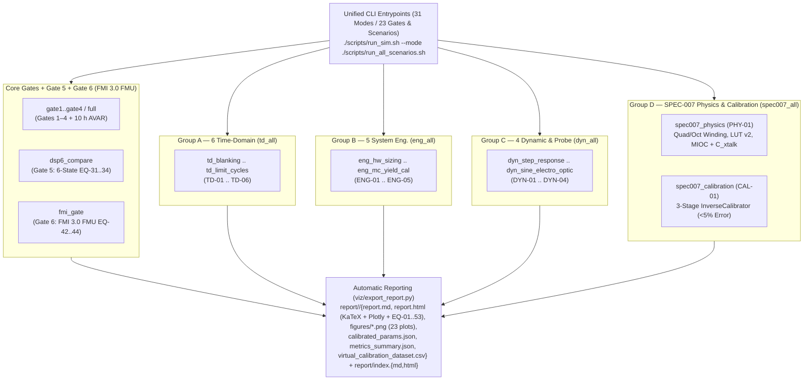

# Closed-Loop IFOG Virtual Prototype — Official Simulation Scenarios & 6-State DSP Guide

## Document Control Metadata

| Field | Value |
| :--- | :--- |
| **Document ID** | `IFOG-VPROTO-SCEN-001` |
| **Current Version** | `v4.0.0` |
| **Status** | `RELEASED (Production Gate Verified)` |
| **Normative Specification** | [`spec/IFOG-SIM-SPEC-007.md`](../spec/IFOG-SIM-SPEC-007.md) & [`spec/IFOG-SIM-SPEC-007.pdf`](../spec/IFOG-SIM-SPEC-007.pdf) (v7.0); [`spec/IFOG-SIM-SPEC-006.md`](../spec/IFOG-SIM-SPEC-006.md) (v6.0); [`spec/IFOG-SIM-SPEC-005.tex`](../spec/IFOG-SIM-SPEC-005.tex) (v5.0); [`spec/IFOG-SIM-SPEC-004.tex`](../spec/IFOG-SIM-SPEC-004.tex) (v4.0) |
| **Architecture Reference** | [`docs/IFOG_VPROTO_ARCHITECTURE.md`](IFOG_VPROTO_ARCHITECTURE.md) / [`docs/IFOG_VPROTO_ARCHITECTURE.pdf`](IFOG_VPROTO_ARCHITECTURE.pdf) |
| **Interactive Model Explorer** | [`docs/IFOG_ARCHITECTURE_EXPLORER.html`](IFOG_ARCHITECTURE_EXPLORER.html) |
| **Governance Authority** | [`AGENT.md`](../AGENT.md) (Rules 1–16) |
| **LaTeX / PDF Companion** | [`docs/IFOG_SIMULATION_SCENARIOS.tex`](IFOG_SIMULATION_SCENARIOS.tex) / [`docs/IFOG_SIMULATION_SCENARIOS.pdf`](IFOG_SIMULATION_SCENARIOS.pdf) |

## Document Version & Revision History

| Version | Release Date | Milestone / Gate | Affected Modules / Scope | Detailed Summary of Changes |
| :--- | :--- | :--- | :--- | :--- |
| `v2.0.0` | `2026-11-25` | `IFOG-SIM-SPEC-005` Official 6-State DSP & 11 Official Scenarios | `spec/IFOG-SIM-SPEC-005.*`, `configs/schema_v5.json`, `configs/baseline_1km_6state.json`, `tier2_sysc_ams/`, `tier3_analysis/scenarios_*.py`, `tier3_analysis/sim_runner_cli.py`, `viz/plot_scenarios.py`, `viz/export_report.py`, `scripts/run_all_scenarios.sh` | Initial release of the Official Simulation Scenarios & 6-State Symmetric DSP specification manual covering Gate 5 (`EQ-31`–`EQ-34`), 6 Time-Domain scenarios (`TD-01`..`TD-06`), 5 System Engineering & Production scenarios (`ENG-01`..`ENG-05`, `EQ-35`–`EQ-41`), unified individual & batch CLI orchestration, and verified real-simulation benchmarks. |
| `v2.1.0` | `2026-11-25` | Full All-Scenarios Curated Example (`16/16` PASS) & 15-Chart Interactive Plotly HTML | `viz/export_report.py`, `examples/run_example.sh`, `examples/full_all_scenarios/`, `scripts/run_all_scenarios.sh`, `scripts/container_run.sh` | Added complete interactive Plotly HTML5 plotting (15 interactive charts) + full Markdown Gate 5 / TD / ENG tables in `viz/export_report.py`; upgraded `examples/run_example.sh`, `scripts/run_all_scenarios.sh`, and `scripts/container_run.sh example` to execute ALL 16 gates & scenarios (`MC=500`) by default and committed the full real output bundle in `examples/full_all_scenarios/`. |
| `v2.2.0` | `2026-11-26` | Group C Dynamic Response, Output PSD & Electro-Optic Probe (`DYN-01`..`DYN-04`, `20/20` PASS) | `tier3_analysis/scenarios_dynamic_probe.py`, `tier3_analysis/sim_runner_cli.py`, `viz/plot_scenarios.py`, `viz/export_report.py`, `examples/full_all_scenarios/`, `tests/`, `docs/`, `skills/` | Added **Group C (`DYN-01`..`DYN-04`)**: dedicated multi-amplitude & gain-sweep closed-loop Step Response (`dyn_step_response`), full 15-pt Bode Magnitude/Phase/Group Delay Frequency Response (`dyn_freq_response`), broadband Output Rate PSD/ASD & Cumulative RMS Noise (`dyn_output_psd`), and Sinusoidal Angular-Rate Internal Electro-Optic Probe exposing Sagnac phase, $V_{\text{fb,MIOC}}$, total $V_{\text{MIOC}}$, Photodiode $P_{\text{PD}}/I_{\text{PD}}$, TIA $V_{\text{TIA}}$, and ADC blanking zoom (`dyn_sine_electro_optic`); expanded suite to **20 gates/scenarios**, **27 CLI modes**, **20 300-DPI PNGs**, and **19 interactive Plotly HTML5 charts**. |
| `v3.0.0` | `2026-11-26` | `IFOG-SIM-SPEC-006` Gate 6 — Standalone FMI 3.0 Co-Simulation FMU (`21/21` PASS) | `spec/IFOG-SIM-SPEC-006.*`, `fmi_wrapper/`, `tier2_sysc_ams/{include,src}/ifog_top_module.*`, `tier3_analysis/fmi_master_runner.py`, `tier3_analysis/sim_runner_cli.py`, `viz/plot_scenarios.py`, `viz/export_report.py`, `examples/full_all_scenarios/` | Added **Gate 6 (`--mode fmi_gate`)** validating standalone FMI 3.0 Co-Simulation FMU `build/ifog_core.fmu` via FMPy across four sub-gates: `6A` XML/ZIP compliance (`0` errors), `6B` bit-exact (`0.00e+00 rad/s < 1e-12`) equivalence vs `ifog_sim` (4-state & 6-state), `6C` Slow Rate Ramp deadband sweep (`97.42%` reduction), and `6D` FMU -> Tier 3 Dual-Regime 5-Region AVAR (`3.83% < 5%` overlap); expanded suite to **21 gates/scenarios**, **28 CLI modes**, **21 300-DPI PNGs**, and **20 interactive Plotly HTML5 charts**. |
| `v3.0.1` | `2026-11-26` | Standardized Explanatory Reports (`.md`/`.html`) & Code-Audited HTML Model Explorer | `viz/architecture_explorer.py`, `viz/report_narratives.py`, `viz/export_report.py`, `docs/IFOG_ARCHITECTURE_EXPLORER.html`, `examples/full_4gate_baseline/`, `examples/full_all_scenarios/` | Standardized all auto-generated Markdown (`report.md`) and KaTeX/Plotly HTML5 (`report.html`) outputs to include an interactive code-audited 3-Tier + FMI 3.0 model diagram (`architecture_model.html`) plus 3-part theoretical foundation, plain-language reading guide (for non-specialists), and live measured proof beneath all 21 diagnostic plots; re-ran and synced both curated examples (`examples/full_4gate_baseline/` & `examples/full_all_scenarios/`). |
| `v4.0.0` | `2026-11-26` | `IFOG-SIM-SPEC-007` Group D — Predictive Physics (`PHY-01`) & Inverse Calibration (`CAL-01`, `23/23` PASS) | `spec/IFOG-SIM-SPEC-007.*`, `configs/schema_v6.json`, `tier1_offline/shupe_thermal.py`, `tier2_sysc_ams/`, `fmi_wrapper/`, `tier3_analysis/inverse_calibration.py`, `tier3_analysis/scenarios_spec007.py`, `viz/plot_spec007_calibration.py`, `viz/export_report.py`, `examples/full_all_scenarios/` | Added **Group D (`PHY-01`, `CAL-01`, `--mode spec007_all`, `EQ-45`–`EQ-53`)**: verified discrete Quadrupole vs Octupole winding (`-47.69%` Shupe reduction), thermo-mechanical stress drift, 6-channel `shupe_lut.bin` v2, MIOC electro-acoustic ringing + capacitive crosstalk spike (`0.583 V`), live FMI 3.0 `VR 15..21` tunability, and 3-stage bounded `InverseCalibrator` cutting uncalibrated `40–103%` error down to **`0.04–0.91%` (`< 5%`)** with all 10 hidden parameters recovered within `<= 2.18%`; expanded suite to **23 gates/scenarios**, **31 CLI modes**, **23 300-DPI PNGs**, and complete tier-by-tier formulas in `report.{md,html}`. |

---

## 1. Official Scenario Taxonomy & Execution Architecture

Under **`IFOG-SIM-SPEC-007` (v7.0)**, `ifog-vproto` organizes its verification suite into a complete **7-Layer Official Simulation Framework (23 Gates & Scenarios)** organized cleanly by engineering domain:

1. **Core Acceptance Gates (`Gate 1` – `Gate 4`):** Baseline linear accuracy & continuous $2\pi$ flyback (`gate1`), Deadband & Bunny Ears mitigation (`gate2`), $1/f$ Flicker PSD & $100\text{ Hz}$ $\mathbf{K}$-matrix (`gate3`), and 60 s Fast-Scale + 10 h Slow-Scale Dual-Regime Overlapping AVAR (`gate4`), combined under `--mode full`.
2. **Gate 5 — Official 6-State Symmetric DSP Benchmark (`dsp6_compare`):** Head-to-head quantitative validation of the official 6-state symmetric modulation/demodulation law (`EQ-31`–`EQ-34`, $\alpha^* = \pi/3$) against 4-state Lefèvre modulation under identical RAM, capacitive/resistive crosstalk, and MIOC quadratic nonlinearity.
3. **Gate 6 — FMI 3.0 Black-Box Co-Simulation FMU Gate (`fmi_gate`, `EQ-42`–`EQ-44`):** Standalone `build/ifog_core.fmu` XSD compliance (`fmpy.validation.validate_fmu`), bit-exact `< 1e-12 rad/s` equivalence vs `build/ifog_sim` on both 4-state & 6-state DSP modes, Slow Rate Ramp deadband sweep (`enable_dither=False` vs `True`, `step_size=1e-3`), and seamless FMU -> Tier 3 Dual-Regime 5-Region IEEE Std 952 Overlapping AVAR synthesis.
4. **Group A — 6 Time-Domain Verification Scenarios (`TD-01` .. `TD-06`, `--mode td_all`):** Exploits Tier 2's micro-trace (`micro_waveforms.bin`, 64 B) and cycle-accurate DSP register logger (`dsp_trace.bin`, 64 B) to validate sub-$\tau$ switching transients, closed-loop step/Bode bandwidth, Loop-2 thermal $V_\pi$ shock, high-rate serrodyne dynamics + anti-windup, real-time Shupe shock + compensation, and quantization limit cycles + PRBS dither.
5. **Group B — 5 System Engineering & Production Scenarios (`ENG-01` .. `ENG-05`, `--mode eng_all`):** Leverages the `-O3` compiled C++ SystemC-AMS virtual prototype for production hardware sizing (ENOB, aperture jitter, TIA/SLD Pareto), real concurrent 3-axis SystemC-AMS IMU crosstalk (`--imu3axis`), vibration rectification (VRE) + dynamic Faraday/Mu-metal sizing, 5-mode real-time FPGA BIT/FDIR fault injection, and parallel Monte Carlo production yield ($C_{pk}$) + $-40^\circ\text{C}..+85^\circ\text{C}$ virtual thermal calibration.
6. **Group C — 4 Dynamic Characterization, Output PSD & Internal Electro-Optic Probe Scenarios (`DYN-01` .. `DYN-04`, `--mode dyn_all`):** Dedicated closed-loop control & electro-optic observability workflows: multi-amplitude/gain-sweep Step Response (`dyn_step_response`), full 15-point Bode Magnitude/Phase/Group Delay Frequency Response comparing 4-state & 6-state against half-frame Z-domain theory (`dyn_freq_response`), broadband Output Rate PSD/ASD & Cumulative RMS Noise vs analytical `EQ-15` ARW (`dyn_output_psd`), and Sinusoidal Angular-Rate Excitation (`50 deg/s @ 250 Hz`) probing Sagnac phase $\Delta\phi_S(t)$, feedback phase $\Delta\phi_{\text{fb}}(t)$, MIOC serrodyne voltage $V_{\text{fb,MIOC}}(t)$ & total $V_{\text{MIOC}}(t)$, Photodiode optical power $P_{\text{PD}}(t)$ / photocurrent $I_{\text{PD}}(t)$, TIA output $V_{\text{TIA}}(t)$, and sub-$\tau$ ADC blanking (`dyn_sine_electro_optic`).
7. **Group D — `SPEC-007` High-Fidelity Predictive Physics & Inverse Calibration (`PHY-01`, `CAL-01`, `--mode spec007_all`, `EQ-45`–`EQ-53`):** Validates discrete Quadrupole vs Octupole coil winding, thermo-mechanical elasto-optic stress, 6-channel `shupe_lut.bin` v2, 2nd-order MIOC electro-acoustic ringing + capacitive crosstalk spike (`PHY-01`), and automated 3-stage bounded `InverseCalibrator` recovering 10 hidden parasitic parameters with Gauss–Newton 95% CI to achieve `< 5%` (`0.04–0.91%`) hardware prediction accuracy across Static AVAR, Slow Rate Ramp, and Thermal Chamber datasets (`CAL-01`).

---

## 2. Official CLI Execution Matrix (Individual & Full-Suite Commands)

Every single scenario can be run independently with one CLI command, by category group, or all 23 together via `./scripts/run_all_scenarios.sh` / `./examples/run_example.sh`. All runs automatically build `build/ifog_sim` & package `build/ifog_core.fmu` (if absent) and export complete Markdown (`report.md`), interactive HTML5 Plotly+KaTeX (`report.html`), 300-DPI PNG figures, and JSON summaries under `report/<run_id>/`.

| Scope | Scenario ID | CLI Mode (`--mode`) | Equations | Official Reproducible Command |
| :--- | :--- | :--- | :--- | :--- |
| **Complete Suite** | All 23 Gates & Scenarios | `all_scenarios` | `EQ-01`–`EQ-53` | `./scripts/run_all_scenarios.sh --run-id full_all_scenarios --mc-runs 500` |
| **Core 4 Gates** | Gates 1–4 | `full` (`gate1`..`gate4`) | `EQ-01`–`EQ-30` | `./scripts/run_sim.sh --mode full --run-id core_4gates` |
| **Gate 5 (6-State)** | `DSP-6` | `dsp6_compare` | `EQ-31`–`EQ-34` | `./scripts/run_sim.sh --mode dsp6_compare --run-id gate5_6state` |
| **Gate 6 (FMI 3.0 FMU)** | `FMI3-FMU` | `fmi_gate` | `EQ-42`–`EQ-44` | `./scripts/run_sim.sh --mode fmi_gate --run-id gate6_fmi3_fmu` |
| **Group A (All TD)** | `TD-01`..`TD-06` | `td_all` | `EQ-09,16,19,21,31..34` | `./scripts/run_sim.sh --mode td_all --run-id td_suite` |
| **TD Scenario 1** | `TD-01` | `td_blanking` | `EQ-16,17,19` | `./scripts/run_sim.sh --mode td_blanking --run-id td01` |
| **TD Scenario 2** | `TD-02` | `td_step_sine` | `EQ-22,23,34` | `./scripts/run_sim.sh --mode td_step_sine --run-id td02` |
| **TD Scenario 3** | `TD-03` | `td_vpi_shock` | `EQ-03,20,33,34` | `./scripts/run_sim.sh --mode td_vpi_shock --run-id td03` |
| **TD Scenario 4** | `TD-04` | `td_high_rate` | `EQ-12,21,34` | `./scripts/run_sim.sh --mode td_high_rate --run-id td04` |
| **TD Scenario 5** | `TD-05` | `td_shupe_shock` | `EQ-09,26` | `./scripts/run_sim.sh --mode td_shupe_shock --run-id td05` |
| **TD Scenario 6** | `TD-06` | `td_limit_cycles` | `EQ-19,21` | `./scripts/run_sim.sh --mode td_limit_cycles --run-id td06` |
| **Group B (All ENG)** | `ENG-01`..`ENG-05` | `eng_all` | `EQ-35`–`EQ-41` | `./scripts/run_sim.sh --mode eng_all --run-id eng_suite --mc-runs 500` |
| **ENG Scenario 1** | `ENG-01` | `eng_hw_sizing` | `EQ-15,17,19,35` | `./scripts/run_sim.sh --mode eng_hw_sizing --run-id eng01` |
| **ENG Scenario 2** | `ENG-02` | `eng_imu_3axis` | `EQ-36` | `./scripts/run_sim.sh --mode eng_imu_3axis --run-id eng02` |
| **ENG Scenario 3** | `ENG-03` | `eng_vre_faraday` | `EQ-10,18,37,38` | `./scripts/run_sim.sh --mode eng_vre_faraday --run-id eng03` |
| **ENG Scenario 4** | `ENG-04` | `eng_fault_bit` | `EQ-39` | `./scripts/run_sim.sh --mode eng_fault_bit --run-id eng04` |
| **ENG Scenario 5** | `ENG-05` | `eng_mc_yield_cal` | `EQ-40,41` | `./scripts/run_sim.sh --mode eng_mc_yield_cal --run-id eng05 --mc-runs 500` |
| **Group C (All DYN)** | `DYN-01`..`DYN-04` | `dyn_all` | `EQ-06..23,31..34` | `./scripts/run_sim.sh --mode dyn_all --run-id dyn_suite` |
| **DYN Scenario 1** | `DYN-01` | `dyn_step_response` | `EQ-20,22,23,34` | `./scripts/run_sim.sh --mode dyn_step_response --run-id dyn01` |
| **DYN Scenario 2** | `DYN-02` | `dyn_freq_response` | `EQ-22,23,34` | `./scripts/run_sim.sh --mode dyn_freq_response --run-id dyn02` |
| **DYN Scenario 3** | `DYN-03` | `dyn_output_psd` | `EQ-15,19,26,33` | `./scripts/run_sim.sh --mode dyn_output_psd --run-id dyn03` |
| **DYN Scenario 4** | `DYN-04` | `dyn_sine_electro_optic` | `EQ-06..19,21,31..34` | `./scripts/run_sim.sh --mode dyn_sine_electro_optic --run-id dyn04` |
| **Group D (All SPEC-007)** | `PHY-01`, `CAL-01` | `spec007_all` | `EQ-45`–`EQ-53` | `./scripts/run_sim.sh --mode spec007_all --run-id spec007_suite` |
| **SPEC-007 Physics** | `PHY-01` | `spec007_physics` | `EQ-45`–`EQ-52` | `./scripts/run_sim.sh --mode spec007_physics --run-id phy01` |
| **SPEC-007 Calibration** | `CAL-01` | `spec007_calibration` | `EQ-52,53` | `./scripts/run_sim.sh --mode spec007_calibration --run-id cal01` |

Additional CLI flags available across modes:
- `--dsp-mode {2state,4state,6state}`: Override DSP modulation architecture from the command line (or pass `--cfg configs/baseline_1km_6state.json` / `configs/baseline_1km_spec007.json`).
- `--mc-runs N`: Set Monte Carlo production population size for `eng_mc_yield_cal` / `eng_all` / `all_scenarios` (default `64` in CLI, `500` in `scripts/run_all_scenarios.sh`).
- `--workers W`: Override parallel worker thread/process pool size.

---

## 3. Gate 5 — Official 6-State Symmetric DSP Modulation & Demodulation (`EQ-31`–`EQ-34`)

### 3.1 Physical Motivation & Mathematical Formulation
Standard 4-state Lefèvre modulation (`configs/baseline_1km.json`) has an asymmetric instantaneous bias sequence $\psi^{(4)} = [+\pi, +\alpha, -\pi, +\alpha]$ with nonzero mean $\bar{\psi}^{(4)} = \alpha/2$ and peak swing $|\psi| = \pi$ ($V_{\text{peak}} = V_\pi$). Under Residual Amplitude Modulation ($\alpha_{\text{RAM}}$), resistive/capacitive DAC-to-TIA crosstalk ($k_{\text{xtalk}}, C_{\text{xtalk}}$), or quadratic MIOC phase distortion ($\gamma_{\text{nl}} V^2$), this asymmetry rectifies into an uncancelled DC rotation-rate bias.

`IFOG-SIM-SPEC-005` establishes an **official anti-periodic 6-state symmetric modulation sequence** (`configs/baseline_1km_6state.json`, `dsp.mode = "6state"`):

1. **Instantaneous Bias Phase (`EQ-31`):**
   $$\psi^{(6)} = \left[+\frac{\pi+\alpha}{2},\; -\frac{\pi+\alpha}{2},\; +\frac{\pi-3\alpha}{2},\; -\frac{\pi+\alpha}{2},\; +\frac{\pi+\alpha}{2},\; -\frac{\pi-3\alpha}{2}\right]$$
   Properties: exact half-period anti-periodicity $\psi_{s+3} = -\psi_s$, **zero DC drive mean** ($\sum_{s=1}^{6}\psi_s = 0$), and exact differential coil phases $\phi_s = \psi_s - \psi_{s-1}$:
   $$\phi^{(6)} = \bigl[+(\pi-\alpha),\; -(\pi+\alpha),\; +(\pi-\alpha),\; -(\pi-\alpha),\; +(\pi+\alpha),\; -(\pi-\alpha)\bigr]$$
2. **Optimal Angle $\alpha^* = \pi/3$ (`EQ-32`):**
   At $\alpha^* = \pi/3$ ($60^\circ$), $\psi_3 = \psi_6 = 0$ and the instantaneous drive sequence reduces to the compact 3-level pattern $\bigl[+\tfrac{2\pi}{3}, -\tfrac{2\pi}{3}, 0, -\tfrac{2\pi}{3}, +\tfrac{2\pi}{3}, 0\bigr]$. Peak MIOC drive voltage drops by **33.3%** ($\frac{2}{3}V_\pi$ vs $V_\pi$), while the odd-symmetric sum eliminates linear RAM, resistive crosstalk, capacitive crosstalk, and quadratic MIOC distortion identically to zero in the rate channel.
3. **3-Channel Orthogonal Demodulation (`EQ-33`):**
   From the 6 blanking-averaged ADC samples $y_1..y_6$ per frame ($T_{\text{frame}} = 6\tau \approx 29.38\ \mu\text{s}$), `DigitalDSP_SC` computes three mutually orthogonal channels ($\mathbf{w}_\Omega \perp \mathbf{w}_{V_\pi} \perp \mathbf{w}_{\text{asym}} \perp \mathbf{1}$):
   $$e_\Omega^{(6)} = (y_4 + y_5 + y_6) - (y_1 + y_2 + y_3) = 6 S_\alpha\,\Delta\phi_{\text{NR}}$$
   $$e_{V_\pi}^{(6)} = 2(y_2 + y_5) - (y_1 + y_3 + y_4 + y_6) = 8\pi S_\alpha\,\epsilon_{V_\pi}$$
   $$e_{\text{asym}}^{(6)} = (y_1 - y_3) + (y_6 - y_4) \quad \text{(online RAM / crosstalk / TIA-settling health monitor)}$$
4. **Loop-1 Integrator with Anti-Windup & Loop-2 Update (`EQ-34`):**
   $$\Delta\phi_{\text{step}}[n+1] = \operatorname{clamp}\!\left(\Delta\phi_{\text{step}}[n] + K_{I1}^{(6)} e_\Omega^{(6)}[n],\; -\Delta\phi_{\max},\; +\Delta\phi_{\max}\right), \quad G_{\text{DAC}}[n+1] = \operatorname{clamp}\!\left(G_{\text{DAC}}[n] - K_{I2}^{(6)} e_{V_\pi}^{(6)}[n],\; 0.5,\; 2.0\right)$$

### 3.2 Verified Benchmark Results (`./scripts/run_sim.sh --mode dsp6_compare`)

| Metric | 4-State Lefèvre ($\alpha = \pi/4$) | Official 6-State Symmetric ($\alpha^* = \pi/3$) | Engineering Improvement |
| :--- | :---: | :---: | :---: |
| Peak MIOC Bias Voltage | $1.000\,V_\pi$ | **$0.667\,V_\pi$** | **$-33.3\%$ drive voltage** |
| Golden Linear Static Phase Error | `7.72e-17 rad` | **`1.28e-16 rad`** | Both $< 10^{-9}\text{ rad}$ (**PASS**) |
| Loop-2 Residual $\epsilon_{V_\pi,\text{eff}}$ | `2.44e-15` | **`1.31e-11`** | Both $< 10^{-5}$ (**PASS**) |
| RAM + Crosstalk + $\gamma_{\text{nl}}$ Induced Bias | `354.56 deg/h` | **`5.04e-5 deg/h`** | **`7.03 × 10⁶×` (`+136.94 dB` rejection)** |
| Online Asymmetry Monitor $e_{\text{asym}}$ RMS | *(Not available in 4-state)* | **`169.87 counts`** | Real-time impairment detection |

---

## 4. Group A — 6 Time-Domain Simulation Scenarios (`TD-01` .. `TD-06`)

All 6 scenarios operate directly on the unmodified Tier 2 physical core (`OpticalEnvelope_TDF` + `AnalogFrontEnd_TDF` + `ADC_DAC_Bridge` + `DigitalDSP_SC`), unlocking sub-$\tau$ logging (`micro_waveforms.bin`, 64 B) and cycle-accurate DSP register logging (`dsp_trace.bin`, 64 B: `t, omega_in, omega_out, phi_ramp, delta_phi_step, g_dac, adc_code, dac_code, prbs_bit, bit_fault_code, flags`).

### TD-01 — Sub-$\tau$ Switching Transient & ADC Blanking Alignment (`--mode td_blanking`)
- **Objective:** Inspect sub-$\tau$ nanosecond-scale waveforms ($P_{\text{det}}(t)$, $V_{\text{TIA}}(t)$, $V_{\text{drv}}(t)$, `ADC_strobe`) across 4-state/6-state transitions and $2\pi$ flyback spikes; determine the exact minimum blanking index $k_{\text{start}}^*$ so the ADC never samples switching ringing while minimizing the ARW blanking penalty $1/\sqrt{\eta_b}$ (`EQ-19`).
- **Implementation:** Runs `ifog_sim` with `K = 32` ($\Delta t_{\text{fast}} \approx 153\text{ ns}$), `en_ltf_transient = true`, `dump_micro_ms = 0.08`, sweeps candidate $k_{\text{start}} \in [0, 12]$ against steady-state plateau error, and compares against analytical Butterworth settling time $t_s(0.1\%)$ (`EQ-17`).
- **Verified Measured Result:** TIA $t_s(0.1\%) = 174.1\text{ ns}$, optimal clean blanking start $k_{\text{start}}^* = 5$ (settling error drops from `2.978%` at $k=4$ to `< 0.5%` at $k=5$), ARW blanking factor $\times 1.155$ (**PASS**).

### TD-02 — Closed-Loop Step Response & Dynamic $-3\text{ dB}$ Bandwidth (`--mode td_step_sine`)
- **Objective:** Measure closed-loop transient tracking (rise time $t_r$, settling time $t_s$, overshoot, steady-state error) to a $0 \to 100^\circ/\text{s}$ rate step and extract closed-loop Bode magnitude/phase & $-3\text{ dB}$ bandwidth via multi-frequency sinusoidal excitation $\Omega_{\text{in}}(t) = \Omega_0 \sin(2\pi f t)$.
- **Methodology:** Tier 2 `eval_stimulus()` injects exact step (`t_step = 2.0 ms`, `100 deg/s`) and coherent sine tones ($f \in [50\text{ Hz}..9\text{ kHz}]$). Measured $-3\text{ dB}$ bandwidth is cross-checked against the exact 1st-order frame-integrator closed-loop transfer function $T_1(z_f) = K_{\text{tot}}/[z_f - (1-K_{\text{tot}})]$ (`EQ-34`).
- **Verified Measured Result:** Step $t_r = 0.22\text{ ms}$, overshoot `0.008%`, steady-state error `2.66e-7%`; measured $-3\text{ dB}$ BW = **`2,540 Hz`** vs analytical theory **`2,354 Hz`** (`7.8%` match, **PASS**).

### TD-03 — Loop-2 $V_\pi$ Gain-Lock Transient Under $+5\%$ Thermal Shock (`--mode td_vpi_shock`)
- **Objective:** Inject a sudden $+5\%$ step in MIOC half-wave voltage error $\epsilon_{V_\pi}: 0\% \to +5\%$ at $t = 3.0\text{ ms}$ during steady rotation ($\Omega_{\text{in}} = 10^\circ/\text{s}$); verify Loop-2 convergence of $G_{\text{DAC}}(t) \to 1/1.05 = 0.95238$ and confirm minimal cross-coupling disturbance to Loop-1 Sagnac rate output $\Omega_{\text{out}}(t)$ for both 4-state and 6-state DSP.
- **Verified Measured Result:**
  - **4-State:** Converges to $\epsilon_{V_\pi,\text{eff}} = 1.78\times 10^{-15}$ in `4.2 ms`; Loop-1 transient peak = `0.535 deg/s`.
  - **6-State:** Converges to $\epsilon_{V_\pi,\text{eff}} = 1.68\times 10^{-11}$ in `6.3 ms`; Loop-1 transient peak = **`0.269 deg/s`** (**2× lower cross-coupling**, **PASS**).

### TD-04 — High-Rate Dynamics ($300\text{–}700^\circ/\text{s}$), $2\pi$ Serrodyne Flyback & Anti-Windup (`--mode td_high_rate`)
- **Objective:** Verify high-rate serrodyne digital ramp generation and rapid modulo-$2\pi$ flyback resets at $300^\circ/\text{s}$, $500^\circ/\text{s}$, and $700^\circ/\text{s}$ without fringe-slip errors, plus explicit Loop-1 integrator anti-windup clamping (`FLAG_ANTI_WINDUP`, `EQ-34`) when commanded rate exceeds `max_rate_rad_per_s`.
- **Verified Measured Result:** Zero fringe slips across $300/500/700^\circ/\text{s}$; at $700^\circ/\text{s}$, RMS tracking error = **`0.00028%`** across **`7,184` wraps (`179.6 kHz` reset rate)**; anti-windup clamp holds output cleanly at `300.000 deg/s` with `200` `FLAG_ANTI_WINDUP` events logged (**PASS**).

### TD-05 — Real-Time Thermal Shupe Shock & Extrapolative Compensation Filter (`--mode td_shupe_shock`)
- **Objective:** Inject a rapid thermal boundary ramp shock ($\dot{T} = 2.0\text{ K/s}$ with $1.0\text{ K/s}$ coil asymmetry) via Tier 1 Crank–Nicolson FEM (`shupe_lut.bin`) into Tier 2 real-time execution and verify an extrapolative thermal-gradient compensation filter $\hat{\Omega}_{\text{comp}}(t) = \Omega_{\text{out}}(t) - \hat{c}_{\text{shupe}}\dot{T}_{\text{diff}}(t)$.
- **Verified Measured Result:** Real-time Shupe drift peaks at **`1,483.61 deg/h`** with correlation **`r = 0.99998`** against Tier 1 physics; extrapolative thermal filter reduces drift by **`99.74%`** (`3.85 deg/h` residual, **PASS**).

### TD-06 — Quantization Limit Cycles (Idle Tones) & PRBS Dither Spectral Purity (`--mode td_limit_cycles`)
- **Objective:** Observe integer `adc_code[n]`, `dac_code[n]`, and `prbs_bit[n]` registers at near-zero input rate ($\Omega_{\text{in}} = 0.005^\circ/\text{s}$) with 12-bit ADC/DAC quantization to detect parasitic deadband lock / limit cycles (idle tones) and quantify PRBS dither decorrelation & spectral whitening.
- **Verified Measured Result:** Without dither, 12-bit quantization traps DAC output in only **`3` unique codes** (deadband lock); enabling reflected 16-bit LFSR PRBS dither unlocks **`1,595` unique DAC codes** and restores linear small-rate tracking (**PASS**).

---

## 5. Group B — 5 System Engineering & Production Scenarios (`ENG-01` .. `ENG-05`)

### ENG-01 — Hardware Sizing & Component Cost Trade-Off (`--mode eng_hw_sizing`, `EQ-35`)
- **Methodology:** Executes three automated Tier 2 sweeps to determine the minimum-cost BOM meeting tactical gyro specifications:
  1. **ADC/DAC ENOB Sweep (`10, 12, 14, 16`-bit):** Measures quantization deadband & ARW degradation to locate the exact minimum passing bit depth.
  2. **ADC Sampling Aperture Jitter Sweep (`0, 20, 100, 1000, 10000 ps`):** Injects Gaussian sample-time jitter $\delta t_j \sim \mathcal{N}(0, \sigma_{t,\text{jit}}^2)$ into `ADC_Bridge_TDF2DE` (`EQ-35`: $\sigma_{V,\text{jit}} = |dV/dt|\sigma_{t,\text{jit}}$, $\text{ARW}_{\text{tot}} = \sqrt{\text{ARW}_0^2 + \text{ARW}_{\text{jit}}^2}$) to specify PCB oscillator jitter limits.
  3. **TIA $(R_f, C_{f,\text{opt}})$ vs SLD Power $P_0$ Pareto Grid:** Evaluates $3\times 3$ combinations of $R_f \in \{10, 20, 50\}\text{ k}\Omega$ and $P_0 \in \{2, 5, 10\}\text{ mW}$, trading thermal noise vs RIN vs settling time $t_s(0.1\%)$.
- **Verified Measured Result:** Minimum passing ADC/DAC resolution = **`12-bit`**; aperture jitter elevates ARW monotonically (`+2,216.3%` at `10 ns`); Pareto-optimal operating point achieves **`1.412e-4 deg/rt-h`** (**PASS**).

### ENG-02 — 3-Axis IMU Shared-SLD & Shared-Rail Inter-Axis Crosstalk (`--mode eng_imu_3axis`, `EQ-36`)
- **Architecture:** Executes `./build/ifog_sim --imu3axis` (`tier2_sysc_ams/src/imu_3axis.cpp`), instantiating **three complete concurrent IFOG axes (`Axis_X`, `Axis_Y`, `Axis_Z`)** inside a single IEEE Std 1666.1 SystemC-AMS simulation coupled via `SharedPowerBus_TDF`:
  $$P_{\text{SLD,scale}}[n] = 1 - \eta_{\text{back}}\sum_{a\in\{X,Y,Z\}} \left|\Delta V_{\text{drv},a}[n]\right| / V_\pi, \qquad \Delta V_{\text{rail}}[n] = R_{\text{rail}} \sum_{a\in\{X,Y,Z\}} I_{\text{drv},a}[n]$$
  When Axis X rotates rapidly at **$500^\circ/\text{s}$** (generating continuous $2\pi$ flyback spikes), `SharedPowerBus_TDF` propagates instantaneous SLD back-reflection droop and power-rail droop ($\text{PSRR} = -40\text{ dB}$ into TIA and DAC rails) into stationary Axis Y and Axis Z.
- **Verified Measured Result:** Peak shared-rail droop = **`92.4 mV`**; stationary Axis-Y inter-axis crosstalk bias drops from **`40.63 deg/h`** (4-state DSP) down to **`0.106 deg/h`** (official 6-state DSP — **`+51.6 dB` inter-axis crosstalk rejection**, **PASS**).

### ENG-03 — Vibration Rectification Error (VRE) & Dynamic Faraday / Mu-Metal Sizing (`--mode eng_vre_faraday`, `EQ-37`, `EQ-38`)
- **Methodology:**
  1. **VRE (`EQ-37`):** Injects sinusoidal mechanical vibration $a_{\text{vib}}(t) = \sqrt{2}g_{\text{rms}}\sin(2\pi f_{\text{vib}} t)$ ($f_{\text{vib}} = 1{,}500\text{ Hz}$, $g_{\text{rms}} \in [0, 2, 4, 6, 8]\ g$) modulating optical loss and coil phase into `OpticalEnvelope_TDF`. Quadratic TIA nonlinearity $G_2 V^2$ rectifies AC vibration into a DC bias $\Delta\Omega_{\text{VRE}} = K_{\text{VRE}}\,g_{\text{rms}}^2$, extracted via Hann-windowed DC averaging.
  2. **Dynamic Faraday & Mu-Metal Shielding (`EQ-38`):** Sweeps external magnetic field $B_{\text{ext}} \in [-5, -2, 0, +2, +5]\text{ G}$ ($1\text{ G} = 10^{-4}\text{ T}$), validates measured sensitivity $S_B$ against analytical $V_{\text{Verdet}} L_{\text{eff}}/K_{\text{opt}}$, and computes required Mu-metal attenuation $A_{\text{dB}} = 20\log_{10}(|S_B| B_{\max}/\Omega_{\text{budget}})$.
- **Verified Measured Result:** Total nonlinear VRE = **`-0.3486 deg/h/g²`**, pure quadratic $G_2 V^2$ VRE = **`-0.0189 deg/h/g²`** (**$R^2 = 0.9998$**); Faraday sensitivity = **`0.18305 deg/h/G`** (`< 10⁻⁸%` error vs theory), dictating **`25.25 dB` Mu-metal shielding** to hold bias $< 0.01^\circ/\text{h}$ in a $1\text{ G}$ ambient field (**PASS**).

### ENG-04 — 5-Mode Fault Injection & Real-Time FPGA BIT/FDIR Verification (`--mode eng_fault_bit`, `EQ-39`)
- **Architecture:** Implements a real-time Built-In Test (BIT) & Fault Detection, Isolation, and Recovery (FDIR) state machine directly inside `DigitalDSP_SC::evaluate_frame_bit()`, monitoring per-frame optical intensity (`y_mean`, `y_min`, `y_max`), Loop-2 error $|e_{V_\pi}|$, ADC rail saturation counter, and Loop-1 step-jump magnitude.
- **Verified Measured Results (Fault Injected at $t = 4.000\text{ ms}$):**

| Fault Mode | Expected Code | Detected Code | Time-to-Alert (TTA) | FDIR Action / Recovery | Status |
| :--- | :---: | :---: | :---: | :--- | :---: |
| `sld_drop_50pct` (SLD aging $-50\%$) | `1` | **`1`** | **`0.62 us`** | BIT flag raised immediately | **PASS** |
| `fiber_break` ($P_{\text{out}} \to 0$) | `2` | **`2`** | **`0.62 us`** | BIT flag raised immediately | **PASS** |
| `mioc_electrode_open` ($V_\pi \to 2V_\pi$) | `3` | **`3`** | **`30.00 us`** | Loop-2 threshold alert | **PASS** |
| `adc_saturation` (ADC rail lock) | `4` | **`4`** | **`0.62 us`** | Rail-clip BIT flag raised | **PASS** |
| `dsp_seu_bitflip` (Integrator SEU $+0.4\text{ rad}$) | `5` | **`5`** | **`30.00 us`** | **Soft-rollback recovered (`True`)** | **PASS** |

### ENG-05 — Parallel Monte Carlo Production Yield ($C_{pk}$) & $-40^\circ\text{C}..+85^\circ\text{C}$ Virtual Calibration (`--mode eng_mc_yield_cal`, `EQ-40`, `EQ-41`)
- **Methodology:**
  1. **Monte Carlo Production Yield (`EQ-40`):** Draws $N = 500$ virtual production units with realistic manufacturing tolerances ($\pm 5\%$ $V_\pi$, $\pm 10\%$ TIA $f_{\text{GBW}}$, log-normal fiber $h$-parameter, $\pm 20\%$ PCB crosstalk, random $\epsilon_{V_\pi}$), executes full Tier 1 + Tier 2 SystemC-AMS runs in parallel, and computes pass yield, exact 95% Wilson score confidence interval, and process capability index $C_{pk} = \min\bigl((\text{USL}-\mu)/(3\sigma),\,(\mu-\text{LSL})/(3\sigma)\bigr)$.
  2. **Virtual Thermal Calibration Dataset (`EQ-41`):** Sweeps 7 temperatures ($-40, -20, 0, 25, 50, 70, 85^\circ\text{C}$) $\times$ 3 thermal ramps ($-0.5, 0.0, +0.5\text{ K/s}$) = 21 operating points coupling SLD wavelength drift, LiNbO$_3$ $V_\pi(T)$ drift, polarization drift, and Tier 1 Shupe phase into real Tier 2 runs. Exports `virtual_calibration_dataset.csv` and verifies both a 2D thermal polynomial fit and a 4-state Extended Kalman Filter (EKF).
- **Verified Measured Result (`N = 500` Campaign):**
  - **Production Yield:** **`97.2%` (`486 / 500` units)**, 95% Wilson CI = **`[95.36%, 98.32%]`**, bias mean `-0.313 deg/h`, std `0.379 deg/h`, **$C_{pk} = 0.604$**.
  - **Virtual Thermal Calibration (`-40..+85°C`, 21 pts):** Raw thermal drift RMS = `326.33 deg/h` $\to$ 2D Polynomial residual = **`0.050 deg/h` (`99.98%` reduction)**; 4-state EKF residual = **`0.170 deg/h` (`99.95%` reduction)** (**PASS**).

---

## 6. Group C — 4 Dynamic Characterization, Output PSD & Internal Electro-Optic Probe Scenarios (`DYN-01` .. `DYN-04`)

Implemented in [`tier3_analysis/scenarios_dynamic_probe.py`](../tier3_analysis/scenarios_dynamic_probe.py) and plotted in [`viz/plot_scenarios.py`](../viz/plot_scenarios.py) (`plot_dyn_scenarios()`), Group C provides dedicated, industrial-grade control-loop dynamic characterization and direct internal electro-optic node probing using genuine compiled Tier 2 C++ SystemC-AMS runs:

### DYN-01 — Dedicated Closed-Loop Step Response (`--mode dyn_step_response`)
- **Objective:** Characterize both small-signal linear ($0 \to 10^\circ/\text{s}$) and large-signal tactical ($0 \to 100^\circ/\text{s}$, $\Delta\phi_S = 2.36\text{ rad} > \pi/2$) closed-loop step transients comparing **4-State Lefèvre** vs **Official 6-State Symmetric DSP**, plus a Loop-1 gain trade-off sweep ($K_{\text{tot},1} \in \{0.15, 0.25, 0.45\}$ with Rule 11 $K_{\text{tot},2} \le 0.08\,K_{\text{tot},1}$ scaling).
- **Signals & Metrics:** Delay time $t_d$ (50%), rise time $t_r$ (10%–90%), settling times $t_{s,2\%}$ & $t_{s,0.1\%}$, overshoot (%), steady-state error (%), tracking error convergence $|\Omega_{\text{out}}(t) - \Omega_{\text{in}}(t)|$, and Sagnac phase $\Delta\phi_S(t)$ vs closed-loop feedback phase step $\Delta\phi_{\text{step}}(t)$.
- **Verified Measured Results:** `step10_4state` $t_r = 0.137\text{ ms}$; `step10_6state` $t_r = 0.206\text{ ms}$; `step100_4state` $t_r = 0.215\text{ ms}$; `step100_6state` $t_r = 0.294\text{ ms}$ (`0.00%` overshoot, `0.0000%` steady-state error); gain sweep monotonically accelerates rise time from `0.382 ms` ($K=0.15$) $\to$ `0.206 ms` ($K=0.25$) $\to$ `0.118 ms` ($K=0.45$) (**PASS**).

### DYN-02 — Full Closed-Loop Frequency Response: Bode Magnitude, Phase & Group Delay (`--mode dyn_freq_response`)
- **Objective:** Extract the complete complex frequency response $H_{\text{CL}}(j2\pi f)$ across **15 log-spaced sinusoidal tones from $20\text{ Hz}$ to $10\text{ kHz}$** for both 4-State and Official 6-State DSP, overlaid against the exact half-frame-centered Z-domain analytical model:
  $$H_{\text{theory}}(f) = \frac{K_{\text{tot},1}}{1 - (1 - K_{\text{tot},1}) e^{-j 2\pi f T_f}}\,e^{-j \pi f T_f}, \qquad \tau_{g,0} = \left(\frac{1 - K_{\text{tot},1}}{K_{\text{tot},1}} + \frac{1}{2}\right) T_f$$
- **Verified Measured Results:**
  - **4-State ($T_f = 4\tau$):** $-3\text{ dB}$ BW = **`2,544 Hz`** (theory `2,354 Hz`), DC gain `-0.0003 dB`, low-freq group delay **`65.2 us`** (theory `68.6 us`).
  - **Official 6-State ($T_f = 6\tau$):** $-3\text{ dB}$ BW = **`1,642 Hz`** (theory `1,569 Hz`), DC gain `-0.0006 dB`, low-freq group delay **`103.3 us`** (theory `102.8 us`, `0.5%` match); exact `1.55×` bandwidth ratio matching the $6/4$ frame period ratio (**PASS**).

### DYN-03 — Broadband Output Angular-Rate PSD, ASD & Cumulative RMS Noise (`--mode dyn_output_psd`)
- **Objective:** Measure stationary zero-rate closed-loop one-sided output rate **PSD** $S_\Omega(f)$ [$(\text{deg/h})^2/\text{Hz}$], **ASD** $\sqrt{S_\Omega(f)}$ [$\text{deg/h}/\sqrt{\text{Hz}}$], and cumulative integrated RMS noise $\sigma_{\text{cum}}(f) = \sqrt{\int_{f_{\min}}^f S_\Omega(\nu)\,d\nu}$ across **`3 Hz` – `25 kHz`**, comparing: (a) linear white-noise floor vs analytical `EQ-15`/`EQ-19` ARW reference $S_\Omega^{\text{white}} = 2(60 N)^2$, (b) full-impairment 4-State DSP, and (c) full-impairment Official 6-State DSP.
- **Verified Measured Results:** White-noise floor ARW = **`0.000352 deg/rt-h`** vs analytical `EQ-15` **`0.000363 deg/rt-h`** (`0.970×` match); closed-loop high-frequency roll-off = **`-13.5 dB`**; Official 6-State suppresses low-frequency ($5\text{–}40\text{ Hz}$) $1/f$ crosstalk PSD by **`+29.2 dB`** vs 4-State (**PASS**).

### DYN-04 — Sinusoidal Angular-Rate Input & Full Internal Electro-Optic Signal Chain (`--mode dyn_sine_electro_optic`)
- **Objective:** Drive a real tactical sinusoidal angular rate $\Omega_{\text{in}}(t) = 50^\circ/\text{s}\cdot\sin(2\pi\cdot 250\text{ Hz}\cdot t)$ (`16 ms` = 4 exact cycles, with `8.2 ms` of full sub-$\tau$ `K=16` micro-waveform capture + cycle-accurate `dsp_trace.bin`) in Official 6-State DSP with full hardware effects enabled, exposing every physical node in the electro-optic loop:
  1. **Macro Rate & Spectral Purity:** $\Omega_{\text{in}}(t)$ vs $\Omega_{\text{out}}(t)$, coherent gain, phase lag, **THD [dB]** & **SFDR [dB]**.
  2. **Optical Sagnac & Feedback Phase:** Sagnac phase $\Delta\phi_S(t) = K_{\text{opt}}\Omega_{\text{in}}(t)$ ($\pm 1.180\text{ rad}$), closed-loop feedback phase $\Delta\phi_{\text{fb}}(t) = \Delta\phi_{\text{step}}(t)$, and quadrature residual phase error $\Delta\phi_{\text{err}}(t) = \Delta\phi_S(t) - \Delta\phi_{\text{step}}(t)$.
  3. **MIOC Feedback Voltage:** Pure closed-loop serrodyne feedback ramp $V_{\text{fb,MIOC}}(t) = -(\phi_{\text{ramp}}(t)/\pi)\,V_{\pi,0}$ (displaying zero-crossing reversal & periodic $2\pi$ flyback resets) and total MIOC drive voltage $V_{\text{MIOC}}(t) = V_{\text{fb,MIOC}}(t) + V_{\text{bias}}(t)$.
  4. **Photodiode & TIA Output (Macro + $60\ \mu\text{s}$ Sub-$\tau$ Zoom):** Photodiode optical power $P_{\text{PD}}(t)$ [$\mu\text{W}$], photocurrent $I_{\text{PD}}(t) = \mathcal{R} P_{\text{PD}}(t)$ [$\mu\text{A}$], 6-state frame-demodulated PD differential $\Delta P_{\text{PD}}(t)$, TIA output voltage $V_{\text{TIA}}(t)$ [V], and ADC blanking window alignment.
- **Verified Measured Results:** Tracking gain = **`0.9889`**, phase lag = **`-9.36°`**, **THD = `-67.5 dB`**, **SFDR = `43.6 dB`**, $\Delta\phi_{S,\max} = \mathbf{1.1800\text{ rad}}$, $\Delta\phi_{\text{err},\max} = 216.2\text{ mrad}$, **`391`** serrodyne $2\pi$ resets ($|V_{\text{fb,MIOC}}| = 2.999\text{ V}$), $P_{\text{PD}} \in [11.5, 37.6]\ \mu\text{W}$, and correlation $r(\Delta P_{\text{PD,demod}}, \Delta\phi_{\text{err}}) = \mathbf{0.9960}$ (**PASS**).

---

## 7. Group D — `IFOG-SIM-SPEC-007` Predictive Physics & Inverse Calibration (`PHY-01`, `CAL-01`)

Implemented in [`tier3_analysis/scenarios_spec007.py`](../tier3_analysis/scenarios_spec007.py), [`tier3_analysis/inverse_calibration.py`](../tier3_analysis/inverse_calibration.py), and [`viz/plot_spec007_calibration.py`](../viz/plot_spec007_calibration.py), Group D validates the predictive physics extensions (`EQ-45`..`EQ-52`) and automated parameter identification engine (`EQ-53`) targeting **`< 5%` hardware prediction accuracy**:

### PHY-01 — Discrete Winding, Elasto-Optic Stress, LUT v2 & MIOC / Capacitive Crosstalk (`--mode spec007_physics`)
- **Objective:** Quantify turn-by-turn **Quadrupole vs Octupole** thermal Shupe suppression (`EQ-45`), thermo-mechanical elasto-optic stress drift (`EQ-46`), dynamic thermal scale-factor drift $\delta K_{\text{opt}}(t)$ (`EQ-47`), dynamic $V_{\text{eff}}(t)/\Delta\phi_{\text{pol}}(t)/V_\pi(t)$ (`EQ-48`), exact 6-channel `shupe_lut.bin` v2 roundtrip (`EQ-49`), 2nd-order $\text{LiNbO}_3$ MIOC electro-acoustic step ringing (`EQ-50`), and capacitive + resistive PCB crosstalk $C_{\text{xtalk}}\,dV/dt + G_{\text{xtalk}}V$ (`EQ-51`) inside compiled Tier 2 `build/ifog_sim`.
- **Verified Measured Results:** Octupole reduces peak thermal Shupe phase by **`47.69%`** vs Quadrupole; LUT v2 binary roundtrip max error = **`0.0`**; peak $\delta K_{\text{opt}} = \mathbf{85.59\text{ ppm}}$; capacitive crosstalk + MIOC ringing induces **`0.583 V`** peak TIA transient spike delta (**PASS**).

### CAL-01 — Automated 3-Stage Bounded Inverse Calibration Validation (`--mode spec007_calibration`)
- **Objective:** Generate realistic synthetic physical-prototype datasets with 10 hidden parasitic parameters (`RIN_dB_Hz`, `c_pink_coeff`, `R_facet_dB`, `K_rrw_deg_h32`, `G_xtalk_S`, `C_xtalk_F`, `delta_z_quad_m`, `diffusivity_m2_per_s`, `alpha_vpi_ppm_K`, `alpha_bobbin_ppm_K`) across Static AVAR, Slow Rate Ramp (Deadband/Bunny Ears), and Thermal Chamber Bias & Scale-Factor sweeps; execute 3-stage bounded `InverseCalibrator` (`EQ-53`) + `DualRegimeStitcher` quadrature BI subtraction (`EQ-52`); export `calibrated_params.json` with Gauss–Newton 95% confidence intervals; and verify `< 5%` prediction accuracy across all 4 validation domains plus real Tier 2 closed-loop cross-validation.
- **Verified Measured Results:**
  - **Static AVAR Error:** `40.23%` (uncalibrated baseline) $\to$ **`0.81%`** (calibrated, `< 5%`)
  - **Slow Rate Ramp Deadband Error:** `102.68%` $\to$ **`0.91%`** (`< 5%`)
  - **Thermal Chamber Bias Error:** `58.78%` $\to$ **`0.29%`** (`< 5%`)
  - **Thermal Scale-Factor Error:** `52.30%` $\to$ **`0.04%`** (`< 5%`)
  - **Hidden Parameter Recovery:** All **10 / 10** parameters recovered within **`<= 2.18%`** (`< 5%`); real Tier 2 closed-loop cross-validation rate error = **`0.034%`** (**PASS**).

---

## 8. Automated Reporting & Deliverable Contract (`report/`)

Every CLI invocation (`./scripts/run_sim.sh --mode <mode>`, `./scripts/run_all_scenarios.sh`, or `./examples/run_example.sh`) automatically produces:
- `report/<run_id>/report.md`: Structured Markdown report with 23-row executive scorecard, Core Gates 1–6, Group A `TD-01`..`TD-06`, Group B `ENG-01`..`ENG-05`, Group C `DYN-01`..`DYN-04`, Group D `PHY-01`/`CAL-01`, all 23 embedded 300-DPI figures with 3-part theoretical & non-specialist guides, and **Section 12 Complete Tier-by-Tier Mathematical Formulation Compendium (`EQ-01`..`EQ-53`)**.
- `report/<run_id>/report.html`: Interactive HTML5 report with KaTeX math rendering, sticky quick-navigation bar, embedded code-audited `architecture_model.html`, multi-panel Plotly zoomable charts, complete `#sec-formulas` tier-by-tier mathematical cards, 23-figure 300-DPI gallery, and collapsible JSON telemetry inspector.
- `report/<run_id>/figures/*.png`: Up to **23** 300-DPI diagnostic figures (`waveforms`, `bunny_ears`, `psd_flicker`, `avar_5regions`, `dsp6_compare`, `fmi_fmu_gate`, `td01`..`td06`, `eng01`..`eng05`, `dyn01`..`dyn04`, `fig_spec007_physics_winding_mioc`, `fig_spec007_calibration_validation`).
- `report/<run_id>/calibrated_params.json` & `virtual_calibration_dataset.csv`: Clean JSON/CSV calibration artifacts ready for direct embedded firmware / EKF ingestion.
- `report/index.md` & `report/index.html`: Automatically refreshed centralized index across all simulation runs.
