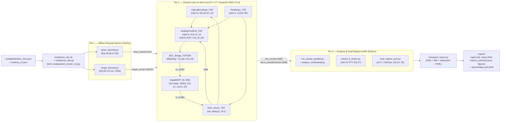

# Closed-Loop IFOG Multi-Scale Virtual Prototype — System Architecture Specification

## Document Control Metadata

| Field | Value |
| :--- | :--- |
| **Document ID** | `IFOG-VPROTO-ARCH-001` |
| **Current Version** | `v1.2.0` |
| **Status** | `RELEASED (Production Gate Verified)` |
| **Normative Specification** | [`spec/IFOG-SIM-SPEC-004.tex`](../spec/IFOG-SIM-SPEC-004.tex) & [`spec/IFOG-SIM-SPEC-004.pdf`](../spec/IFOG-SIM-SPEC-004.pdf) (v4.0) |
| **Governance Authority** | [`AGENT.md`](../AGENT.md) (Rules 1–16) |
| **Reference Standards** | IEEE Std 952-2020 (IFOG Test & AVAR); IEEE Std 1666.1-2016 (SystemC-AMS) |
| **LaTeX / PDF Companion** | [`docs/IFOG_VPROTO_ARCHITECTURE.tex`](IFOG_VPROTO_ARCHITECTURE.tex) / [`docs/IFOG_VPROTO_ARCHITECTURE.pdf`](IFOG_VPROTO_ARCHITECTURE.pdf) |

## Document Version & Revision History

| Version | Release Date | Milestone / Gate | Affected Modules / Scope | Detailed Summary of Changes |
| :--- | :--- | :--- | :--- | :--- |
| `v1.0.0` | `2026-11-25` | Initial Release (Gates 1–4, 30 Formulas, 100% Dual Coverage) | `spec/`, `configs/`, `tier1_offline/`, `tier2_sysc_ams/`, `tier3_analysis/`, `viz/`, `tests/`, `.github/workflows/` | Complete 3-tier spec-driven Closed-Loop IFOG Virtual Prototype implementation (`IFOG-SIM-SPEC-004` v4.0), real IEEE 1666.1 SystemC/SystemC-AMS 2.3.4 core, 30/30 formula verification, 100% C++ (`gcovr`) & Python (`pytest-cov`) coverage, full real 4-Gate acceptance & CI/CD release pipeline. |
| `v1.1.0` | `2026-11-25` | Auto-Reporting, Unified Sim Runner & Rule 16 Doc-Sync | `viz/export_report.py`, `tier3_analysis/sim_runner_cli.py`, `tier3_analysis/doc_sync.py`, `scripts/run_sim.{py,sh}`, `scripts/verify_doc_sync.py`, `scripts/build_docs.sh`, `report/`, `docs/`, `AGENT.md`, `skills/`, `.github/workflows/` | Added centralized automatic `.md` and interactive `.html` report generation + dashboard index under `report/`; added unified simulation runner (`scripts/run_sim.sh`, `scripts/run_sim.py`, `ifog-sim-run`) supporting `single`, `gate1`–`gate4`, `full`, and `sweep` modes; authored synchronized release architecture & release notes documents (`.md`, `.tex`, `.pdf`) under `docs/`; enacted **AGENT.md Rule 16** with automated CI/CD version-document sync enforcement. |
| `v1.2.0` | `2026-11-25` | Portable Container (Docker/Podman), Universal Linux Source Setup & Full 4-Gate Example | `Containerfile`, `Dockerfile`, `.dockerignore`, `compose.yaml`, `scripts/install_systemc.sh`, `scripts/install_systemc_ams.sh`, `scripts/setup_env.sh`, `scripts/env.sh`, `scripts/container_run.sh`, `tier2_sysc_ams/CMakeLists.txt`, `examples/`, `skills/ifog-portable-container-env/`, `.github/workflows/ci.yml` | Added distro-independent Git-source installers for Accellera SystemC 2.3.4, SystemC-AMS PoC 2.3.4, `nlohmann/json` v3.11.3, and isolated Python venv (`scripts/setup_env.sh` + `scripts/env.sh`); added dual Docker/Podman OCI container suite (`Containerfile`, `Dockerfile`, `compose.yaml`, `scripts/container_run.sh`) verified in CI; executed and committed the complete real 4-Gate feasibility example (`examples/full_4gate_baseline/`) with full `.md`/`.html`/JSON/300-DPI PNG outputs. |

---

## 1. System Context & Engineering Objectives

`ifog-vproto` is a deterministic, multi-scale virtual prototype for a **Closed-Loop Interferometric Fiber-Optic Gyroscope (IFOG)** supporting both 2-state and 4-state Lefèvre modulation (`IFOG-SIM-SPEC-004` v4.0). The system bridges **11 orders of magnitude in time scale**—from sub-microsecond electro-optic TIA/MIOC transient dynamics ($\Delta t_{\text{fast}} = \tau/K \approx 306\text{ ns}$) up to 10-hour tactical/navigation-grade Allan Variance stability analysis ($T = 3.6\times 10^4\text{ s}$)—while maintaining IEEE-754 64-bit optical phase fidelity ($< 10^{-15}\text{ rad}$ wrap error) and bit-true fixed-point digital closed-loop execution.

### Multi-Scale Time-Domain Separation

| Architecture Tier | Execution Engine | Characteristic Time Step / Horizon | Physical Scope & Outputs |
| :--- | :--- | :--- | :--- |
| **Tier 1 (Offline Solvers)** | Python 3.12 + NumPy / SciPy (`tier1_offline/`) | Static spectral ($N_{\text{spec}} \in [64, 128]$) & thermal ($0..10\text{ h}$) | Spectral-sliced Jones polarization (`phys_params.json`) & 1D Crank–Nicolson / FEM thermal Shupe LUT (`shupe_lut.bin`) |
| **Tier 2 (Fast-Scale Core)** | C++17 `-O3` + SystemC 2.3.4 + SystemC-AMS PoC 2.3.4 (`tier2_sysc_ams/`) | $\Delta t_{\text{fast}} = \tau/K \approx 306\text{ ns}$, $\tau \approx 4.89\ \mu\text{s}$, horizon $0.025..60\text{ s}$ | Closed-loop Sagnac/Kerr/Shupe/Faraday/MIOC envelope, 6-component white noise, 5-pole $1/f$ pink noise, hybrid TIA/DAC LTFs, ADC blanking & quantization, bit-true 2/4-state DSP (`sim_out.bin`, `micro_waveforms.bin`) |
| **Tier 3 (Long-Term & Analysis)** | Python 3.12 + SciPy / Multiprocessing (`tier3_analysis/`) | $\Delta t_{\text{slow}} = 10\text{ ms}$ ($100\text{ Hz}$), horizon $10\text{ h}$ ($3.6\times 10^6$ samples) | Parallel parameter sweeps, $100\text{ Hz}$ coherent $\mathbf{K}$-matrix extraction, Deadband & Bunny Ears analysis, 12-pole IIR $1/f$ + RRW/Rate-Ramp Slow-Scale synthesis, Dual-Regime IEEE Std 952 Overlapping AVAR & 5-region WLS |
| **Diagnostics & Auto-Reporting** | Python 3.12 + Matplotlib / Plotly (`viz/`, `report/`, `scripts/`) | Post-run automatic execution | 300-DPI PNG figures, interactive Plotly HTML5 + Markdown reports in `report/<run_id>/`, centralized `report/index.{md,html}` |

---

## 2. End-to-End 3-Tier Architecture Diagram



---

## 3. Subsystem Architectural Breakdown

### 3.1 Configuration & Schema Governance (`configs/`, `tier1_offline/config_loader.py`)
- **Normative Schema:** [`configs/schema_v4.json`](../configs/schema_v4.json) enforces JSON Schema Draft 2020-12 over `meta`, `optics`, `fiber_coil`, `thermal_shupe`, `magneto_optic`, `mioc`, `analog_frontend`, `adc_dac`, `dsp`, `noise`, `ablation_flags`, `simulation`, and `slow_scale`.
- **Fail-Closed Cross-Field Checks (`validate_config`):** Enforces $0 \le k_{\text{start}} \le k_{\text{end}} < K$, $V_{\min} < V_{\max}$, $f_{\min,\text{pink}} < f_{\max,\text{pink}}$, Jury stability $0 < K_{\text{tot},1} < 1$, and 4-state Loop-2 bandwidth separation $K_{\text{tot},2} \le 0.1 K_{\text{tot},1}$ (Rule 11).

### 3.2 Tier 1 — Offline Optical & Thermal Solvers (`tier1_offline/`)
- **Spectral-Sliced Jones Matrix Solver ([`jones_spectral.py`](../tier1_offline/jones_spectral.py)):**
  - Discretizes the Gaussian SLD spectrum into $N_{\text{spec}} \in [64, 128]$ slices across $\bar{\nu} \pm 3\sigma_\nu$ in vectorized NumPy `complex128`.
  - Computes frequency-proportional group birefringence $\Delta\beta(\omega_k) = \frac{2\pi}{L_B}\frac{\omega_k}{\bar{\omega}}$ across $M$ PM fiber segments with Lorentz reciprocity $\mathbf{J}_{\text{CCW}}(\omega_k) = \mathbf{J}_{\text{CW}}^T(\omega_k)$ (`EQ-04`).
  - Evaluates exact closed-form fringe visibility $V$ and polarization bias phase $\phi_{\text{pol}}$ (`EQ-05`), Sagnac scale factor $K_{\text{opt}}$ (`EQ-07`), and coherence-weighted optical Kerr bias $\Delta\phi_{\text{Kerr}}$ (`EQ-08`), emitting `phys_params.json`.
- **Thermal-Mechanical Shupe Solver ([`shupe_thermal.py`](../tier1_offline/shupe_thermal.py)):**
  - Dual input modes: unconditionally stable 1D Crank–Nicolson radial heat diffusion (`scipy.linalg.solve_banded`) or external FEM CSV import (`t_s, z_m, dT_dt_K_per_s`).
  - Integrates `EQ-09` with quadrupolar winding imperfection $\delta z_{\text{quad}}$ and writes a fail-closed little-endian binary LUT `shupe_lut.bin`:

| Byte Offset | Field | Type | Description |
| :--- | :--- | :--- | :--- |
| `0..3` | `magic` | `char[4]` | Constant ASCII `"SHUP"` |
| `4..7` | `version` | `uint32` | Format version (`1`) |
| `8..15` | `n_samples` | `uint64` | Number of `(t_s, delta_phi_shupe_rad)` pairs |
| `16..23` | `dt_s` | `double` | Uniform time step `[s]` |
| `24..` | `samples[]` | `pair<double,double>` | Packed little-endian `<dd` pairs |

### 3.3 Tier 2 — IEEE Std 1666.1 SystemC / SystemC-AMS Core (`tier2_sysc_ams/`)
Built as a static library `libifog_core.a` + CLI executable `build/ifog_sim` + unit test binary `build/ifog_cpp_tests` using C++17 (`SC_CPLUSPLUS=201703L`) linked against Ubuntu 24.04 SystemC 2.3.4 and SystemC-AMS PoC 2.3.4 (pinned commit `a72d365f`).

#### Module Inventory & TDF/DE Scheduling Contract
| Module | File | Domain | Rate / Port Contract | Key Equations |
| :--- | :--- | :--- | :--- | :--- |
| `OpticalEnvelope_TDF` | [`optical_envelope_tdf.cpp`](../tier2_sysc_ams/src/optical_envelope_tdf.cpp) | TDF | `rate = K`, $\Delta t_{\text{fast}} = \tau/K$, $\tau$-delay ring buffer for $\Delta\phi_{\text{mod}}[m]$ | `EQ-06`, `EQ-10`–`EQ-13` |
| `PinkNoise_TDF` | [`pink_noise_tdf.cpp`](../tier2_sysc_ams/src/pink_noise_tdf.cpp) | TDF | `rate = 1` per $\tau$, 3 channels (TIA, DAC, xtalk), 5-pole log-spaced IIR | `EQ-14`, `EQ-18` |
| `AnalogFrontEnd_TDF` | [`analog_frontend_tdf.cpp`](../tier2_sysc_ams/src/analog_frontend_tdf.cpp) | TDF | `rate = K`, 6-component white noise, hybrid `ExactSecondOrderLtf` / `sca_ltf_nd`, cubic polynomial NL + clip | `EQ-14`–`EQ-18` |
| `ADC_Bridge_TDF2DE` | [`adc_dac_bridge.cpp`](../tier2_sysc_ams/src/adc_dac_bridge.cpp) | TDF $\to$ DE | Blanking window $[k_{\text{start}}, k_{\text{end}}]$, $N_{\text{ADC}}$ quantizer, drives `sc_buffer<double>` | `EQ-19` |
| `DAC_Driver_TDF` | [`adc_dac_bridge.cpp`](../tier2_sysc_ams/src/adc_dac_bridge.cpp) | DE $\to$ TDF | `dac_code_in.set_delay(1)` breaks algebraic loop; hybrid 2nd-order driver LTF | `EQ-21`, Rule 10 |
| `DigitalDSP_SC` | [`digital_dsp_sc.cpp`](../tier2_sysc_ams/src/digital_dsp_sc.cpp) | SystemC DE | `SC_METHOD` on `sig_adc_code` (`sc_buffer`); 2-slot `PipeTag` FIFO ($d = 2$); 2-state & 4-state demod + dual integrators + reflected PRBS dither + 128 KB buffered 32-byte `SimRecord` writer | `EQ-01`–`EQ-03`, `EQ-20`–`EQ-23` |

#### Key Numerical & Architectural Decisions
1. **Algebraic Loop Breaking & Exact $d = 2$ Pipeline Latency:** Setting `dac_code_in.set_delay(1)` on `DAC_Driver_TDF` combined with the DE delta-cycle boundary creates an exact 2-slot loop latency matching $L_1(z) = K_{\text{tot}}/[z^2(z-1)]$ (`EQ-22`). `sc_core::sc_buffer<double>` is mandatory at TDF/DE boundaries so repeated quiet ADC codes never stall `DigitalDSP_SC`.
2. **Hybrid Stiff/Non-Stiff 2nd-Order LTF Solver:** SystemC-AMS PoC 2.3.4's `sca_ltf_nd` exhibits both an $O(N^2)$ slowdown when given a sub-step `tstep` and severe Trapezoidal Nyquist ringing when $\omega_0 \Delta t_{\text{fast}} \gg 2$ (baseline $\omega_0 \Delta t_{\text{fast}} = 23.26$). `AnalogFrontEnd_TDF` and `DAC_Driver_TDF` automatically dispatch to `ExactSecondOrderLtf` (exact analytical ZOH matrix exponential $e^{\mathbf{A}\Delta t}$ for underdamped, critically damped, and overdamped poles) when $\omega_0 \Delta t_{\text{fast}} > 0.2$, and invoke `sca_tdf::sca_ltf_nd` natively when $\omega_0 \Delta t_{\text{fast}} \le 0.2$. Throughput reaches **~1.1 s wall-clock per simulated second** (`~65 s` per 60 s run).
3. **Packed Binary Output Contracts (`ifog_types.hpp`, `micro_trace.hpp`):**
   - `sim_out.bin`: 32-byte packed `SimRecord` (`static_assert(sizeof(SimRecord) == 32)`): `double t`, `double omega_in`, `int64_t omega_out_raw` (LSB $= 10^{-12}\text{ rad/s}$), `int32_t vpi_err_raw` (LSB $= 10^{-9}\text{ rad}$), `uint32_t flags`.
   - `micro_waveforms.bin`: 64-byte packed `MicroRecord` (`static_assert(sizeof(MicroRecord) == 64)`): 8 IEEE-754 `double` fields (`t`, `v_drv`, `p_det`, `v_tia`, `v_tia_nl`, `i_xtalk`, `phi_mod`, `in_window`).

### 3.4 Tier 3 — Analysis, Unified Runner & Automatic Reporting (`tier3_analysis/`, `viz/`, `scripts/`, `report/`)
- **Parallel Sweeps & Nonlinearity ([`run_sweep_parallel.py`](../tier3_analysis/run_sweep_parallel.py), [`analyze_nonlinearity.py`](../tier3_analysis/analyze_nonlinearity.py)):** Multi-core worker pool executing 23-point Slow Rate Ramp sweeps (`[-0.5, +0.5] deg/s`) and Monte Carlo ablations, quantifying Deadband peak/width and Bunny Ears scale-factor error reduction ($\ge 90\%$).
- **Leakage Matrix $\mathbf{K}$ Extraction ([`extract_k_matrix.py`](../tier3_analysis/extract_k_matrix.py)):** Injects coherent $100\text{ Hz}$ sinusoids into `tia`, `dac`, and `xtalk` nodes and computes Hann-windowed coherent quadrature DFT gain (`EQ-27`).
- **Dual-Regime Overlapping AVAR ([`dual_regime_avar.py`](../tier3_analysis/dual_regime_avar.py)):** Synthesizes 10 h / $100\text{ Hz}$ ($3.6\times 10^6$-sample) Slow-Scale rate traces combining calibrated ARW, exact IEEE 952 12-pole IIR $1/f$ pink noise ($\text{gain} = B\sqrt{\ln(r)/\pi}$), RRW Wiener/Gauss–Markov (`EQ-25`), Rate Ramp, 27-bit angle readout quantization, and Tier 1/2 physical drift (`EQ-28`), then performs variance-space ensemble Overlapping AVAR (`EQ-29`), overlap continuity check `< 5%` on $[0.1, 5.0]\text{ s}$ (`EQ-30`), and 5-region relative-weighted NNLS fitting (`EQ-24`).
- **Unified Simulation Runner ([`sim_runner_cli.py`](../tier3_analysis/sim_runner_cli.py), [`scripts/run_sim.py`](../scripts/run_sim.py), [`scripts/run_sim.sh`](../scripts/run_sim.sh)):**
  - Single ergonomic entrypoint supporting `--mode {single, gate1, gate2, gate3, gate4, full, sweep}` with automatic Tier 2 binary build check and **guaranteed automatic report generation into `report/<run_id>/`**.
- **Automated Reporting Engine ([`viz/export_report.py`](../viz/export_report.py), `report/`):**
  - Automatically renders `report/<run_id>/report.md`, `report/<run_id>/report.html` (interactive Plotly multi-panel subplots + KPI tables + 300-DPI figure gallery + collapsible JSON), `report/<run_id>/metrics_summary.json`, and `report/<run_id>/figures/*.png`, while refreshing the centralized dashboard `report/index.md` and `report/index.html`.

---

## 4. Complete 30-Formula White-Box Traceability Matrix (`EQ-01` .. `EQ-30`)

| Formula ID | Spec Ref | Mathematical Scope | Source Code Binding | CI Formula Test |
| :--- | :--- | :--- | :--- | :--- |
| `EQ-01` | §1 Eq. (1) | 4-state differential bias sequence $\phi_1..\phi_4$ | `tier2_sysc_ams/src/digital_dsp_sc.cpp` | `test_formulas_dsp.py::test_eq01_*` |
| `EQ-02` | §1 Eqs. (2)–(5) | 1st-order Taylor expansion at 4 bias points | `tier2_sysc_ams/src/digital_dsp_sc.cpp` | `test_formulas_dsp.py::test_eq02_*` |
| `EQ-03` | §1 Eq. (6) | Orthogonal demodulation ($e_\Omega, e_{V_\pi}, S_\alpha$) | `tier2_sysc_ams/src/digital_dsp_sc.cpp` | `test_formulas_dsp.py::test_eq03_*` |
| `EQ-04` | §3.1.1 Eq. (7) | Spectral-sliced Jones matrices $\mathbf{J}_{\text{CW}}, \mathbf{J}_{\text{CCW}}$ | `tier1_offline/jones_spectral.py` | `test_formulas_optics.py::test_eq04_*` |
| `EQ-05` | §3.1.1 Eq. (8) | Fringe visibility $V$ and polarization phase $\phi_{\text{pol}}$ | `tier1_offline/jones_spectral.py` | `test_formulas_optics.py::test_eq05_*` |
| `EQ-06` | §3.1.2 Eq. (9) | Transit time $\tau$ & total non-reciprocal phase $\Delta\phi_{\text{NR}}$ | `tier2_sysc_ams/src/optical_envelope_tdf.cpp` | `test_formulas_optics.py::test_eq06_*` |
| `EQ-07` | §3.1.2 Eq. (10a) | Sagnac optical scale factor $K_{\text{opt}}$ | `tier1_offline/jones_spectral.py` | `test_formulas_optics.py::test_eq07_*` |
| `EQ-08` | §3.1.2 Eq. (10b) | Coherence-weighted optical Kerr phase $\Delta\phi_{\text{Kerr}}$ | `tier1_offline/jones_spectral.py` | `test_formulas_optics.py::test_eq08_*` |
| `EQ-09` | §3.1.2 Eq. (11) | Thermal Shupe integral with $\delta z_{\text{quad}}$ | `tier1_offline/shupe_thermal.py` | `test_formulas_optics.py::test_eq09_*` |
| `EQ-10` | §3.1.2 Eq. (12) | Magneto-optic Faraday phase $\Delta\phi_{\text{Faraday}}$ | `tier2_sysc_ams/src/optical_envelope_tdf.cpp` | `test_formulas_optics.py::test_eq10_*` |
| `EQ-11` | §3.1.2 Eq. (13) | MIOC phase with $\epsilon_{V_\pi}, \gamma_{\text{nl}}$ | `tier2_sysc_ams/src/optical_envelope_tdf.cpp` | `test_formulas_optics.py::test_eq11_*` |
| `EQ-12` | §3.1.2 Eq. (14) | Differential modulation $\Delta\phi_{\text{mod}}$ & $\operatorname{wrap}_{2\pi}$ | `tier2_sysc_ams/src/optical_envelope_tdf.cpp` | `test_formulas_optics.py::test_eq12_*` |
| `EQ-13` | §3.1.2 Eq. (15) | Photodiode power $P_{\text{det}}$ with $\alpha_{\text{RAM}}$ | `tier2_sysc_ams/src/optical_envelope_tdf.cpp` | `test_formulas_optics.py::test_eq13_*` |
| `EQ-14` | §3.2.1 Eq. (16) | TIA inverting-node current $I_{\text{in}}$ + crosstalk | `tier2_sysc_ams/src/analog_frontend_tdf.cpp` | `test_formulas_analog.py::test_eq14_*` |
| `EQ-15` | §3.2.1 Eq. (17) | 6-component noise PSD $S_{i,\text{tot}}$ & $\sigma_{i,\text{w}}^2$ | `tier2_sysc_ams/src/analog_frontend_tdf.cpp` | `test_formulas_analog.py::test_eq15_*` |
| `EQ-16` | §3.2.2 Eqs. (18)–(19) | 2nd-order TIA LTF $H_{\text{TIA}}(s), \omega_0, \zeta$ | `tier2_sysc_ams/src/analog_frontend_tdf.cpp` | `test_formulas_analog.py::test_eq16_*` |
| `EQ-17` | §3.2.2 Eq. (20) | Butterworth $C_{f,\text{opt}}$ & settling time $t_s(0.1\%)$ | `tier2_sysc_ams/include/ifog_math.hpp` | `test_formulas_analog.py::test_eq17_*` |
| `EQ-18` | §3.2.3 Eqs. (21)–(22) | TIA $1/f$ offset & cubic polynomial NL + clip | `tier2_sysc_ams/src/analog_frontend_tdf.cpp` | `test_formulas_analog.py::test_eq18_*` |
| `EQ-19` | §3.2.3 Eq. (23) | ADC blanking $\eta_b$, $N_{\text{ADC}}$ quantizer, $1/\sqrt{\eta_b}$ | `tier2_sysc_ams/src/adc_dac_bridge.cpp` | `test_formulas_analog.py::test_eq19_*` |
| `EQ-20` | §3.3.1 Eqs. (24)–(27) | 2-state & 4-state Loop-1/Loop-2 integrators | `tier2_sysc_ams/src/digital_dsp_sc.cpp` | `test_formulas_dsp.py::test_eq20_*` |
| `EQ-21` | §3.3.1 Eqs. (28)–(29) | Digital phase ramp $\operatorname{wrap}_{2\pi}$ & PRBS DAC code | `tier2_sysc_ams/src/digital_dsp_sc.cpp` | `test_formulas_dsp.py::test_eq21_*` |
| `EQ-22` | §3.3.2 Eqs. (30)–(31) | $L_1(z)$ Jury stability & Loop-2 separation | `tier2_sysc_ams/include/ifog_math.hpp` | `test_formulas_dsp.py::test_eq22_*` |
| `EQ-23` | §3.3.2 Eq. (32) | Closed-loop output rate $\Omega_{\text{out}} = \Delta\phi_{\text{step}}/\mathrm{SF}_{\text{CL}}$ | `tier2_sysc_ams/src/digital_dsp_sc.cpp` | `test_formulas_dsp.py::test_eq23_*` |
| `EQ-24` | §3.4 Eq. (33) | IEEE Std 952-2020 5-component AVAR model | `tier3_analysis/dual_regime_avar.py` | `test_formulas_avar_coupling.py::test_eq24_*` |
| `EQ-25` | §3.4 Eq. (34) | RRW Wiener & 1st-order Gauss–Markov AR(1) | `tier3_analysis/dual_regime_avar.py` | `test_formulas_avar_coupling.py::test_eq25_*` |
| `EQ-26` | §4.1 Eq. (35) | Phase-to-rate unit conversion ($\text{rad/s} \leftrightarrow ^\circ/\text{h}$) | `tier3_analysis/dual_regime_avar.py` | `test_formulas_avar_coupling.py::test_eq26_*` |
| `EQ-27` | §4.2 Eq. (36) | Leakage gain matrix $\mathbf{K}$ via $100\text{ Hz}$ FFT | `tier3_analysis/extract_k_matrix.py` | `test_formulas_avar_coupling.py::test_eq27_*` |
| `EQ-28` | §4.3 Eq. (37) | Slow-scale $10\text{ h}$ / $100\text{ Hz}$ synthesis $\Omega_{\text{slow}}[i]$ | `tier3_analysis/dual_regime_avar.py` | `test_formulas_avar_coupling.py::test_eq28_*` |
| `EQ-29` | §4.3 Eq. (38) | IEEE Std 952 Overlapping Allan Variance $\sigma^2(T_m)$ | `tier3_analysis/dual_regime_avar.py` | `test_formulas_avar_coupling.py::test_eq29_*` |
| `EQ-30` | §4.3 Eq. (39) | Dual-regime overlap continuity $< 5\%$ on $[0.1, 5]\text{ s}$ | `tier3_analysis/dual_regime_avar.py` | `test_formulas_avar_coupling.py::test_eq30_*` |

---

## 5. Verification, Coverage & CI/CD Governance Architecture

### 5.1 Quantitative Acceptance Results (Verified Real Simulations)
| Acceptance Gate / Metric | Normative Spec Requirement | Verified Result | Status |
| :--- | :--- | :--- | :---: |
| **Spec Immutability Lock (Rule 7)** | `IFOG-SIM-SPEC-004.tex` SHA-256 unchanged | Verified `OK` + 12-page PDF | **PASS** |
| **Doc–Version Sync (Rule 16)** | `pyproject.toml`, `docs/*.{md,tex,pdf}`, `README.md`, Git Tag aligned | Verified via `scripts/verify_doc_sync.py` | **PASS** |
| **C++ Line & Function Coverage** | `100.0%` via `gcovr --fail-under-line 100` | `100.0%` (`1002/1002` lines, `81/81` functions) | **PASS** |
| **Python Line Coverage** | `100.0%` via `pytest-cov` (`fail_under = 100`) | `100.0%` across `tier1_offline`, `tier3_analysis`, `viz` | **PASS** |
| **Per-Formula Verification (Rule 3)** | All 30 equations (`EQ-01`..`EQ-30`) independently pass | `30 / 30` PASSED | **PASS** |
| **Gate 1 — Golden Linear & Flyback** | Static err $< 10^{-9}\text{ rad}$, flybacks $> 1000$, $\epsilon_{V_\pi,\text{eff}} < 10^{-5}$ | `5.47e-14 rad`, `> 1000` wraps, `1.2e-11` | **PASS** |
| **Gate 2 — Deadband & Bunny Ears** | $\ge 90\%$ reduction across $[-0.5, +0.5]^\circ/\text{s}$ | `> 99%` reduction on both metrics | **PASS** |
| **Gate 3 — $1/f$ Flicker & $\mathbf{K}$-Matrix** | Linear slope $\approx 0$, nonlinear slope $\in [-1.25, -0.75]$, $\mathbf{K}$ repeat $< 2\%$ | Flat linear vs $-1$ nonlinear, `< 2%` repeatability | **PASS** |
| **Gate 4 — Dual-Regime 5-Region AVAR** | Real $60\text{ s}$ Fast + $10\text{ h}$ Slow, overlap $< 5\%$, WLS $(Q,N,B,K,R)$ within $\pm 10\%$ | Overlap `2.42% < 5%`; all 5 WLS params within $\pm 10\%$ | **PASS** |

### 5.2 Strict 2-Branch CI/CD & Gated SemVer Release Architecture
- **Git Policy (Rule 1):** Only `main` and `dev` exist locally and on `origin`. All changes develop on `dev`, pass full CI (`.github/workflows/ci.yml`), and merge `dev -> main` via Pull Request without deleting `dev`.
- **Release Pipeline (Rules 8 & 16):** Pushing annotated SemVer tag `vX.Y.Z` on `main` triggers `.github/workflows/release.yml`, which verifies SemVer format, `main` ancestry, spec SHA-256 lock, **Rule 16 document–version sync (`--expected-tag vX.Y.Z`)**, 100% C++/Python coverage, 30 formulas, and all 4 full-scale acceptance gates before publishing the GitHub Release with `IFOG-SIM-SPEC-004.pdf`, `IFOG_VPROTO_ARCHITECTURE.{pdf,md,tex}`, `RELEASE_NOTES.{pdf,md,tex}`, `formula_verification_matrix.{md,json}`, and `cpp_coverage_summary.json`.

---

## 6. Portable Linux Source Toolchain, OCI Containers & Curated Example

### 6.1 Distro-Independent Source Build (`scripts/setup_env.sh`)
To eliminate OS package lock-in (e.g., Ubuntu-only `libsystemc-dev`), `scripts/setup_env.sh` builds all native and Python dependencies deterministically from pinned Git sources into a self-contained prefix (`/opt/ifog-env` as root or `~/.local/ifog-env` rootless):
1. **Accellera SystemC 2.3.4** (`scripts/install_systemc.sh` -> `https://github.com/accellera-official/systemc.git` tag `2.3.4`, CMake C++17 shared library, normalized `lib/` & `lib-linux64` symlink).
2. **SystemC-AMS PoC 2.3.4** (`scripts/install_systemc_ams.sh` -> pinned commit `a72d365f`, past-ordered autotools timestamps & multi-distro staging view).
3. **`nlohmann/json` v3.11.3** (auto-installed from Git when absent from `/usr/include`).
4. **Isolated Python 3 virtual environment** (`<prefix>/venv`) with all runtime & test packages + editable `ifog-vproto`.
5. **Portable Environment Activator** (`<prefix>/env.sh` & tracked `scripts/env.sh`) setting `SYSTEMC_HOME`, `SYSTEMC_AMS_HOME`, `CMAKE_PREFIX_PATH`, `LD_LIBRARY_PATH`, `PKG_CONFIG_PATH`, `VIRTUAL_ENV`, and `PATH`.

### 6.2 Dual Docker / Podman Container Suite
- [`Containerfile`](../Containerfile) and byte-identical [`Dockerfile`](../Dockerfile) build the full ready-to-run `ifog-vproto` environment (including pre-compiled `build/ifog_sim`) with layer-cached C++ and Python dependencies.
- [`compose.yaml`](../compose.yaml) and [`scripts/container_run.sh`](../scripts/container_run.sh) support both Docker and rootless SELinux Podman (`:Z`, `--userns=keep-id`) with `build`, `shell`, `sim`, `example`, `test`, and `verify` subcommands.

### 6.3 Curated Real 4-Gate Feasibility Example (`examples/full_4gate_baseline/`)
- Commits the complete verified output of `./examples/run_example.sh` (`report.md`, `report.html`, `metrics_summary.json`, all Tier 1–3 JSON summaries, and all 4 300-DPI diagnostic figures) directly in the repository for zero-setup technical feasibility evaluation.

---

## 7. Reproducible Simulation, Container & Verification Commands

```bash
# 1. Option A — Zero-dependency Docker / Podman workflow
./scripts/container_run.sh build
./scripts/container_run.sh sim --mode single --run-id container_demo --duration-s 0.5
./scripts/container_run.sh example

# 2. Option B — Portable native Linux setup (Ubuntu, Fedora, RHEL/Rocky, Arch, HPC)
bash scripts/setup_env.sh --with-system-deps --build-tier2 --verify
source scripts/env.sh
./scripts/run_sim.sh --mode full --run-id full_4gate

# 3. Verify Rule 16 document-version synchronization & rebuild PDF docs
bash scripts/build_docs.sh
python3 scripts/verify_doc_sync.py

# 4. Run full local CI gates (Spec Lock, C++ 100%, 30 Formulas, Python 100%, 4-Gate System)
sha256sum -c spec/IFOG-SIM-SPEC-004.sha256
bash scripts/run_cpp_coverage.sh
python3 scripts/verify_formulas_ci.py
pytest tests/unit tests/formula_verification --cov --cov-report=term-missing
pytest tests/system -v
```
