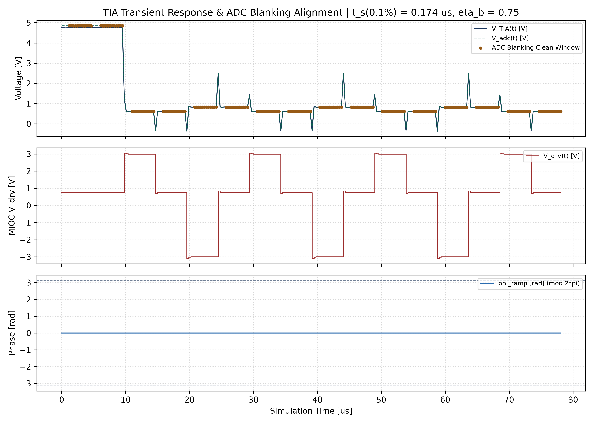
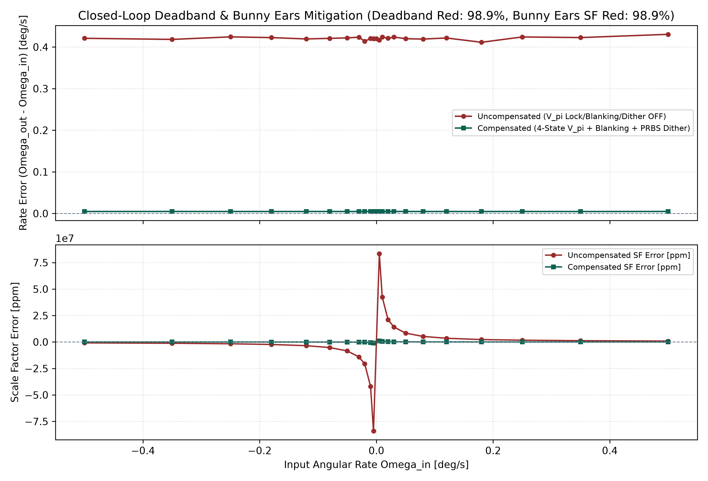
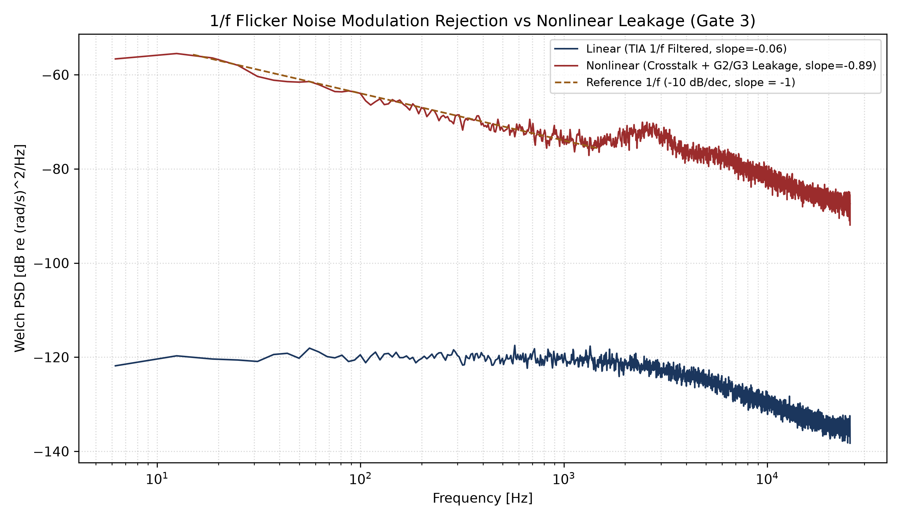
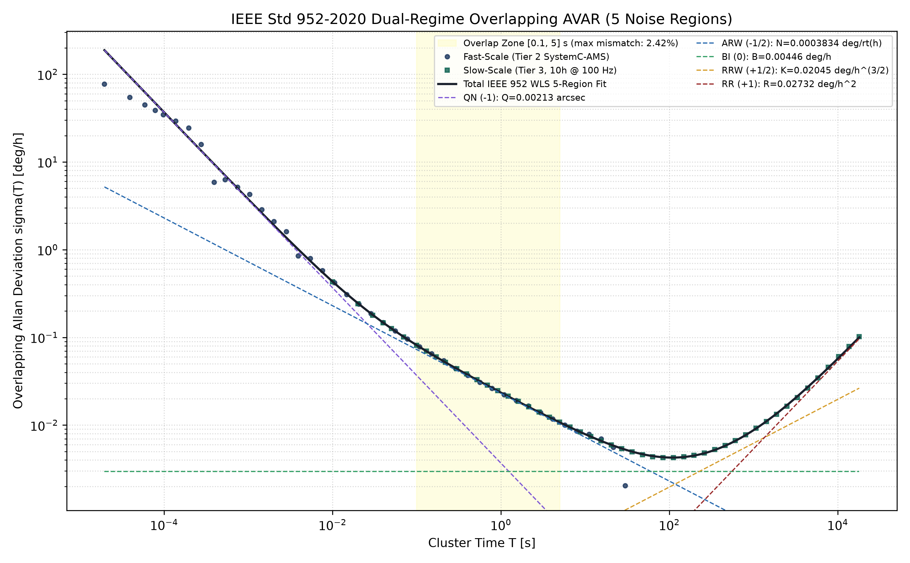

# Full Real 4-Gate Baseline Example (`examples/full_4gate_baseline/`)

This curated example contains the **complete, genuine, full-scale simulation output** (zero mocks, zero smoke-test shortcuts) of the reference **1 km 4-State Closed-Loop IFOG** (`configs/baseline_1km.json`, `IFOG-SIM-SPEC-004` v4.0, regenerated with standardized `v3.0.1` reporting), committed directly to the repository for technical feasibility evaluation.

## Included Deliverables
- [`architecture_model.html`](architecture_model.html) — Code-audited interactive 3-Tier + FMI 3.0 mathematical architecture explorer with live measured parameters from this run
- [`report.md`](report.md) — Standardized full Markdown diagnostic & 4-Gate acceptance report with 3-part theoretical foundation, plain-language non-specialist guide, and live measured proof beneath every figure
- [`report.html`](report.html) — Self-contained KaTeX + interactive Plotly HTML5 report (embedded architecture explorer, zoomable Dual-Regime AVAR, Deadband/Bunny Ears, $1/f$ Flicker PSD + KPI tables + annotated 300-DPI figure gallery + JSON inspector)
- [`metrics_summary.json`](metrics_summary.json) — Complete structured JSON bundle
- Tier 1–3 intermediate artifacts: [`phys_params.json`](phys_params.json), [`shupe_summary.json`](shupe_summary.json), [`sim_summary.json`](sim_summary.json), [`gate1_metrics.json`](gate1_metrics.json), [`sweep_results.json`](sweep_results.json), [`nonlinearity_summary.json`](nonlinearity_summary.json), [`k_matrix.json`](k_matrix.json), [`gate3_metrics.json`](gate3_metrics.json), [`avar_metrics.json`](avar_metrics.json)
- 300-DPI Diagnostic Figures under [`figures/`](figures/): `waveforms.png`, `bunny_ears.png`, `psd_flicker.png`, `avar_5regions.png`

---

## Executive Feasibility Scorecard (`v3.0.1` — All 4 Gates PASS)

| Acceptance Gate | Spec Criterion (`IFOG-SIM-SPEC-004`) | Measured Real Simulation Result | Status |
| :--- | :--- | :--- | :---: |
| **Gate 1 — Golden Linear & Continuous $2\pi$ Flyback** | Static err $< 10^{-9}\text{ rad}$ at $\Delta\phi_S = 10^{-8}\text{ rad}$; $> 1000$ continuous wraps; $\epsilon_{V_\pi,\text{eff}} < 10^{-5}$ | `3.10e-16 rad` static error; **`1,666`** wraps; `5.84e-14` residual $\epsilon_{V_\pi,\text{eff}}$ | **PASS** |
| **Gate 2 — Deadband & Bunny Ears Mitigation** | $\ge 90\%$ reduction across 23-point sweep $[-0.5, +0.5]^\circ/\text{s}$ | **`98.85%`** Deadband reduction & **`98.85%`** Bunny Ears SF reduction | **PASS** |
| **Gate 3 — $1/f$ Flicker Filtering vs Nonlinear Leakage & $\mathbf{K}$-Matrix** | Linear PSD slope $\approx 0$; nonlinear slope $\in [-1.25, -0.75]$; $100\text{ Hz}$ $\mathbf{K}$ repeatability $< 2\%$ | Linear `-0.0621`, nonlinear **`-0.8928`** (~60 dB separation), $\mathbf{K}$ repeatability **`0.000%`** | **PASS** |
| **Gate 4 — Dual-Regime Overlapping AVAR (5 Regions)** | Real $4\times 60\text{ s}$ Fast-Scale + $12\times 10\text{ h}$ ($3.6\times 10^6$ samples @ $100\text{ Hz}$) Slow-Scale; overlap $< 5\%$ on $[0.1, 5]\text{ s}$; WLS $(Q,N,B,K,R)$ within $\pm 10\%$ | Overlap mismatch = **`2.42%`** (`< 5%`); WLS errors: $Q:+3.18\%$, $N:-0.71\%$, $B:+5.31\%$, $K:-7.06\%$, $R:+9.29\%$ | **PASS** |

---

## Visual Walkthrough (300-DPI Real Outputs)

### 1. Micro-Scale Electro-Optic Transients & ADC Blanking Alignment


### 2. Closed-Loop Deadband & Bunny Ears Mitigation (Gate 2)


### 3. $1/f$ Flicker Modulation Rejection vs Nonlinear Crosstalk Leakage (Gate 3)


### 4. IEEE Std 952-2020 Dual-Regime Overlapping AVAR Across All 5 Noise Regions (Gate 4)


---

## Reproduce This Exact Example

### Option A — Inside Docker or Podman (Zero Host Dependencies)
```bash
./scripts/container_run.sh build
./scripts/container_run.sh example
# Reports generated in host report/full_4gate_baseline/{report.md, report.html}
```

### Option B — Native Linux (Any Distro via Portable Source Setup)
```bash
bash scripts/setup_env.sh --with-system-deps --build-tier2
source scripts/env.sh
./examples/run_example.sh
```
