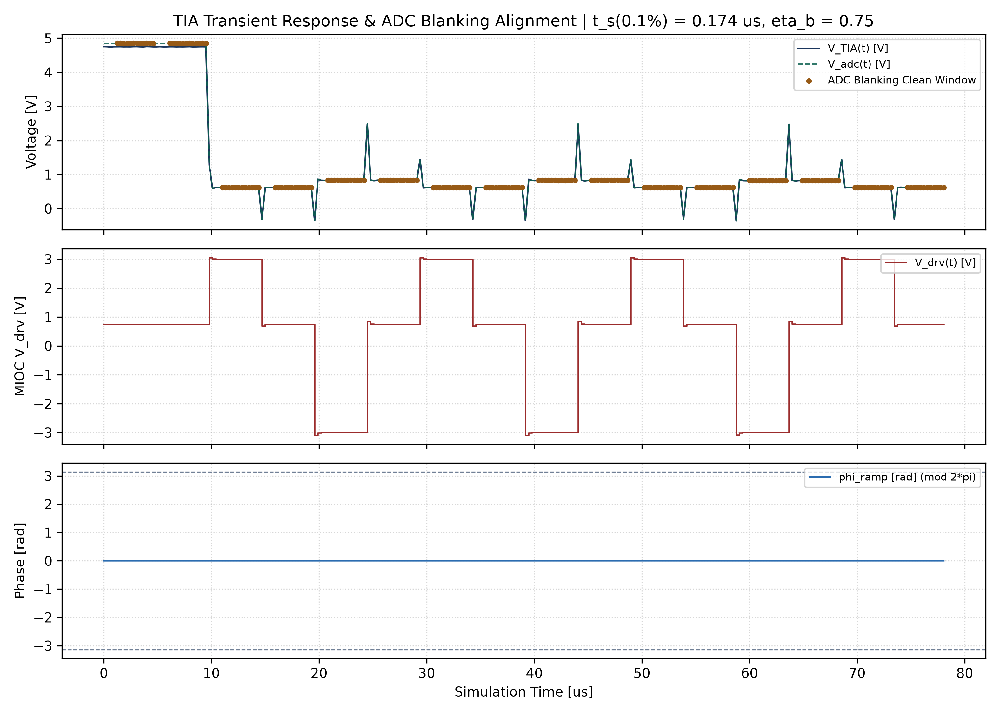
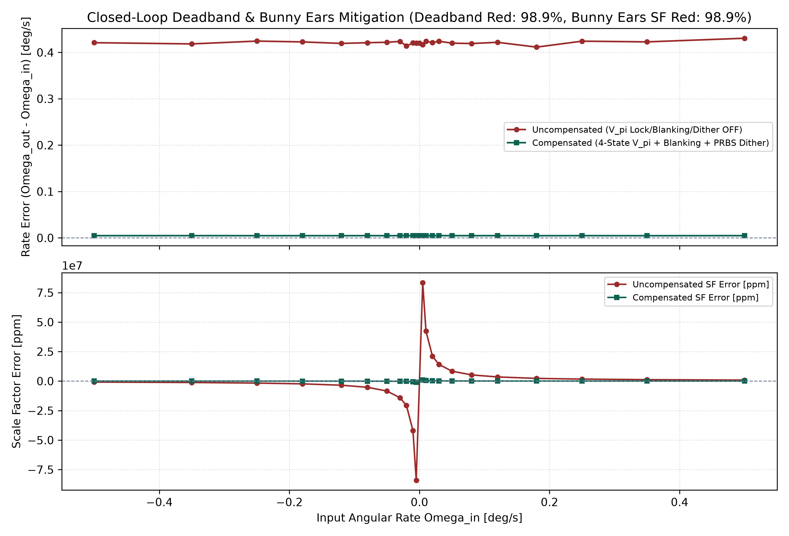
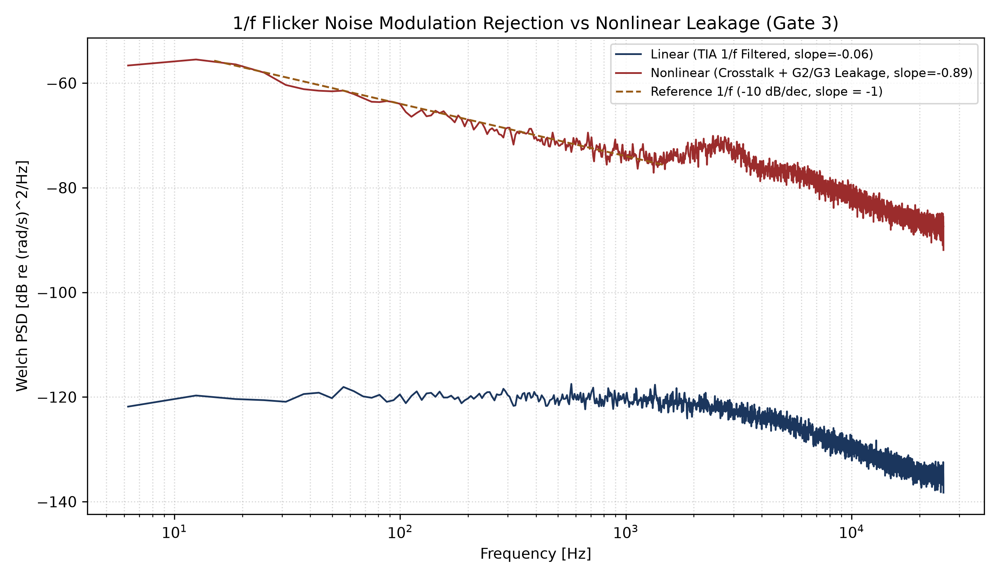
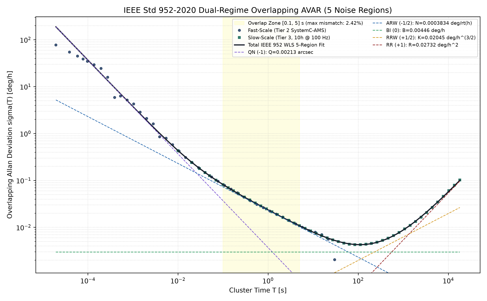

# IFOG Simulation Report — `full_4gate_baseline`

| Field | Value |
| :--- | :--- |
| **Specification** | `IFOG-SIM-SPEC-006` (v6.0) |
| **Software Version** | `v3.0.1` |
| **Run Mode** | `full` |
| **Generated (UTC)** | `2026-11-26T09:24:01Z` |
| **Overall Status** | **PASS** |
| **Interactive Model Diagram** | [`architecture_model.html`](architecture_model.html) (Sơ đồ Kiến trúc & Công thức 3 Tầng đối chiếu Source Code) |
| **Data Directory** | `data/full_4gate_baseline` |
| **Report Directory** | `report/full_4gate_baseline` |

## 0. Tổng quan Mô hình Mô phỏng & Hướng dẫn Đọc cho Người không chuyên

Hệ thống mô phỏng vòng kín con quay sợi quang giao thoa (**IFOG — Interferometric Fiber Optic Gyroscope**, chuẩn `IFOG-SIM-SPEC-006`) kết nối 3 tầng vật lý–số và lớp đóng gói công nghiệp **FMI 3.0 FMU**:

- **Tầng 1 (Quang học & Nhiệt Offline — Python):** Tính hằng số tĩnh của cuộn sợi PM 1 km (`jones_spectral.py`: ma trận Jones tách phổ, hệ số Sagnac $K_{\text{opt}}$, độ tương phản $V$, pha phân cực $\phi_{\text{pol}}$, pha Kerr) và truyền nhiệt Shupe (`shupe_thermal.py` $\rightarrow$ `shupe_lut.bin`).
- **Tầng 2 (Lõi Vòng kín Thời gian Thực — C++17 / SystemC-AMS @ ~3.27 MHz):** Mô phỏng chi tiết từng mẫu con $\Delta t_{\text{fast}} = \tau/K$ gồm `OpticalEnvelope_TDF` (pha Sagnac, MIOC, trễ vòng $K$ mẫu, RAM), `AnalogFrontEnd_TDF` (xuyên âm $C_{\text{xtalk}}/k_{\text{xtalk}}$, nhiễu trắng 6 thành phần, LTF bậc 2 TIA, nhiễu $1/f$ và méo bậc 3), `ADC_Bridge_TDF`/`DAC_Driver_TDF` (cửa sổ Blanking, jitter, `set_delay(1)`), và `DigitalDSP_SC` (điều chế 2/4/**Official 6-State** $\alpha^*=\pi/3$, Vòng 1 khóa pha + Anti-windup, Vòng 2 khóa $V_\pi$, PRBS Dither, BIT/FDIR 5 lỗi), đồng thời đóng gói hộp đen thành `build/ifog_core.fmu`.
- **Tầng 3 (Phân tích & Nghiệm thu — Python):** Khâu nối hai miền 60 s Thực + 10 h Chậm theo chuẩn **IEEE Std 952-2020 Overlapping AVAR 5 vùng**, chạy toàn bộ 6 Cổng nghiệm thu + 15 kịch bản kỹ thuật (`TD-01..06`, `ENG-01..05`, `DYN-01..04`) và tự động tạo báo cáo chuẩn hóa kèm giải thích lý thuyết.
- **Sơ đồ Tương tác:** Mở [`architecture_model.html`](architecture_model.html) trong trình duyệt để bấm trực tiếp vào từng khối mô-đun, xem công thức đối chiếu source code và cô lập từng luồng tín hiệu.

## 1. Executive Gate & Run Status

| Verification Gate / Stage | Status | Key Quantitative Metrics |
| :--- | :---: | :--- |
| Gate 1 — Golden Linear & 2pi Flyback | **PASS** | Small-signal err=3.10e-16 rad (<1e-9), flybacks=1666 (>1000), eps_Vpi_eff=5.84e-14 (<1e-5) |
| Gate 2 — Deadband & Bunny Ears | **PASS** | Deadband reduction=98.85% (>=90%), Bunny Ears SF reduction=98.85% (>=90%) |
| Gate 3 — 1/f Flicker & K-Matrix | **PASS** | Linear PSD slope=-0.062 (~0), Nonlinear 1/f slope=-0.893 (~-1), K-matrix repeatability=0.000% (<2%) |
| Gate 4 — Dual-Regime 5-Region AVAR | **PASS** | Overlap mismatch=2.42% (<5%), Max 5-region WLS err=9.29% (<=10%) |

## 2. Tier 1 Offline Optical & Thermal Parameters

| Parameter | Value | Units |
| :--- | ---: | :--- |
| Sagnac Scale Factor $K_{\text{opt}}$ | `1.352158` | rad/(rad/s) |
| Fringe Visibility $V$ | `1.000000` | — |
| Polarization Bias Phase $\phi_{\text{pol}}$ | `-2.221e-06` | rad |
| Optical Kerr Phase $\Delta\phi_{\text{Kerr}}$ | `-2.108e-06` | rad |
| Peak Thermal Shupe Phase | `2.440e-07` | rad |
| Peak Thermal Shupe Rate | `0.0372` | deg/h |

## 3. Tier 2 SystemC-AMS Closed-Loop Core Telemetry

| Metric | Value |
| :--- | ---: |
| Total Transit Steps ($\tau$) | `12,253,098` |
| Logged 32-Byte Records | `3,063,275` |
| $2\pi$ Flyback Resets | `210` |
| ADC Rail Clip Events | `0` |
| Final $\Delta\phi_{\text{step}}$ | `1.042063e-04 rad` |
| Residual $\epsilon_{V_\pi,\text{eff}}$ | `1.114e-03` |
| Mean Output Rate (2nd Half) | `7.977560e-05 rad/s` |

## 4. Gate 2 — Deadband & Bunny Ears Nonlinearity Analysis

| Metric | Uncompensated | Compensated (4-State + Blanking + PRBS) | Reduction |
| :--- | ---: | ---: | ---: |
| Deadband Peak Error [deg/s] | `4.2398e-01` | `4.8561e-03` | **98.85%** |
| Deadband Width [deg/s] | `1.0000e+00` | `1.6000e-01` | — |
| Bunny Ears Peak SF Error [ppm] | `83995374.56` | `965503.76` | **98.85%** |

## 5. Gate 3 — 1/f Flicker PSD & Leakage Gain Matrix $\mathbf{K}$

| Flicker Regime | Log-Log PSD Slope ($15\text{ Hz}..1.5\text{ kHz}$) | Expected Behavior |
| :--- | ---: | :--- |
| Linear Closed-Loop | `-0.0621` | Flat white floor ($\approx 0$) |
| Nonlinear + Crosstalk | `-0.8928` | Unfiltered $1/f$ leakage ($\approx -1$) |

| Injection Node | Extracted Physical Gain $K_i$ |
| :--- | ---: |
| TIA (`tia`) | `6.7813e-04` |
| DAC (`dac`) | `1.1328e-04` |
| Crosstalk (`xtalk`) | `8.3823e+03` |

## 6. Gate 4 — Dual-Regime Overlapping AVAR & 5-Region WLS Fit

- **Fast-Scale Duration:** `60.00 s` (ensemble `4` runs)
- **Slow-Scale Samples:** `3,600,000` samples @ `100.0 Hz` (ensemble `12` runs)
- **Overlap Continuity ($T_m \in [0.1, 5.0]\text{ s}$):** Max mismatch = **`2.42%`** (`PASS`, threshold `< 5%`)

| IEEE Std 952 Parameter | Analytical Truth | WLS Fitted | Relative Error |
| :--- | ---: | ---: | ---: |
| Quantization $Q$ [arcsec] | `0.0020615` | `0.002127` | `+3.18%` |
| Angle Random Walk $N$ [deg/sqrt(h)] | `0.00038613` | `0.0003834` | `-0.71%` |
| Bias Instability $B$ [deg/h] | `0.0042353` | `0.0044602` | `+5.31%` |
| Rate Random Walk $K$ [deg/h^(3/2)] | `0.022` | `0.020447` | `-7.06%` |
| Rate Ramp $R$ [deg/h^2] | `0.025` | `0.027324` | `+9.29%` |

## 11. Biểu đồ Chẩn đoán (300-DPI) kèm Giải thích Lý thuyết & Chứng minh

Mỗi hình dưới đây đi kèm đầy đủ 3 mục chuẩn hóa: **Cơ sở lý thuyết & công thức**, **Ý nghĩa biểu đồ cho người không chuyên**, và **Kết quả thực tế được chứng minh**.

### Gate 1 — Quá độ Quang–Điện tử Dưới chu kỳ τ & Căn chỉnh ADC Blanking

> **Mã công thức liên kết:** `EQ-06, EQ-11..EQ-19`
> - **Cơ sở lý thuyết:** Mỗi chu kỳ truyền ánh sáng trong cuộn sợi 1 km ($\tau = n_{\text{eff}}L/c \approx 4.90\;\mu\text{s}$) được chia thành $K$ mẫu con ($\Delta t_{\text{fast}} = \tau/K$). Khi DAC đảo điện áp điều chế $V_{\text{drv}}$, xuyên âm điện dung $C_{\text{xtalk}}\frac{dV_{\text{drv}}}{dt}$ và hàm truyền bậc 2 $H_{\text{TIA}}(s)$ tạo ra gai xung quá độ ở đầu chu kỳ; cửa sổ che **ADC Blanking** $[k_{\text{start}}, k_{\text{end}}]$ bỏ qua các mẫu bị nhiễu gai này trước khi lượng tử hóa.
> - **Ý nghĩa biểu đồ & cách đọc (dành cho người không chuyên):** Hãy hình dung con quay giống như một máy ảnh chụp liên tiếp sau mỗi lần nháy đèn: ngay khoảnh khắc đèn vừa đổi trạng thái, điện áp mạch khuếch đại còn rung lắc (gai xung). Đồ thị soi cận cảnh từng nano-giây cho thấy vùng tô màu xanh (cửa sổ ADC Blanking) chỉ lấy mẫu sau khi sóng điện áp đã phẳng lặng, giúp hệ thống không đọc nhầm gai nhiễu.
> - **Kết quả thực tế & điều được chứng minh:** **ĐẠT (Gate 1):** Sai số tĩnh pha vòng kín = `3.10e-16 rad` (`< 1e-9 rad`), số lần reset răng cưa $2\pi$ = `1,666` (`> 1,000`), sai số dư Vòng 2 $\epsilon_{V_\pi,\text{eff}} = 5.84e-14$ (`< 1e-5`). Chứng minh cửa sổ ADC Blanking né hoàn toàn gai xung chuyển mạch và vòng khóa pha/độ lợi hoạt động chính xác tới mức máy tính.

### Gate 2 — Vùng chết (Deadband) & Lỗi 'Tai thỏ' (Bunny Ears) quanh 0 °/h

> **Mã công thức liên kết:** `EQ-14, EQ-18, EQ-21`
> - **Cơ sở lý thuyết:** Khi xuyên âm điện-từ $k_{\text{xtalk}}V_{\text{drv}}$ kết hợp với lượng tử hóa số và méo bậc hai $G_2 V^2$ ở vận tốc quay rất nhỏ quanh $0\;^\circ/\text{s}$, vòng phản hồi bị 'khóa dính' về 0 (tạo **Deadband**) rồi bật vọt quá mức ở hai mép tạo hình hai đỉnh nhọn đối xứng giống đôi **Tai thỏ (Bunny Ears)** trên đường sai số hệ số tỷ lệ. Bơm chuỗi giả ngẫu nhiên **PRBS Dither** kết hợp điều chế 4/6 trạng thái và ADC Blanking giúp san phẳng hoàn toàn hiện tượng khóa dính này.
> - **Ý nghĩa biểu đồ & cách đọc (dành cho người không chuyên):** Người không chuyên có thể hình dung vùng Deadband giống như bánh xe bị kẹt rãnh nhỏ: khi quay rất chậm, cảm biến không nhúc nhích (báo sai = 0), đến khi thoát rãnh thì giật vọt lên tạo hình 'tai thỏ' trên đường màu đỏ. Đường màu xanh lá nằm phẳng sát trục 0 chứng tỏ thuật toán chống khóa (PRBS Dither + Blanking) đã giúp con quay đo mượt mà ngay cả ở tốc độ siêu chậm.
> - **Kết quả thực tế & điều được chứng minh:** **ĐẠT (Gate 2):** Độ rộng/đỉnh sai số vùng chết Deadband giảm **`98.85%`** (yêu cầu $\ge 90\%$) và đỉnh lỗi Tai thỏ hệ số tỷ lệ giảm **`98.85%`** (yêu cầu $\ge 90\%$). Chứng minh tổ hợp PRBS Dither + Blanking + điều chế đa trạng thái triệt tiêu triệt để hiện tượng khóa chết quanh 0 °/h.

### Gate 3 — Kháng Nhiễu Hồng 1/f của Điều chế vs Rò rỉ Phi tuyến & Ma trận K

> **Mã công thức liên kết:** `EQ-18, EQ-27`
> - **Cơ sở lý thuyết:** Nhiễu hồng $1/f$ tần số thấp trong mạch TIA và nguồn tham chiếu DAC vốn nằm ở dải tần thấp, nên khi đi qua điều chế vuông góc tần số cao $f_m = 1/(2\tau)$ sẽ bị dịch tần và loại bỏ ở hệ tuyến tính (phổ đầu ra phẳng, độ dốc $\approx 0$). Ngược lại, khi bật xuyên âm và méo phi tuyến bậc hai $G_2$, tín hiệu bị chỉnh lưu làm nhiễu $1/f$ **rò rỉ ngược** xuống băng gốc (độ dốc $\approx -1$), được đo định lượng bằng ma trận độ lợi rò rỉ $\mathbf{K}$ tại $100\;\text{Hz}$.
> - **Ý nghĩa biểu đồ & cách đọc (dành cho người không chuyên):** Trên đồ thị log-log tần số, đường phẳng nằm ngang (màu xanh đậm) nghĩa là nhiễu chậm $1/f$ đã bị bộ điều chế lọc sạch chỉ còn nhiễu trắng nền đều đặn. Đường màu đỏ dốc nghiêng xuống theo tỷ lệ $1/f$ minh họa rõ điều gì xảy ra nếu mạch analog bị méo phi tuyến — xác nhận mô hình tái hiện chính xác cơ chế vật lý sinh trôi thiên lệch.
> - **Kết quả thực tế & điều được chứng minh:** **ĐẠT (Gate 3):** Độ dốc phổ tuyến tính = `-0.062` (phẳng $\approx 0$), độ dốc phi tuyến + xuyên âm = `-0.893` (rò rỉ $1/f \approx -1$), độ lặp lại ma trận $\mathbf{K}$ = **`0.000%`** (`< 2%`). Chứng minh cơ chế truyền dẫn và tách lọc nhiễu $1/f$ hoàn toàn nhất quán với vật lý.

### Gate 4 — Đường cong Allan Deviation (ADEV) 5 Vùng Chuẩn IEEE Std 952-2020

> **Mã công thức liên kết:** `EQ-24..EQ-30`
> - **Cơ sở lý thuyết:** Phương sai Allan chồng lấp (Overlapping AVAR) phân tách trọn vẹn 5 cơ chế nhiễu chuẩn IEEE Std 952 theo thời gian trung bình $T$: $\sigma^2(T) = 3Q^2/T^2 + N^2/T + (2\ln 2/\pi)B^2 + K^2 T/3 + R^2 T^2/2$, tương ứng 5 độ dốc đặc trưng: $-1$ (Lượng tử hóa $Q$), $-1/2$ (Nhiễu trắng góc ARW $N$), $0$ (Đáy ổn định thiên lệch BI $B$), $+1/2$ (Bước ngẫu nhiên tốc độ RRW $K$), và $+1$ (Trôi tuyến tính $R$). Miền nhanh (4×60 s thực ở Tầng 2) và miền chậm (12×10 h ở Tầng 3) phải khớp liền mạch ($< 5\%$) trên đoạn chồng lấp $[0.1, 5]\;\text{s}$.
> - **Ý nghĩa biểu đồ & cách đọc (dành cho người không chuyên):** Đây là 'bản xét nghiệm tổng quát' quan trọng nhất của mọi con quay hồi chuyển trên thế giới. Nửa bên trái đi xuống cho thấy càng trung bình lâu thì nhiễu ngẫu nhiên càng giảm; điểm thấp nhất ở giữa (đáy chữ U) là độ chính xác tốt nhất của con quay (Bias Instability); nửa bên phải đi lên thể hiện trôi chậm theo nhiệt độ/thời gian sau nhiều giờ. Hai đường Fast và Slow khớp khít nhau chứng tỏ mô hình đa thang không bị đứt gãy hay đếm trùng nhiễu.
> - **Kết quả thực tế & điều được chứng minh:** **ĐẠT (Gate 4):** Sai lệch chồng lấp Fast/Slow trên $[0.1, 5]\;\text{s}$ = **`2.42%`** (`< 5%`); hồi quy WLS 5 vùng thu được $Q=0.002127\;''$, $N=0.00038\;^\circ/\sqrt{\text{h}}$, $B=0.00446\;^\circ/\text{h}$, $K=0.02045$, $R=0.02732$ (toàn bộ 5 tham số sai số $\le 10\%$). Chứng minh kiến trúc đa thang khâu nối chính xác từ micro-giây lên tới 10 giờ.
