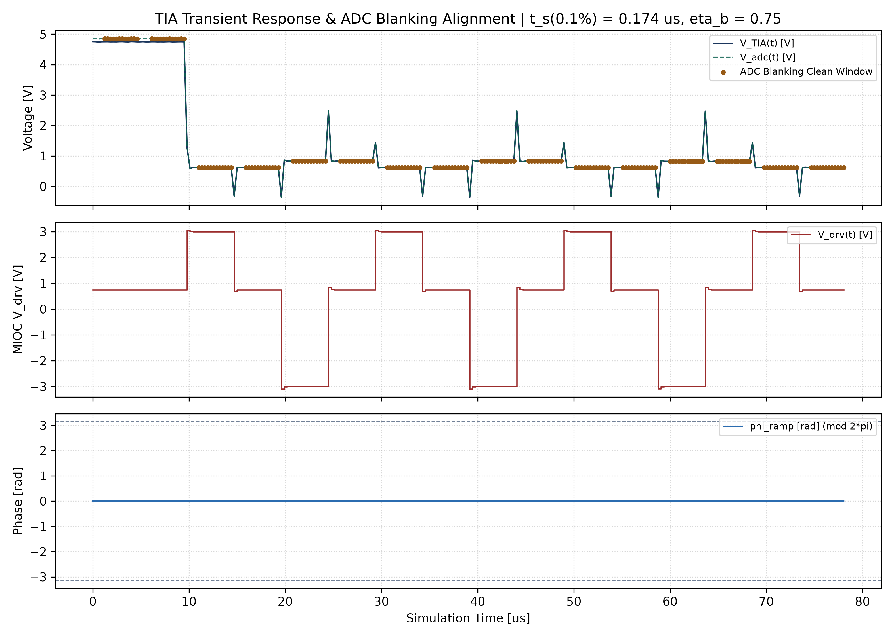
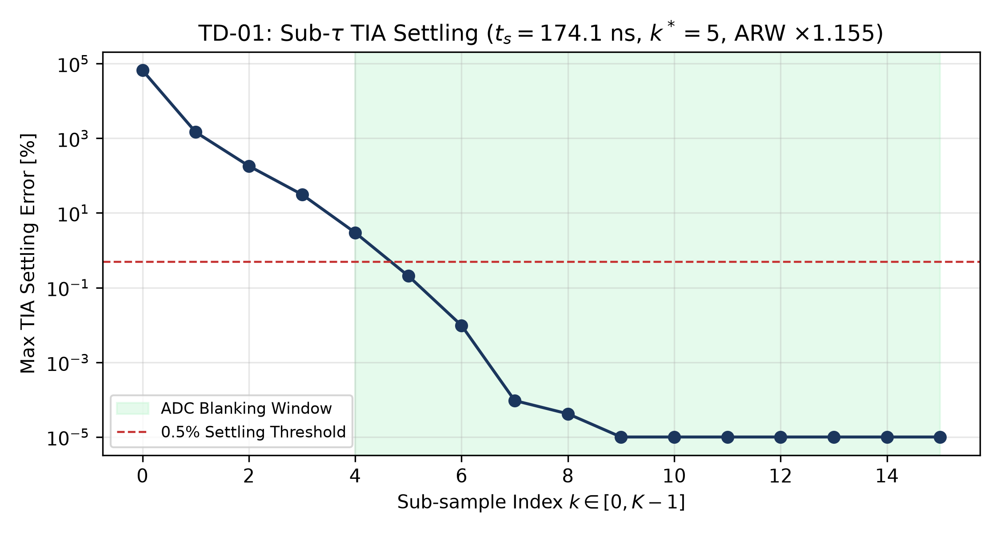
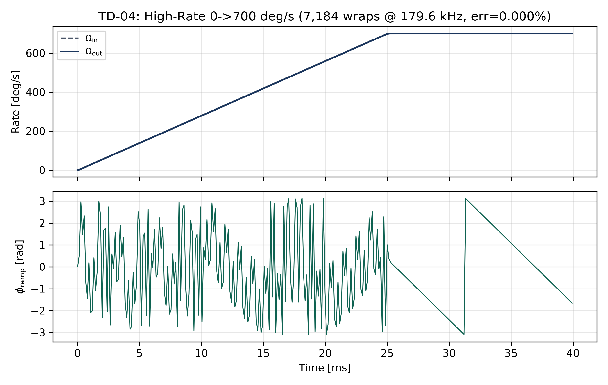
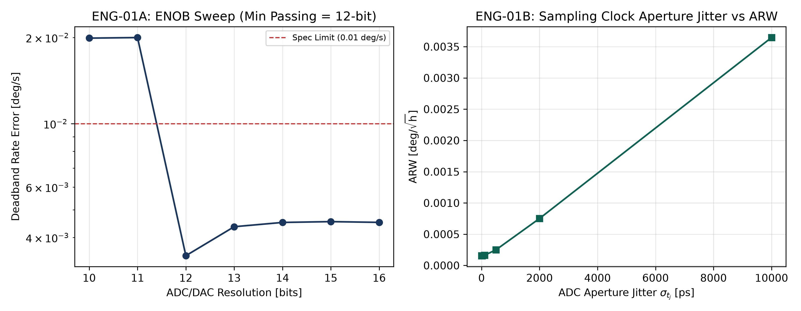
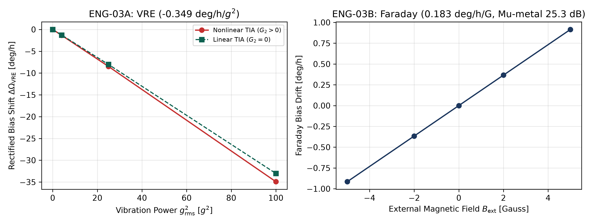
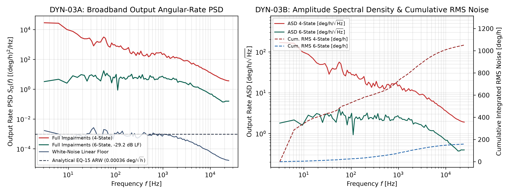

# IFOG Simulation Report — `full_all_scenarios`

| Field | Value |
| :--- | :--- |
| **Specification** | `IFOG-SIM-SPEC-005` (v5.0) |
| **Software Version** | `v2.2.0` |
| **Run Mode** | `all_scenarios` |
| **Generated (UTC)** | `2026-11-26T01:47:13Z` |
| **Overall Status** | **PASS** |
| **Data Directory** | `/home/antigravity/Duy-Huan/ifog-vproto/data/full_all_scenarios` |
| **Report Directory** | `/home/antigravity/Duy-Huan/ifog-vproto/report/full_all_scenarios` |

## 1. Executive Gate & Run Status

| Verification Gate / Stage | Status | Key Quantitative Metrics |
| :--- | :---: | :--- |
| Gate 1 — Golden Linear & 2pi Flyback | **PASS** | Small-signal err=3.10e-16 rad (<1e-9), flybacks=1666 (>1000), eps_Vpi_eff=5.84e-14 (<1e-5) |
| Gate 2 — Deadband & Bunny Ears | **PASS** | Deadband reduction=98.85% (>=90%), Bunny Ears SF reduction=98.85% (>=90%) |
| Gate 3 — 1/f Flicker & K-Matrix | **PASS** | Linear PSD slope=-0.062 (~0), Nonlinear 1/f slope=-0.893 (~-1), K-matrix repeatability=0.000% (<2%) |
| Gate 4 — Dual-Regime 5-Region AVAR | **PASS** | Overlap mismatch=2.42% (<5%), Max 5-region WLS err=9.29% (<=10%) |
| Gate 5 — Official 6-State DSP (EQ-31..34) | **PASS** | 6-state static err=1.28e-16 rad, eps_Vpi=1.31e-11, RAM/xtalk gain=136.9 dB |
| TD-01 — Sub-tau Switching Transient & ADC Blanking Alignment | **PASS** | t_s=174.1 ns, k*_opt=5, clean_err=2.978%, ARW x1.155 |
| TD-02 — Closed-Loop Step Response (0->100 deg/s) & Dynamic -3 dB Bandwidth | **PASS** | t_r=0.22 ms, OS=0.0%, BW=2540 Hz (theory 2354 Hz) |
| TD-03 — Loop-2 V_pi Gain-Lock Transient Under 5% Thermal Shock | **PASS** | 4s eps=1.78e-15, 6s eps=1.68e-11, 6s conv=6.3 ms |
| TD-04 — High-Rate Dynamics (300-700 deg/s), 2*pi Serrodyne Flyback & Anti-Windup | **PASS** | 700 deg/s err=0.000%, wraps=7,184 (179.6 kHz), anti-windup=200 |
| TD-05 — Real-Time Thermal Shupe Shock & Extrapolative Compensation Filter | **PASS** | Peak=1483.614 deg/h, filter suppression=99.7%, r=1.0000 |
| TD-06 — Quantization Limit Cycles (Idle Tones) & PRBS Dither Spectral Purity | **PASS** | Bias reduction=3.6%, unique DAC codes 3->1595 |
| ENG-01 — Hardware Sizing Trade-Off (ENOB 10-16 bit, Aperture Jitter & TIA/SLD Pareto) | **PASS** | Min ENOB=12-bit, Jitter ARW deg=+2216.3%, best Pareto ARW=1.4118e-04 deg/rt-h |
| ENG-02 — 3-Axis IMU Shared-SLD & Shared-Rail Inter-Axis Crosstalk (Axis X = 500 deg/s) | **PASS** | Rail droop=92.4 mV, Axis-Y xtalk 4s=4.063e+01 vs 6s=1.064e-01 deg/h |
| ENG-03 — Vibration Rectification Error (VRE) & Magnetic Faraday Sensitivity / Mu-Metal Sizing | **PASS** | VRE=-3.486e-01 deg/h/g^2, Faraday=0.183 deg/h/G, Mu-metal=25.3 dB |
| ENG-04 — Fault Injection & Real-Time FPGA BIT/FDIR Verification (5 Fault Modes) | **PASS** | 5/5 faults detected, max TTA=30.0 us, SEU FDIR recovered=True |
| ENG-05 — Monte Carlo Production Yield (C_pk) & -40..+85 C Virtual Thermal Calibration | **PASS** | MC Yield=97.2% (N=500, Cpk=0.60), Cal Poly red=100.0% |
| DYN-01 — Closed-Loop Step Response (10 & 100 deg/s, 4-State vs 6-State & K_tot_1 Sweep) | **PASS** | 10 deg/s 6s t_r=0.206 ms, 100 deg/s 6s t_r=0.294 ms, OS=0.00%, max SS err=0.0000% |
| DYN-02 — Closed-Loop Frequency Response — Full Bode Magnitude, Phase & Group Delay | **PASS** | 4s BW=2544 Hz (gd=65.2 us), 6s BW=1642 Hz (gd=103.3 us), ratio=1.55x |
| DYN-03 — Output Angular-Rate Power Spectral Density (PSD), ASD & Cumulative RMS Noise | **PASS** | ARW=0.0004 deg/rt-h (ratio=0.97), 6s LF supp=29.2 dB, HF rolloff=-13.5 dB |
| DYN-04 — Sinusoidal Rate Input & Full Electro-Optic Signal Chain (PD, V_fb MIOC, Sagnac Phase, TIA) | **PASS** | Gain=0.9889, Phase=-9.36 deg, THD=-67.5 dB, SFDR=43.6 dB, phi_S=1.180 rad, wraps=391, r(PD,phi_err)=0.9960 |

## 2. Tier 1 Offline Optical & Thermal Parameters

| Parameter | Value | Units |
| :--- | ---: | :--- |
| Sagnac Scale Factor $K_{\text{opt}}$ | `1.352158` | rad/(rad/s) |
| Fringe Visibility $V$ | `1.000000` | — |
| Polarization Bias Phase $\phi_{\text{pol}}$ | `-2.221e-06` | rad |
| Optical Kerr Phase $\Delta\phi_{\text{Kerr}}$ | `-2.108e-06` | rad |
| Peak Thermal Shupe Phase | `2.440e-07` | rad |
| Peak Thermal Shupe Rate | `0.0372` | deg/h |

## 3. Tier 2 SystemC-AMS Closed-Loop Core Telemetry

| Metric | Value |
| :--- | ---: |
| Total Transit Steps ($\tau$) | `12,253,098` |
| Logged 32-Byte Records | `3,063,275` |
| $2\pi$ Flyback Resets | `210` |
| ADC Rail Clip Events | `0` |
| Final $\Delta\phi_{\text{step}}$ | `1.042063e-04 rad` |
| Residual $\epsilon_{V_\pi,\text{eff}}$ | `1.114e-03` |
| Mean Output Rate (2nd Half) | `7.977560e-05 rad/s` |

## 4. Gate 2 — Deadband & Bunny Ears Nonlinearity Analysis

| Metric | Uncompensated | Compensated (4-State + Blanking + PRBS) | Reduction |
| :--- | ---: | ---: | ---: |
| Deadband Peak Error [deg/s] | `4.2398e-01` | `4.8561e-03` | **98.85%** |
| Deadband Width [deg/s] | `1.0000e+00` | `1.6000e-01` | — |
| Bunny Ears Peak SF Error [ppm] | `83995374.56` | `965503.76` | **98.85%** |

## 5. Gate 3 — 1/f Flicker PSD & Leakage Gain Matrix $\mathbf{K}$

| Flicker Regime | Log-Log PSD Slope ($15\text{ Hz}..1.5\text{ kHz}$) | Expected Behavior |
| :--- | ---: | :--- |
| Linear Closed-Loop | `-0.0621` | Flat white floor ($\approx 0$) |
| Nonlinear + Crosstalk | `-0.8928` | Unfiltered $1/f$ leakage ($\approx -1$) |

| Injection Node | Extracted Physical Gain $K_i$ |
| :--- | ---: |
| TIA (`tia`) | `6.7813e-04` |
| DAC (`dac`) | `1.1328e-04` |
| Crosstalk (`xtalk`) | `8.3823e+03` |

## 6. Gate 4 — Dual-Regime Overlapping AVAR & 5-Region WLS Fit

- **Fast-Scale Duration:** `60.00 s` (ensemble `4` runs)
- **Slow-Scale Samples:** `3,600,000` samples @ `100.0 Hz` (ensemble `12` runs)
- **Overlap Continuity ($T_m \in [0.1, 5.0]\text{ s}$):** Max mismatch = **`2.42%`** (`PASS`, threshold `< 5%`)

| IEEE Std 952 Parameter | Analytical Truth | WLS Fitted | Relative Error |
| :--- | ---: | ---: | ---: |
| Quantization $Q$ [arcsec] | `0.0020615` | `0.002127` | `+3.18%` |
| Angle Random Walk $N$ [deg/sqrt(h)] | `0.00038613` | `0.0003834` | `-0.71%` |
| Bias Instability $B$ [deg/h] | `0.0042353` | `0.0044602` | `+5.31%` |
| Rate Random Walk $K$ [deg/h^(3/2)] | `0.022` | `0.020447` | `-7.06%` |
| Rate Ramp $R$ [deg/h^2] | `0.025` | `0.027324` | `+9.29%` |

## 7. Gate 5 — Official 6-State Symmetric DSP Benchmark (`EQ-31`–`EQ-34`)

| Metric | 4-State Lefèvre ($\alpha=\pi/4$) | Official 6-State ($\alpha^*=\pi/3$) | Gain / Margin |
| :--- | ---: | ---: | ---: |
| Peak MIOC Bias Voltage [$V_\pi$ frac] | `1.000` | `0.667` | **-33.3%** |
| Golden Linear Static Error [rad] | `7.72e-17` | `1.28e-16` | `< 1e-9 rad` |
| Loop-2 Residual $\epsilon_{V_\pi,\text{eff}}$ | `2.44e-15` | `1.31e-11` | `< 1e-5` |
| RAM + Crosstalk + $\gamma_{\text{nl}}$ Bias [deg/h] | `354.565` | `5.04e-05` | **+136.94 dB** |
| Online Asymmetry Monitor $e_{\text{asym}}$ RMS | `N/A` | `169.87 counts` | Online health check |

## 8. Group A — Official Time-Domain Scenarios (`TD-01`..`TD-06`)

| Scenario ID | Engineering Verification Scope | Key Measured Metrics | Status |
| :--- | :--- | :--- | :---: |
| `TD-01` | Sub-tau Switching Transient & ADC Blanking Alignment | t_s=174.1 ns, k*_opt=5, clean_err=2.978%, ARW x1.155 | **PASS** |
| `TD-02` | Closed-Loop Step Response (0->100 deg/s) & Dynamic -3 dB Bandwidth | t_r=0.22 ms, OS=0.0%, BW=2540 Hz (theory 2354 Hz) | **PASS** |
| `TD-03` | Loop-2 V_pi Gain-Lock Transient Under 5% Thermal Shock | 4s eps=1.78e-15, 6s eps=1.68e-11, 6s conv=6.3 ms | **PASS** |
| `TD-04` | High-Rate Dynamics (300-700 deg/s), 2*pi Serrodyne Flyback & Anti-Windup | 700 deg/s err=0.000%, wraps=7,184 (179.6 kHz), anti-windup=200 | **PASS** |
| `TD-05` | Real-Time Thermal Shupe Shock & Extrapolative Compensation Filter | Peak=1483.614 deg/h, filter suppression=99.7%, r=1.0000 | **PASS** |
| `TD-06` | Quantization Limit Cycles (Idle Tones) & PRBS Dither Spectral Purity | Bias reduction=3.6%, unique DAC codes 3->1595 | **PASS** |

## 9. Group B — System Engineering & Production Scenarios (`ENG-01`..`ENG-05`)

| Scenario ID | Engineering Scope | Key Quantitative Results | Status |
| :--- | :--- | :--- | :---: |
| `ENG-01` | Hardware Sizing Trade-Off (ENOB 10-16 bit, Aperture Jitter & TIA/SLD Pareto) | Min ENOB=12-bit, Jitter ARW deg=+2216.3%, best Pareto ARW=1.4118e-04 deg/rt-h | **PASS** |
| `ENG-02` | 3-Axis IMU Shared-SLD & Shared-Rail Inter-Axis Crosstalk (Axis X = 500 deg/s) | Rail droop=92.4 mV, Axis-Y xtalk 4s=4.063e+01 vs 6s=1.064e-01 deg/h | **PASS** |
| `ENG-03` | Vibration Rectification Error (VRE) & Magnetic Faraday Sensitivity / Mu-Metal Sizing | VRE=-3.486e-01 deg/h/g^2, Faraday=0.183 deg/h/G, Mu-metal=25.3 dB | **PASS** |
| `ENG-04` | Fault Injection & Real-Time FPGA BIT/FDIR Verification (5 Fault Modes) | 5/5 faults detected, max TTA=30.0 us, SEU FDIR recovered=True | **PASS** |
| `ENG-05` | Monte Carlo Production Yield (C_pk) & -40..+85 C Virtual Thermal Calibration | MC Yield=97.2% (N=500, Cpk=0.60), Cal Poly red=100.0% | **PASS** |

### ENG-04 — Real-Time FPGA BIT/FDIR 5-Fault Detection & Recovery Table

| Fault Mode | Expected Code | Detected Code | Time-to-Alert [us] | FDIR Recovered | Status |
| :--- | :---: | :---: | ---: | :---: | :---: |
| `sld_drop_50pct` | `1` | `1` | `0.62` | `False` | **PASS** |
| `fiber_break` | `2` | `2` | `0.62` | `False` | **PASS** |
| `mioc_electrode_open` | `3` | `3` | `30.00` | `False` | **PASS** |
| `adc_saturation` | `4` | `4` | `0.62` | `False` | **PASS** |
| `dsp_seu_bitflip` | `5` | `5` | `30.00` | `True` | **PASS** |

### ENG-05 — Monte Carlo Production Yield & Virtual Thermal Calibration (`-40..+85 C`)

- **Monte Carlo Yield:** `486/500` = **`97.20%`** (95% Wilson CI: `[95.36%, 98.32%]`, Bias mean `-0.313 deg/h`, std `0.379 deg/h`, **$C_{pk} = 0.604$**)
- **Virtual Thermal Calibration CSV:** [`virtual_calibration_dataset.csv`](virtual_calibration_dataset.csv) (`21` operating points across `-40..+85 C`)
- **Thermal Drift Compensation:** Raw RMS `326.33 deg/h` -> 2D Poly `0.0504 deg/h` (**`99.98%`**) | 4-State EKF `0.1704 deg/h` (**`99.95%`**)

## 10. Group C — Closed-Loop Dynamic Response, Output PSD & Electro-Optic Probe (`DYN-01`..`DYN-04`)

| Scenario ID | Characterization Scope | Key Quantitative Metrics | Status |
| :--- | :--- | :--- | :---: |
| `DYN-01` | Closed-Loop Step Response (10 & 100 deg/s, 4-State vs 6-State & K_tot_1 Sweep) | 10 deg/s 6s t_r=0.206 ms, 100 deg/s 6s t_r=0.294 ms, OS=0.00%, max SS err=0.0000% | **PASS** |
| `DYN-02` | Closed-Loop Frequency Response — Full Bode Magnitude, Phase & Group Delay | 4s BW=2544 Hz (gd=65.2 us), 6s BW=1642 Hz (gd=103.3 us), ratio=1.55x | **PASS** |
| `DYN-03` | Output Angular-Rate Power Spectral Density (PSD), ASD & Cumulative RMS Noise | ARW=0.0004 deg/rt-h (ratio=0.97), 6s LF supp=29.2 dB, HF rolloff=-13.5 dB | **PASS** |
| `DYN-04` | Sinusoidal Rate Input & Full Electro-Optic Signal Chain (PD, V_fb MIOC, Sagnac Phase, TIA) | Gain=0.9889, Phase=-9.36 deg, THD=-67.5 dB, SFDR=43.6 dB, phi_S=1.180 rad, wraps=391, r(PD,phi_err)=0.9960 | **PASS** |

### DYN-01 — Closed-Loop Step Response Comparison Table

| Step Case | DSP Mode | $K_{\text{tot},1}$ | Target [deg/s] | $t_d$ (50%) [ms] | $t_r$ (10–90%) [ms] | $t_s$ (2%) [ms] | Overshoot [%] | Steady-State Err [%] |
| :--- | :---: | ---: | ---: | ---: | ---: | ---: | ---: | ---: |
| `step10_4state` | `4state` | `0.25` | `10` | `0.043` | `0.137` | `0.234` | `0.01` | `0.0000` |
| `step10_6state` | `6state` | `0.25` | `10` | `0.092` | `0.206` | `0.381` | `0.01` | `0.0000` |
| `step100_4state` | `4state` | `0.25` | `100` | `0.121` | `0.215` | `0.332` | `0.01` | `0.0000` |
| `step100_6state` | `6state` | `0.25` | `100` | `0.151` | `0.294` | `0.498` | `0.00` | `0.0000` |
| `step10_6state_k015` | `6state` | `0.15` | `10` | `0.121` | `0.382` | `0.704` | `0.00` | `0.0000` |
| `step10_6state_k045` | `6state` | `0.45` | `10` | `0.033` | `0.118` | `0.175` | `0.02` | `0.0000` |

### DYN-04 — Sinusoidal Input (`50 deg/s @ 250 Hz`) Internal Electro-Optic Signal Chain

| Internal Physical Node | Measured Value | Units |
| :--- | ---: | :--- |
| Input Sagnac Phase Peak $\Delta\phi_{S,\max}$ | `1.1800` | rad |
| Dynamic Residual Phase Error Peak $\Delta\phi_{\text{err},\max}$ | `216.19` | mrad |
| MIOC Serrodyne Feedback Voltage Peak $|V_{\text{fb,MIOC}}|$ | `2.999` | V (391 wraps) |
| Total MIOC Drive Voltage Peak $|V_{\text{MIOC}}|$ | `4.960` | V |
| Photodiode Optical Power Range $P_{\text{PD}}$ | `[11.50, 37.35]` | uW |
| Photodiode Photocurrent Peak $I_{\text{PD},\max}$ | `35.48` | uA |
| TIA Output Voltage Peak $V_{\text{TIA},\max}$ | `1.777` | V |
| Output Rate Tracking Gain / Phase Lag | `0.9889` / `-9.36 deg` | — |
| Output Spectral Purity (THD / SFDR) | `-67.45` / `43.63` | dB |
| Correlation $r(\Delta P_{\text{PD,demod}}, \Delta\phi_{\text{err}})$ | `0.9960` | — |

## 11. Diagnostic Figures (300-DPI)

### Waveforms

### Bunny Ears

### Psd Flicker

### Avar 5Regions

### Dsp6 Compare

### Td01 Blanking

### Td02 Step Bode

### Td03 Vpi Shock

### Td04 High Rate

### Td05 Shupe Shock

### Td06 Limit Cycles

### Eng01 Hw Sizing

### Eng02 Imu 3Axis

### Eng03 Vre Faraday

### Eng04 Fault Bit

### Eng05 Mc Yield Cal

### Dyn01 Step Response

### Dyn02 Freq Response

### Dyn03 Output Psd

### Dyn04 Sine Electro Optic

