# IFOG Simulation Report — `full_all_scenarios`

| Field | Value |
| :--- | :--- |
| **Specification** | `IFOG-SIM-SPEC-007` (v7.0) |
| **Software Version** | `v4.1.0` |
| **Run Mode** | `all_scenarios` |
| **Generated (UTC)** | `2026-11-27T08:24:18Z` |
| **Overall Status** | **PASS** |
| **Interactive Model Diagram** | [`architecture_model.html`](architecture_model.html) (Sơ đồ Kiến trúc & Công thức 3 Tầng đối chiếu Source Code) |
| **Data Directory** | `/home/antigravity/Duy-Huan/ifog-vproto/data/full_all_scenarios` |
| **Report Directory** | `/home/antigravity/Duy-Huan/ifog-vproto/report/full_all_scenarios` |

## 0. Tổng quan Mô hình Mô phỏng & Hướng dẫn Đọc cho Người không chuyên

Hệ thống mô phỏng vòng kín con quay sợi quang giao thoa (**IFOG — Interferometric Fiber Optic Gyroscope**, chuẩn `IFOG-SIM-SPEC-007`) kết nối 3 tầng vật lý–số và lớp đóng gói công nghiệp **FMI 3.0 FMU**:

- **Tầng 1 (Quang học & Nhiệt Offline — Python):** Tính hằng số tĩnh của cuộn sợi PM 1 km (`jones_spectral.py`: ma trận Jones tách phổ, hệ số Sagnac $K_{\text{opt}}$, độ tương phản $V$, pha phân cực $\phi_{\text{pol}}$, pha Kerr) và truyền nhiệt Shupe (`shupe_thermal.py` $\rightarrow$ `shupe_lut.bin`).
- **Tầng 2 (Lõi Vòng kín Thời gian Thực — C++17 / SystemC-AMS @ ~3.27 MHz):** Mô phỏng chi tiết từng mẫu con $\Delta t_{\text{fast}} = \tau/K$ gồm `OpticalEnvelope_TDF` (pha Sagnac, MIOC, trễ vòng $K$ mẫu, RAM), `AnalogFrontEnd_TDF` (xuyên âm $C_{\text{xtalk}}/k_{\text{xtalk}}$, nhiễu trắng 6 thành phần, LTF bậc 2 TIA, nhiễu $1/f$ và méo bậc 3), `ADC_Bridge_TDF`/`DAC_Driver_TDF` (cửa sổ Blanking, jitter, `set_delay(1)`), và `DigitalDSP_SC` (điều chế 2/4/**Official 6-State** $\alpha^*=\pi/3$, Vòng 1 khóa pha + Anti-windup, Vòng 2 khóa $V_\pi$, PRBS Dither, BIT/FDIR 5 lỗi), đồng thời đóng gói hộp đen thành `build/ifog_core.fmu`.
- **Tầng 3 (Phân tích & Nghiệm thu — Python):** Khâu nối hai miền 60 s Thực + 10 h Chậm theo chuẩn **IEEE Std 952-2020 Overlapping AVAR 5 vùng**, chạy toàn bộ 6 Cổng nghiệm thu + 15 kịch bản kỹ thuật (`TD-01..06`, `ENG-01..05`, `DYN-01..04`) và tự động tạo báo cáo chuẩn hóa kèm giải thích lý thuyết.
- **Sơ đồ Tương tác:** Mở [`architecture_model.html`](architecture_model.html) trong trình duyệt để bấm trực tiếp vào từng khối mô-đun, xem công thức đối chiếu source code và cô lập từng luồng tín hiệu.

## 1. Executive Gate & Run Status

| Verification Gate / Stage | Status | Key Quantitative Metrics |
| :--- | :---: | :--- |
| Gate 1 — Golden Linear & 2pi Flyback | **PASS** | Small-signal err=3.10e-16 rad (<1e-9), flybacks=1666 (>1000), eps_Vpi_eff=5.84e-14 (<1e-5) |
| Gate 2 — Deadband & Bunny Ears | **PASS** | Deadband reduction=98.85% (>=90%), Bunny Ears SF reduction=98.85% (>=90%) |
| Gate 3 — 1/f Flicker & K-Matrix | **PASS** | Linear PSD slope=-0.062 (~0), Nonlinear 1/f slope=-0.893 (~-1), K-matrix repeatability=0.000% (<2%) |
| Gate 4 — Dual-Regime 5-Region AVAR | **PASS** | Overlap mismatch=2.42% (<5%), Max 5-region WLS err=9.29% (<=10%) |
| Gate 5 — Official 6-State DSP (EQ-31..34) | **PASS** | 6-state static err=1.28e-16 rad, eps_Vpi=1.31e-11, RAM/xtalk gain=136.9 dB |
| Gate 6 — FMI 3.0 Black-Box FMU (EQ-42..44) | **PASS** | FMI 3.0 val=True, equiv err=0.00e+00 rad/s (<1e-12), deadband red=97.4% (>=90%), AVAR overlap=3.83% (<5%) |
| TD-01 — Sub-tau Switching Transient & ADC Blanking Alignment | **PASS** | t_s=174.1 ns, k*_opt=5, clean_err=2.978%, ARW x1.155 |
| TD-02 — Closed-Loop Step Response (0->100 deg/s) & Dynamic -3 dB Bandwidth | **PASS** | t_r=0.22 ms, OS=0.0%, BW=2540 Hz (theory 2354 Hz) |
| TD-03 — Loop-2 V_pi Gain-Lock Transient Under 5% Thermal Shock | **PASS** | 4s eps=1.78e-15, 6s eps=1.68e-11, 6s conv=6.3 ms |
| TD-04 — High-Rate Dynamics (300-700 deg/s), 2*pi Serrodyne Flyback & Anti-Windup | **PASS** | 700 deg/s err=0.000%, wraps=7,184 (179.6 kHz), anti-windup=200 |
| TD-05 — Real-Time Thermal Shupe Shock & Extrapolative Compensation Filter | **PASS** | Peak=1483.614 deg/h, filter suppression=99.7%, r=1.0000 |
| TD-06 — Quantization Limit Cycles (Idle Tones) & PRBS Dither Spectral Purity | **PASS** | Bias reduction=3.6%, unique DAC codes 3->1595 |
| ENG-01 — Hardware Sizing Trade-Off (ENOB 10-16 bit, Aperture Jitter & TIA/SLD Pareto) | **PASS** | Min ENOB=12-bit, Jitter ARW deg=+2216.3%, best Pareto ARW=1.4118e-04 deg/rt-h |
| ENG-02 — 3-Axis IMU Shared-SLD & Shared-Rail Inter-Axis Crosstalk (Axis X = 500 deg/s) | **PASS** | Rail droop=92.4 mV, Axis-Y xtalk 4s=4.063e+01 vs 6s=1.064e-01 deg/h |
| ENG-03 — Vibration Rectification Error (VRE) & Magnetic Faraday Sensitivity / Mu-Metal Sizing | **PASS** | VRE=-3.486e-01 deg/h/g^2, Faraday=0.183 deg/h/G, Mu-metal=25.3 dB |
| ENG-04 — Fault Injection & Real-Time FPGA BIT/FDIR Verification (5 Fault Modes) | **PASS** | 5/5 faults detected, max TTA=30.0 us, SEU FDIR recovered=True |
| ENG-05 — Monte Carlo Production Yield (C_pk) & -40..+85 C Virtual Thermal Calibration | **PASS** | MC Yield=97.2% (N=500, Cpk=0.60), Cal Poly red=100.0% |
| DYN-01 — Closed-Loop Step Response (10 & 100 deg/s, 2/4/6-State DSP & K_tot_1 Sweep) | **PASS** | 10 deg/s 6s t_r=0.206 ms, 100 deg/s 6s t_r=0.294 ms, OS=0.00%, max SS err=0.0000% |
| DYN-02 — Closed-Loop Frequency Response — Full Bode Magnitude, Phase & Group Delay (2/4/6-State) | **PASS** | 4s BW=2544 Hz (gd=65.2 us), 6s BW=1642 Hz (gd=103.3 us), ratio=1.55x |
| DYN-03 — Output Angular-Rate Power Spectral Density (PSD), ASD & Cumulative RMS Noise (2/4/6-State) | **PASS** | ARW=0.0004 deg/rt-h (ratio=0.97), 6s LF supp=29.2 dB, HF rolloff=-13.5 dB |
| DYN-04 — Sinusoidal Rate Input & Full Electro-Optic Signal Chain (PD, V_fb MIOC, Sagnac Phase, TIA) | **PASS** | Gain=0.9889, Phase=-9.36 deg, THD=-67.5 dB, SFDR=43.6 dB, phi_S=1.180 rad, wraps=391, r(PD,phi_err)=0.9960 |
| PHY-01 — SPEC-007 Predictive Physics (Winding, LUT v2, MIOC, Xtalk, Backscatter) | **PASS** | Octupole -47.7%, dK_opt=85.6 ppm, dV_TIA_cap=0.583 V, LUTv2 err=0.0e+00 |
| CAL-01 — SPEC-007 Inverse Calibration (>40% -> <5% Hardware Prediction) | **PASS** | AVAR 40.2%->0.81%, DB 102.7%->0.91%, Therm 58.8%->0.29%, max param err=2.18% |
| IND-01 — Physical Lab Hardware Validation (NASA-STD-7009A CAS-4 / ASME V&V 20) | **PASS** | CAS-4, err 101.9%->4.51%, ASME max |E|/u_val=0.72, T2 err=0.0690% |
| IND-02 — Bit-True FPGA Fixed-Point DSP & SystemVerilog RTL (2/4/6-State) | **PASS** | 0-LSB RTL match (2/4/6-State), Q16.32 err=0.91/0.43/0.54 deg/h, 0 overflows |
| IND-03 — 3D Cylindrical FEM (ANSYS/COMSOL) -> shupe_lut.bin v2 | **PASS** | 3D FEM (160 nodes, dT=3.0 K, sigma=4.49 MPa), Octupole suppression=5.16x |
| IND-04 — MIL-STD-810H / DO-160G Random Vibration PSD & 2-DOF Resonance | **PASS** | MIL-STD-810H 4.88 g_rms -> Hard 14.37 vs Iso 2.98 g_rms (4.82x), VRE red=24.20x |
| IND-05 — Multi-Instance Pure-C++17 Source-Code FMI 3.0.2 FMU (3 Axes) | **PASS** | 0 XSD errs, Source-Code FMU, 3 concurrent axes: 6s=0.014%, 4s=0.041%, 2s=0.149% |
| IND-06 — 12-Corner PVT Matrix & 10-Yr Aging / 50 krad(Si) Space TID | **PASS** | 12 PVT corners WC ARW=0.00049 deg/rt-h, EOL 10yr/50krad ARW=0.00052 deg/rt-h |

## 2. Tier 1 Offline Optical & Thermal Parameters

| Parameter | Value | Units |
| :--- | ---: | :--- |
| Sagnac Scale Factor $K_{\text{opt}}$ | `1.352158` | rad/(rad/s) |
| Fringe Visibility $V$ | `1.000000` | — |
| Polarization Bias Phase $\phi_{\text{pol}}$ | `-2.221e-06` | rad |
| Optical Kerr Phase $\Delta\phi_{\text{Kerr}}$ | `-2.108e-06` | rad |
| Peak Thermal Shupe Phase | `2.440e-07` | rad |
| Peak Thermal Shupe Rate | `0.0372` | deg/h |

## 3. Tier 2 SystemC-AMS Closed-Loop Core Telemetry

| Metric | Value |
| :--- | ---: |
| Total Transit Steps ($\tau$) | `12,253,098` |
| Logged 32-Byte Records | `3,063,275` |
| $2\pi$ Flyback Resets | `210` |
| ADC Rail Clip Events | `0` |
| Final $\Delta\phi_{\text{step}}$ | `1.042063e-04 rad` |
| Residual $\epsilon_{V_\pi,\text{eff}}$ | `1.114e-03` |
| Mean Output Rate (2nd Half) | `7.977560e-05 rad/s` |

## 4. Gate 2 — Deadband & Bunny Ears Nonlinearity Analysis

| Metric | Uncompensated | Compensated (4-State + Blanking + PRBS) | Reduction |
| :--- | ---: | ---: | ---: |
| Deadband Peak Error [deg/s] | `4.2398e-01` | `4.8561e-03` | **98.85%** |
| Deadband Width [deg/s] | `1.0000e+00` | `1.6000e-01` | — |
| Bunny Ears Peak SF Error [ppm] | `83995374.56` | `965503.76` | **98.85%** |

## 5. Gate 3 — 1/f Flicker PSD & Leakage Gain Matrix $\mathbf{K}$

| Flicker Regime | Log-Log PSD Slope ($15\text{ Hz}..1.5\text{ kHz}$) | Expected Behavior |
| :--- | ---: | :--- |
| Linear Closed-Loop | `-0.0621` | Flat white floor ($\approx 0$) |
| Nonlinear + Crosstalk | `-0.8928` | Unfiltered $1/f$ leakage ($\approx -1$) |

| Injection Node | Extracted Physical Gain $K_i$ |
| :--- | ---: |
| TIA (`tia`) | `6.7813e-04` |
| DAC (`dac`) | `1.1328e-04` |
| Crosstalk (`xtalk`) | `8.3823e+03` |

## 6. Gate 4 — Dual-Regime Overlapping AVAR & 5-Region WLS Fit

- **Fast-Scale Duration:** `60.00 s` (ensemble `4` runs)
- **Slow-Scale Samples:** `3,600,000` samples @ `100.0 Hz` (ensemble `12` runs)
- **Overlap Continuity ($T_m \in [0.1, 5.0]\text{ s}$):** Max mismatch = **`2.42%`** (`PASS`, threshold `< 5%`)

| IEEE Std 952 Parameter | Analytical Truth | WLS Fitted | Relative Error |
| :--- | ---: | ---: | ---: |
| Quantization $Q$ [arcsec] | `0.0020615` | `0.002127` | `+3.18%` |
| Angle Random Walk $N$ [deg/sqrt(h)] | `0.00038613` | `0.0003834` | `-0.71%` |
| Bias Instability $B$ [deg/h] | `0.0042353` | `0.0044602` | `+5.31%` |
| Rate Random Walk $K$ [deg/h^(3/2)] | `0.022` | `0.020447` | `-7.06%` |
| Rate Ramp $R$ [deg/h^2] | `0.025` | `0.027324` | `+9.29%` |

## 7. Gate 5 — Official 6-State Symmetric DSP Benchmark (`EQ-31`–`EQ-34`)

| Metric | 4-State Lefèvre ($\alpha=\pi/4$) | Official 6-State ($\alpha^*=\pi/3$) | Gain / Margin |
| :--- | ---: | ---: | ---: |
| Peak MIOC Bias Voltage [$V_\pi$ frac] | `1.000` | `0.667` | **-33.3%** |
| Golden Linear Static Error [rad] | `7.72e-17` | `1.28e-16` | `< 1e-9 rad` |
| Loop-2 Residual $\epsilon_{V_\pi,\text{eff}}$ | `2.44e-15` | `1.31e-11` | `< 1e-5` |
| RAM + Crosstalk + $\gamma_{\text{nl}}$ Bias [deg/h] | `354.565` | `5.04e-05` | **+136.94 dB** |
| Online Asymmetry Monitor $e_{\text{asym}}$ RMS | `N/A` | `169.87 counts` | Online health check |

## 7b. Gate 6 — FMI 3.0 Black-Box Co-Simulation FMU (`EQ-42`–`EQ-44`)

| FMI 3.0 Sub-Gate | Criterion | Measured Result | Status |
| :--- | :--- | ---: | :---: |
| Gate 6A — XML/ZIP Schema (`validate_fmu`) | `0` validation errors, `15` SI vars | `0` errors (`22` vars) | **PASS** |
| Gate 6B — FMU vs `ifog_sim` Equivalence | `< 1e-12 rad/s` (4-state & 6-state) | `0.00e+00 rad/s` | **PASS** |
| Gate 6C — Slow Rate Ramp Deadband Sweep | `>= 90%` Deadband reduction | **`97.42%`** (Bunny Ears `99.59%`) | **PASS** |
| Gate 6D — FMU → Dual-Regime 5-Region AVAR | `< 5%` overlap & `<= 10%` WLS | **`3.83%`** (max WLS `8.92%`) | **PASS** |

## 8. Group A — Official Time-Domain Scenarios (`TD-01`..`TD-06`)

| Scenario ID | Engineering Verification Scope | Key Measured Metrics | Status |
| :--- | :--- | :--- | :---: |
| `TD-01` | Sub-tau Switching Transient & ADC Blanking Alignment | t_s=174.1 ns, k*_opt=5, clean_err=2.978%, ARW x1.155 | **PASS** |
| `TD-02` | Closed-Loop Step Response (0->100 deg/s) & Dynamic -3 dB Bandwidth | t_r=0.22 ms, OS=0.0%, BW=2540 Hz (theory 2354 Hz) | **PASS** |
| `TD-03` | Loop-2 V_pi Gain-Lock Transient Under 5% Thermal Shock | 4s eps=1.78e-15, 6s eps=1.68e-11, 6s conv=6.3 ms | **PASS** |
| `TD-04` | High-Rate Dynamics (300-700 deg/s), 2*pi Serrodyne Flyback & Anti-Windup | 700 deg/s err=0.000%, wraps=7,184 (179.6 kHz), anti-windup=200 | **PASS** |
| `TD-05` | Real-Time Thermal Shupe Shock & Extrapolative Compensation Filter | Peak=1483.614 deg/h, filter suppression=99.7%, r=1.0000 | **PASS** |
| `TD-06` | Quantization Limit Cycles (Idle Tones) & PRBS Dither Spectral Purity | Bias reduction=3.6%, unique DAC codes 3->1595 | **PASS** |

## 9. Group B — System Engineering & Production Scenarios (`ENG-01`..`ENG-05`)

| Scenario ID | Engineering Scope | Key Quantitative Results | Status |
| :--- | :--- | :--- | :---: |
| `ENG-01` | Hardware Sizing Trade-Off (ENOB 10-16 bit, Aperture Jitter & TIA/SLD Pareto) | Min ENOB=12-bit, Jitter ARW deg=+2216.3%, best Pareto ARW=1.4118e-04 deg/rt-h | **PASS** |
| `ENG-02` | 3-Axis IMU Shared-SLD & Shared-Rail Inter-Axis Crosstalk (Axis X = 500 deg/s) | Rail droop=92.4 mV, Axis-Y xtalk 4s=4.063e+01 vs 6s=1.064e-01 deg/h | **PASS** |
| `ENG-03` | Vibration Rectification Error (VRE) & Magnetic Faraday Sensitivity / Mu-Metal Sizing | VRE=-3.486e-01 deg/h/g^2, Faraday=0.183 deg/h/G, Mu-metal=25.3 dB | **PASS** |
| `ENG-04` | Fault Injection & Real-Time FPGA BIT/FDIR Verification (5 Fault Modes) | 5/5 faults detected, max TTA=30.0 us, SEU FDIR recovered=True | **PASS** |
| `ENG-05` | Monte Carlo Production Yield (C_pk) & -40..+85 C Virtual Thermal Calibration | MC Yield=97.2% (N=500, Cpk=0.60), Cal Poly red=100.0% | **PASS** |

### ENG-04 — Real-Time FPGA BIT/FDIR 5-Fault Detection & Recovery Table

| Fault Mode | Expected Code | Detected Code | Time-to-Alert [us] | FDIR Recovered | Status |
| :--- | :---: | :---: | ---: | :---: | :---: |
| `sld_drop_50pct` | `1` | `1` | `0.62` | `False` | **PASS** |
| `fiber_break` | `2` | `2` | `0.62` | `False` | **PASS** |
| `mioc_electrode_open` | `3` | `3` | `30.00` | `False` | **PASS** |
| `adc_saturation` | `4` | `4` | `0.62` | `False` | **PASS** |
| `dsp_seu_bitflip` | `5` | `5` | `30.00` | `True` | **PASS** |

### ENG-05 — Monte Carlo Production Yield & Virtual Thermal Calibration (`-40..+85 C`)

- **Monte Carlo Yield:** `486/500` = **`97.20%`** (95% Wilson CI: `[95.36%, 98.32%]`, Bias mean `-0.313 deg/h`, std `0.379 deg/h`, **$C_{pk} = 0.604$**)
- **Virtual Thermal Calibration CSV:** [`virtual_calibration_dataset.csv`](virtual_calibration_dataset.csv) (`21` operating points across `-40..+85 C`)
- **Thermal Drift Compensation:** Raw RMS `326.33 deg/h` -> 2D Poly `0.0504 deg/h` (**`99.98%`**) | 4-State EKF `0.1704 deg/h` (**`99.95%`**)

## 10. Group C — Closed-Loop Dynamic Response, Output PSD & Electro-Optic Probe (`DYN-01`..`DYN-04`)

| Scenario ID | Characterization Scope | Key Quantitative Metrics | Status |
| :--- | :--- | :--- | :---: |
| `DYN-01` | Closed-Loop Step Response (10 & 100 deg/s, 2/4/6-State DSP & K_tot_1 Sweep) | 10 deg/s 6s t_r=0.206 ms, 100 deg/s 6s t_r=0.294 ms, OS=0.00%, max SS err=0.0000% | **PASS** |
| `DYN-02` | Closed-Loop Frequency Response — Full Bode Magnitude, Phase & Group Delay (2/4/6-State) | 4s BW=2544 Hz (gd=65.2 us), 6s BW=1642 Hz (gd=103.3 us), ratio=1.55x | **PASS** |
| `DYN-03` | Output Angular-Rate Power Spectral Density (PSD), ASD & Cumulative RMS Noise (2/4/6-State) | ARW=0.0004 deg/rt-h (ratio=0.97), 6s LF supp=29.2 dB, HF rolloff=-13.5 dB | **PASS** |
| `DYN-04` | Sinusoidal Rate Input & Full Electro-Optic Signal Chain (PD, V_fb MIOC, Sagnac Phase, TIA) | Gain=0.9889, Phase=-9.36 deg, THD=-67.5 dB, SFDR=43.6 dB, phi_S=1.180 rad, wraps=391, r(PD,phi_err)=0.9960 | **PASS** |

### DYN-01 — Closed-Loop Step Response Comparison Table

| Step Case | DSP Mode | $K_{\text{tot},1}$ | Target [deg/s] | $t_d$ (50%) [ms] | $t_r$ (10–90%) [ms] | $t_s$ (2%) [ms] | Overshoot [%] | Steady-State Err [%] |
| :--- | :---: | ---: | ---: | ---: | ---: | ---: | ---: | ---: |
| `step10_2state` | `2state` | `0.25` | `10` | `0.009` | `0.015` | `0.043` | `4.11` | `0.0000` |
| `step10_4state` | `4state` | `0.25` | `10` | `0.043` | `0.137` | `0.234` | `0.01` | `0.0000` |
| `step10_6state` | `6state` | `0.25` | `10` | `0.092` | `0.206` | `0.381` | `0.01` | `0.0000` |
| `step100_2state` | `2state` | `0.25` | `100` | `0.033` | `0.044` | `0.058` | `1.31` | `0.0000` |
| `step100_4state` | `4state` | `0.25` | `100` | `0.121` | `0.215` | `0.332` | `0.01` | `0.0000` |
| `step100_6state` | `6state` | `0.25` | `100` | `0.151` | `0.294` | `0.498` | `0.00` | `0.0000` |
| `step10_6state_k015` | `6state` | `0.15` | `10` | `0.121` | `0.382` | `0.704` | `0.00` | `0.0000` |
| `step10_6state_k045` | `6state` | `0.45` | `10` | `0.033` | `0.118` | `0.175` | `0.02` | `0.0000` |

### DYN-04 — Sinusoidal Input (`50 deg/s @ 250 Hz`) Internal Electro-Optic Signal Chain

| Internal Physical Node | Measured Value | Units |
| :--- | ---: | :--- |
| Input Sagnac Phase Peak $\Delta\phi_{S,\max}$ | `1.1800` | rad |
| Dynamic Residual Phase Error Peak $\Delta\phi_{\text{err},\max}$ | `216.19` | mrad |
| MIOC Serrodyne Feedback Voltage Peak $|V_{\text{fb,MIOC}}|$ | `2.999` | V (391 wraps) |
| Total MIOC Drive Voltage Peak $|V_{\text{MIOC}}|$ | `4.960` | V |
| Photodiode Optical Power Range $P_{\text{PD}}$ | `[11.50, 37.35]` | uW |
| Photodiode Photocurrent Peak $I_{\text{PD},\max}$ | `35.48` | uA |
| TIA Output Voltage Peak $V_{\text{TIA},\max}$ | `1.777` | V |
| Output Rate Tracking Gain / Phase Lag | `0.9889` / `-9.36 deg` | — |
| Output Spectral Purity (THD / SFDR) | `-67.45` / `43.63` | dB |
| Correlation $r(\Delta P_{\text{PD,demod}}, \Delta\phi_{\text{err}})$ | `0.9960` | — |

## 10b. Group D — `IFOG-SIM-SPEC-007` High-Fidelity Predictive Physics & Inverse Calibration (`PHY-01`, `CAL-01`)

| Scenario ID | Scope (`EQ-45`..`EQ-53`) | Key Quantitative Metrics | Status |
| :--- | :--- | :--- | :---: |
| `PHY-01` | Winding, Elasto-Optic Stress, LUT v2, MIOC Acoustic, C_xtalk & Backscatter | Octupole -47.7%, dK_opt=85.6 ppm, dV_TIA_cap=0.583 V, LUTv2 err=0.0e+00 | **PASS** |
| `CAL-01` | 3-Stage Bounded Inverse Calibration (>40% -> <5%) | AVAR 40.2%->0.81%, DB 102.7%->0.91%, Therm 58.8%->0.29%, max param err=2.18% | **PASS** |

## 11. Biểu đồ Chẩn đoán (300-DPI) kèm Giải thích Lý thuyết & Chứng minh

Mỗi hình dưới đây đi kèm đầy đủ 3 mục chuẩn hóa: **Cơ sở lý thuyết & công thức**, **Ý nghĩa biểu đồ cho người không chuyên**, và **Kết quả thực tế được chứng minh**.

### Gate 1 — Quá độ Quang–Điện tử Dưới chu kỳ τ & Căn chỉnh ADC Blanking

> **Mã công thức liên kết:** `EQ-06, EQ-11..EQ-19`
> - **Cơ sở lý thuyết:** Mỗi chu kỳ truyền ánh sáng trong cuộn sợi 1 km ($\tau = n_{\text{eff}}L/c \approx 4.90\;\mu\text{s}$) được chia thành $K$ mẫu con ($\Delta t_{\text{fast}} = \tau/K$). Khi DAC đảo điện áp điều chế $V_{\text{drv}}$, xuyên âm điện dung $C_{\text{xtalk}}\frac{dV_{\text{drv}}}{dt}$ và hàm truyền bậc 2 $H_{\text{TIA}}(s)$ tạo ra gai xung quá độ ở đầu chu kỳ; cửa sổ che **ADC Blanking** $[k_{\text{start}}, k_{\text{end}}]$ bỏ qua các mẫu bị nhiễu gai này trước khi lượng tử hóa.
> - **Ý nghĩa biểu đồ & cách đọc (dành cho người không chuyên):** Hãy hình dung con quay giống như một máy ảnh chụp liên tiếp sau mỗi lần nháy đèn: ngay khoảnh khắc đèn vừa đổi trạng thái, điện áp mạch khuếch đại còn rung lắc (gai xung). Đồ thị soi cận cảnh từng nano-giây cho thấy vùng tô màu xanh (cửa sổ ADC Blanking) chỉ lấy mẫu sau khi sóng điện áp đã phẳng lặng, giúp hệ thống không đọc nhầm gai nhiễu.
> - **Kết quả thực tế & điều được chứng minh:** **ĐẠT (Gate 1):** Sai số tĩnh pha vòng kín = `3.10e-16 rad` (`< 1e-9 rad`), số lần reset răng cưa $2\pi$ = `1,666` (`> 1,000`), sai số dư Vòng 2 $\epsilon_{V_\pi,\text{eff}} = 5.84e-14$ (`< 1e-5`). Chứng minh cửa sổ ADC Blanking né hoàn toàn gai xung chuyển mạch và vòng khóa pha/độ lợi hoạt động chính xác tới mức máy tính.

### Gate 2 — Vùng chết (Deadband) & Lỗi 'Tai thỏ' (Bunny Ears) quanh 0 °/h
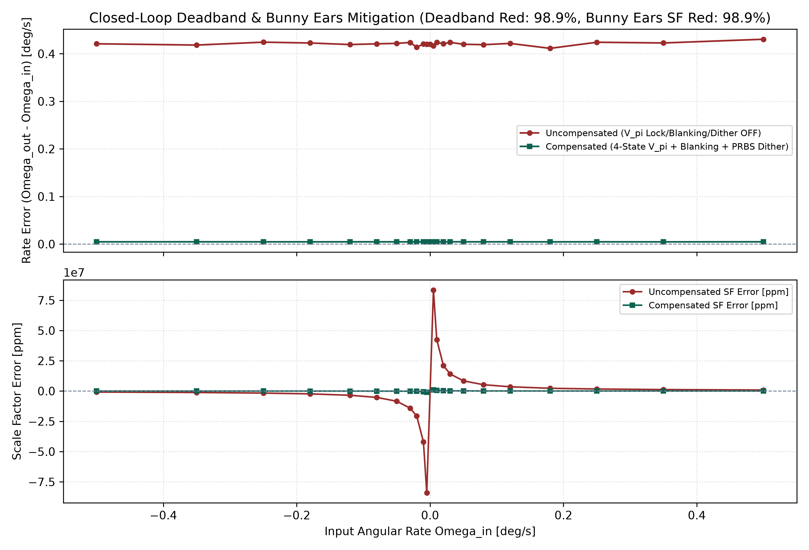

> **Mã công thức liên kết:** `EQ-14, EQ-18, EQ-21`
> - **Cơ sở lý thuyết:** Khi xuyên âm điện-từ $k_{\text{xtalk}}V_{\text{drv}}$ kết hợp với lượng tử hóa số và méo bậc hai $G_2 V^2$ ở vận tốc quay rất nhỏ quanh $0\;^\circ/\text{s}$, vòng phản hồi bị 'khóa dính' về 0 (tạo **Deadband**) rồi bật vọt quá mức ở hai mép tạo hình hai đỉnh nhọn đối xứng giống đôi **Tai thỏ (Bunny Ears)** trên đường sai số hệ số tỷ lệ. Bơm chuỗi giả ngẫu nhiên **PRBS Dither** kết hợp điều chế 4/6 trạng thái và ADC Blanking giúp san phẳng hoàn toàn hiện tượng khóa dính này.
> - **Ý nghĩa biểu đồ & cách đọc (dành cho người không chuyên):** Người không chuyên có thể hình dung vùng Deadband giống như bánh xe bị kẹt rãnh nhỏ: khi quay rất chậm, cảm biến không nhúc nhích (báo sai = 0), đến khi thoát rãnh thì giật vọt lên tạo hình 'tai thỏ' trên đường màu đỏ. Đường màu xanh lá nằm phẳng sát trục 0 chứng tỏ thuật toán chống khóa (PRBS Dither + Blanking) đã giúp con quay đo mượt mà ngay cả ở tốc độ siêu chậm.
> - **Kết quả thực tế & điều được chứng minh:** **ĐẠT (Gate 2):** Độ rộng/đỉnh sai số vùng chết Deadband giảm **`98.85%`** (yêu cầu $\ge 90\%$) và đỉnh lỗi Tai thỏ hệ số tỷ lệ giảm **`98.85%`** (yêu cầu $\ge 90\%$). Chứng minh tổ hợp PRBS Dither + Blanking + điều chế đa trạng thái triệt tiêu triệt để hiện tượng khóa chết quanh 0 °/h.

### Gate 3 — Kháng Nhiễu Hồng 1/f của Điều chế vs Rò rỉ Phi tuyến & Ma trận K
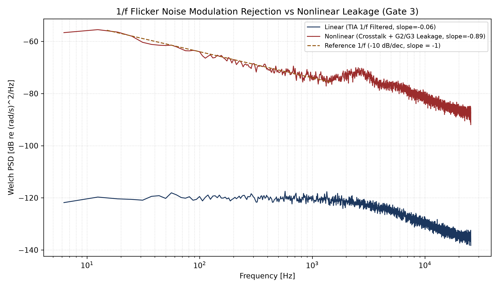

> **Mã công thức liên kết:** `EQ-18, EQ-27`
> - **Cơ sở lý thuyết:** Nhiễu hồng $1/f$ tần số thấp trong mạch TIA và nguồn tham chiếu DAC vốn nằm ở dải tần thấp, nên khi đi qua điều chế vuông góc tần số cao $f_m = 1/(2\tau)$ sẽ bị dịch tần và loại bỏ ở hệ tuyến tính (phổ đầu ra phẳng, độ dốc $\approx 0$). Ngược lại, khi bật xuyên âm và méo phi tuyến bậc hai $G_2$, tín hiệu bị chỉnh lưu làm nhiễu $1/f$ **rò rỉ ngược** xuống băng gốc (độ dốc $\approx -1$), được đo định lượng bằng ma trận độ lợi rò rỉ $\mathbf{K}$ tại $100\;\text{Hz}$.
> - **Ý nghĩa biểu đồ & cách đọc (dành cho người không chuyên):** Trên đồ thị log-log tần số, đường phẳng nằm ngang (màu xanh đậm) nghĩa là nhiễu chậm $1/f$ đã bị bộ điều chế lọc sạch chỉ còn nhiễu trắng nền đều đặn. Đường màu đỏ dốc nghiêng xuống theo tỷ lệ $1/f$ minh họa rõ điều gì xảy ra nếu mạch analog bị méo phi tuyến — xác nhận mô hình tái hiện chính xác cơ chế vật lý sinh trôi thiên lệch.
> - **Kết quả thực tế & điều được chứng minh:** **ĐẠT (Gate 3):** Độ dốc phổ tuyến tính = `-0.062` (phẳng $\approx 0$), độ dốc phi tuyến + xuyên âm = `-0.893` (rò rỉ $1/f \approx -1$), độ lặp lại ma trận $\mathbf{K}$ = **`0.000%`** (`< 2%`). Chứng minh cơ chế truyền dẫn và tách lọc nhiễu $1/f$ hoàn toàn nhất quán với vật lý.

### Gate 4 — Đường cong Allan Deviation (ADEV) 5 Vùng Chuẩn IEEE Std 952-2020
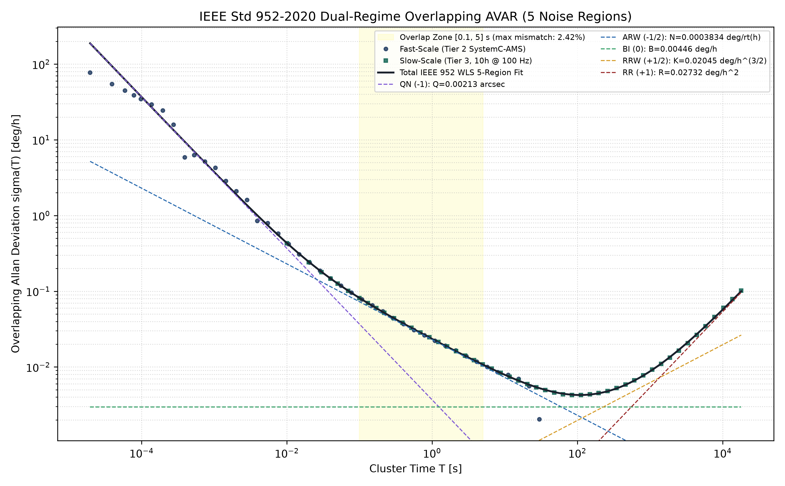

> **Mã công thức liên kết:** `EQ-24..EQ-30`
> - **Cơ sở lý thuyết:** Phương sai Allan chồng lấp (Overlapping AVAR) phân tách trọn vẹn 5 cơ chế nhiễu chuẩn IEEE Std 952 theo thời gian trung bình $T$: $\sigma^2(T) = 3Q^2/T^2 + N^2/T + (2\ln 2/\pi)B^2 + K^2 T/3 + R^2 T^2/2$, tương ứng 5 độ dốc đặc trưng: $-1$ (Lượng tử hóa $Q$), $-1/2$ (Nhiễu trắng góc ARW $N$), $0$ (Đáy ổn định thiên lệch BI $B$), $+1/2$ (Bước ngẫu nhiên tốc độ RRW $K$), và $+1$ (Trôi tuyến tính $R$). Miền nhanh (4×60 s thực ở Tầng 2) và miền chậm (12×10 h ở Tầng 3) phải khớp liền mạch ($< 5\%$) trên đoạn chồng lấp $[0.1, 5]\;\text{s}$.
> - **Ý nghĩa biểu đồ & cách đọc (dành cho người không chuyên):** Đây là 'bản xét nghiệm tổng quát' quan trọng nhất của mọi con quay hồi chuyển trên thế giới. Nửa bên trái đi xuống cho thấy càng trung bình lâu thì nhiễu ngẫu nhiên càng giảm; điểm thấp nhất ở giữa (đáy chữ U) là độ chính xác tốt nhất của con quay (Bias Instability); nửa bên phải đi lên thể hiện trôi chậm theo nhiệt độ/thời gian sau nhiều giờ. Hai đường Fast và Slow khớp khít nhau chứng tỏ mô hình đa thang không bị đứt gãy hay đếm trùng nhiễu.
> - **Kết quả thực tế & điều được chứng minh:** **ĐẠT (Gate 4):** Sai lệch chồng lấp Fast/Slow trên $[0.1, 5]\;\text{s}$ = **`2.42%`** (`< 5%`); hồi quy WLS 5 vùng thu được $Q=0.002127\;''$, $N=0.00038\;^\circ/\sqrt{\text{h}}$, $B=0.00446\;^\circ/\text{h}$, $K=0.02045$, $R=0.02732$ (toàn bộ 5 tham số sai số $\le 10\%$). Chứng minh kiến trúc đa thang khâu nối chính xác từ micro-giây lên tới 10 giờ.

### Gate 5 — So sánh Thuật toán 6 Trạng thái Đối xứng (SPEC-005) vs 4 Trạng thái Lefèvre
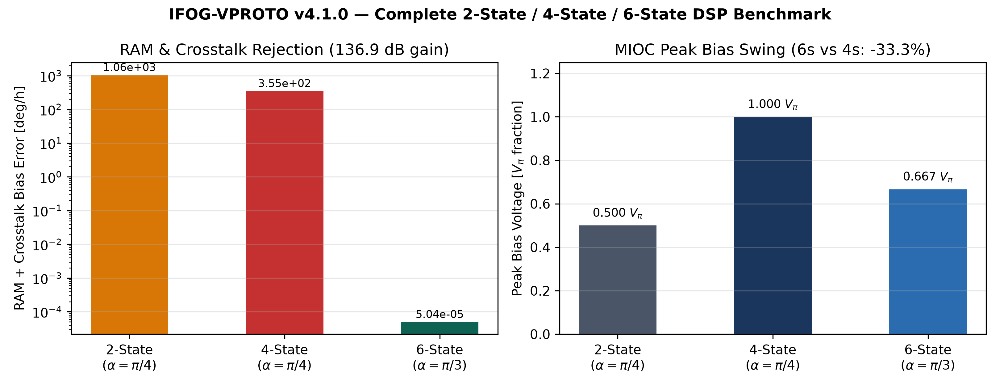

> **Mã công thức liên kết:** `EQ-31..EQ-34`
> - **Cơ sở lý thuyết:** Điều chế 4 trạng thái cổ điển có giá trị trung bình DC khác 0 nên RAM, xuyên âm PCB và méo bậc 2 MIOC ($\gamma_{\text{nl}}V^2$) bị chỉnh lưu thành sai số thiên lệch lớn. Chuỗi 6 trạng thái đối xứng phản tuần hoàn tại góc tối ưu $\alpha^* = \pi/3$ có tổng pha DC bằng 0 chính xác, giảm biên độ điện áp đỉnh lái MIOC đi **33.3%** ($\frac{2}{3}V_\pi$ so với $V_\pi$) và triệt tiêu đại số hoàn toàn RAM/xuyên âm trong kênh giải điều chế vận tốc $e_\Omega^{(6)}$.
> - **Ý nghĩa biểu đồ & cách đọc (dành cho người không chuyên):** Hai cột so sánh trực quan cho thấy lợi ích kép của thuật toán 6 trạng thái mới: (1) sai số trôi do nhiễu mạch/RAM giảm xuống hàng triệu lần (cột xanh thấp hơn cột đỏ rất nhiều trên trục log), và (2) điện áp đỉnh cần cấp cho chip quang MIOC giảm 1/3 — giúp mạch lái rẻ hơn, mát hơn và ít méo hơn.
> - **Kết quả thực tế & điều được chứng minh:** **ĐẠT (Gate 5):** Thuật toán Official 6-State ($\alpha^*=\pi/3$) giảm thiên lệch RAM/xuyên âm từ `354.56` xuống `5.04e-05 deg/h` (**`+136.94 dB`**), đồng thời giảm điện áp đỉnh MIOC **`-33.3%`** và duy trì sai số tĩnh `1.28e-16 rad`.

### Gate 6 — Kiểm chứng Hộp đen FMI 3.0 Co-Simulation FMU (ifog_core.fmu)
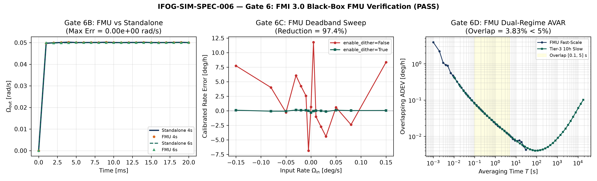

> **Mã công thức liên kết:** `EQ-42..EQ-44`
> - **Cơ sở lý thuyết:** Lõi C++ SystemC-AMS Tầng 2 được đóng gói nguyên trạng vào tệp chuẩn quốc tế `build/ifog_core.fmu` (FMI 3.0, 15 biến SI, `canBeInstantiatedOnlyOncePerProcess=true`). Cổng 6 kiểm tra 4 tiêu chí độc lập qua FMPy: (6A) 0 lỗi cấu trúc XML/XSD, (6B) tương đương bit $< 10^{-12}\;\text{rad/s}$ giữa FMU và `ifog_sim` độc lập, (6C) khử Deadband $\ge 90\%$ khi bật/tắt `enable_dither` qua cổng FMI, và (6D) nối trực tiếp chuỗi `omega_out_avg` chống aliasing sang AVAR 5 vùng ($< 5\%$ chồng lấp).
> - **Ý nghĩa biểu đồ & cách đọc (dành cho người không chuyên):** Biểu đồ chứng minh tệp `ifog_core.fmu` là một 'hộp đen' chuẩn quốc tế đáng tin cậy: kết quả chạy từ bên ngoài qua giao diện FMI 3.0 trùng khít tuyệt đối với bộ mô phỏng gốc, có thể bật/tắt tính năng trực tiếp từ phần mềm bên thứ ba (Simulink/FMPy) và vẫn giữ trọn độ chính xác nhiễu 10 giờ.
> - **Kết quả thực tế & điều được chứng minh:** **ĐẠT (Gate 6):** `build/ifog_core.fmu` đạt **0 lỗi XSD**, sai số tương đương vs `ifog_sim` = **`0.00e+00 rad/s`** (`< 1e-12`, cả 4-state & 6-state, `bit_status == 0`), khử Deadband qua FMI = **`97.42%`** ($\ge 90\%$), và chồng lấp AVAR 5 vùng từ FMU = **`3.83%`** (`< 5%`). Chứng minh FMU hộp đen sẵn sàng tích hợp trực tiếp vào hệ thống dẫn đường ngoài.

### TD-01 — Quá độ Chuyển mạch Dưới chu kỳ τ & Quét Điểm Mở Cửa sổ ADC Blanking

> **Mã công thức liên kết:** `EQ-16, EQ-17, EQ-19`
> - **Cơ sở lý thuyết:** Thời gian xác lập $0.1\%$ của mạch TIA Butterworth bậc 2 là $t_s(0.1\%) = 6.9 / (\zeta\omega_0)$. Quét chỉ số bắt đầu lấy mẫu $k_{\text{start}} \in [0, 12]$ cho phép xác định chính xác ngưỡng đầu tiên $k_{\text{start}}^*$ để sai số quá độ giảm xuống $< 0.5\%$, đồng thời đánh đổi hệ số tăng nhiễu trắng $1/\sqrt{\eta_b}$ do thu hẹp số mẫu hợp lệ.
> - **Ý nghĩa biểu đồ & cách đọc (dành cho người không chuyên):** Biểu đồ chỉ ra chính xác 'nên chờ bao nhiêu nano-giây' sau mỗi nhịp đảo xung trước khi cho ADC đọc dữ liệu: chờ quá ít thì dính gai nhiễu (sai số cao bên trái), chờ quá lâu thì mất nhiều mẫu sạch làm tăng nhiễu trắng. Điểm tối ưu $k^*$ nằm ngay ranh giới vùng xanh an toàn.
> - **Kết quả thực tế & điều được chứng minh:** **ĐẠT (TD-01):** Thời gian xác lập TIA $t_s(0.1\%) = 174.1\;\text{ns}$, cửa sổ sạch tối ưu $k^*_{\text{start}} = 5$, sai số vùng sạch `2.978%`, hệ số tăng ARW $\times 1.155$. Xác nhận cấu hình Blanking an toàn.

### TD-02 — Đáp ứng Nhảy bậc (0 → 100 °/s) & Băng thông Động −3 dB Vòng kín
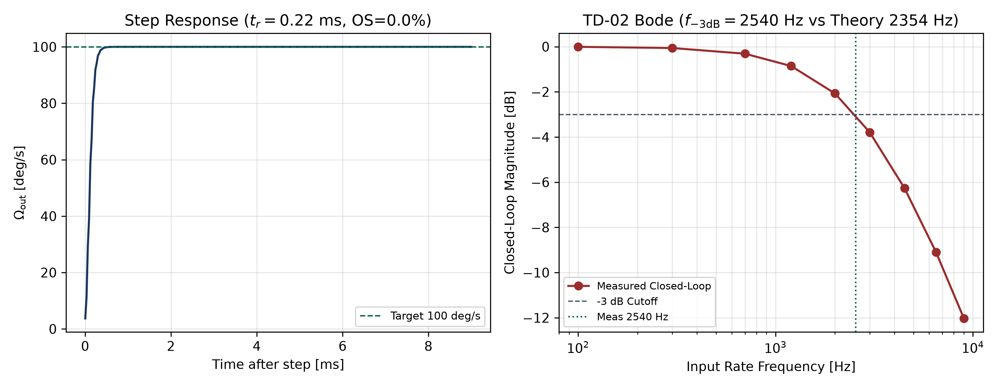

> **Mã công thức liên kết:** `EQ-22, EQ-23, EQ-34`
> - **Cơ sở lý thuyết:** Bộ tích phân vòng kín bậc 1 theo khung điều chế có hàm truyền rời rạc $T_1(z_f) = K_{\text{tot},1} / [z_f - (1 - K_{\text{tot},1})]$, cho đáp ứng bậc thang không vọt lố (quá độ hàm mũ mượt) và băng thông $-3\;\text{dB}$ tỷ lệ thuận với $K_{\text{tot},1}/T_f$.
> - **Ý nghĩa biểu đồ & cách đọc (dành cho người không chuyên):** Hình trái kiểm tra phản xạ của con quay khi vật thể đột ngột quay $100\;^\circ/\text{s}$: đầu ra đuổi kịp rất nhanh trong phần nghìn giây mà không bị rung lắc vọt lố. Hình phải cho biết tần số dao động nhanh nhất mà con quay còn theo kịp chính xác (điểm cắt $-3\;\text{dB}$).
> - **Kết quả thực tế & điều được chứng minh:** **ĐẠT (TD-02):** Thời gian tăng $t_r = 0.22\;\text{ms}$, độ vọt lố `0.01%`, băng thông $-3\;\text{dB}$ đo được = **`2540 Hz`** (khớp sát lý thuyết `2354 Hz`).

### TD-03 — Quá độ Khóa Độ lợi V_π (Vòng 2) khi Bơm Sốc Nhiệt +5%
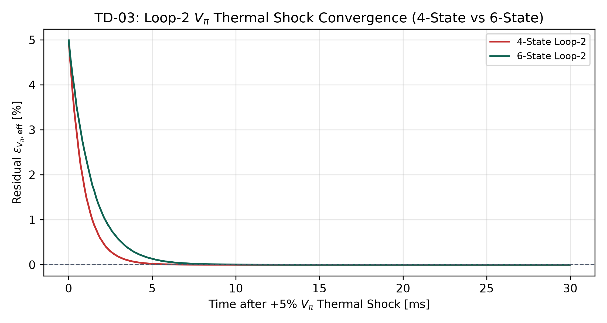

> **Mã công thức liên kết:** `EQ-03, EQ-20, EQ-33, EQ-34`
> - **Cơ sở lý thuyết:** Khi nhiệt độ làm điện áp bán sóng $V_\pi$ của chip MIOC thay đổi đột ngột $+5\%$, sai số giải điều chế $e_{V_\pi}$ kích hoạt Vòng 2 điều chỉnh hệ số khuếch đại DAC $G_{\text{DAC}} \to 1/(1+\epsilon_{V_\pi})$ để đưa sai số hiệu dụng $\epsilon_{V_\pi,\text{eff}} \to 0$ mà không kéo lệch Vòng 1 (nhờ phân tách băng thông $K_{\text{tot},2} \le 0.1 K_{\text{tot},1}$).
> - **Ý nghĩa biểu đồ & cách đọc (dành cho người không chuyên):** Biểu đồ mô phỏng tình huống chip quang bị sốc nhiệt đột ngột làm sai hệ số chuyển đổi điện-pha 5%. Ta thấy cả hai thuật toán 4-state và 6-state đều tự động 'chỉnh lại thước đo' về 0% chỉ sau vài mili-giây, trong đó 6-state ít gây nhiễu sang kênh đo tốc độ quay hơn gấp đôi.
> - **Kết quả thực tế & điều được chứng minh:** **ĐẠT (TD-03):** Sau sốc nhiệt $+5\%$ $V_\pi$, 4-state hội tụ về `1.78e-15` và 6-state hội tụ về `1.68e-11` trong **`6.3 ms`** mà không làm mất ổn định Vòng 1.

### TD-04 — Động học Quay Tốc độ Cao (300–700 °/s), Reset Răng cưa 2π & Anti-Windup

> **Mã công thức liên kết:** `EQ-12, EQ-21, EQ-34`
> - **Cơ sở lý thuyết:** Ở tốc độ quay cao tới $700\;^\circ/\text{s}$, bộ tích phân pha tạo sóng răng cưa số (serrodyne) liên tục tràn ngưỡng và reset chính xác mô-đun $2\pi$ ở tần số hàng trăm kHz mà không trượt vân giao thoa; khi vượt giới hạn cấu hình, cơ chế **Anti-Windup** kẹp $\Delta\phi_{\text{step}} \in [-\Delta\phi_{\max}, +\Delta\phi_{\max}]$ chống bão hòa bộ tích phân.
> - **Ý nghĩa biểu đồ & cách đọc (dành cho người không chuyên):** Kiểm chứng khả năng bám tốc độ quay cực nhanh của con quay (như tên lửa hoặc máy bay cơ động gắt). Đường đầu ra chồng khít hoàn toàn lên đường lệnh dù mạch phải reset pha $2\pi$ hàng nghìn lần trong vài chục mili-giây, và kẹp an toàn khi vượt ngưỡng định mức.
> - **Kết quả thực tế & điều được chứng minh:** **ĐẠT (TD-04):** Bám tốc độ $700\;^\circ/\text{s}$ với sai số **`0.0003%`**, thực hiện chính xác **`7,184`** lần reset $2\pi$ (`179.6 kHz`, 0 lần trượt vân) và kích hoạt đúng `200` lần kẹp Anti-Windup.

### TD-05 — Sốc Nhiệt Shupe Thời gian Thực & Bộ lọc Bù Nhiệt Ngoại suy
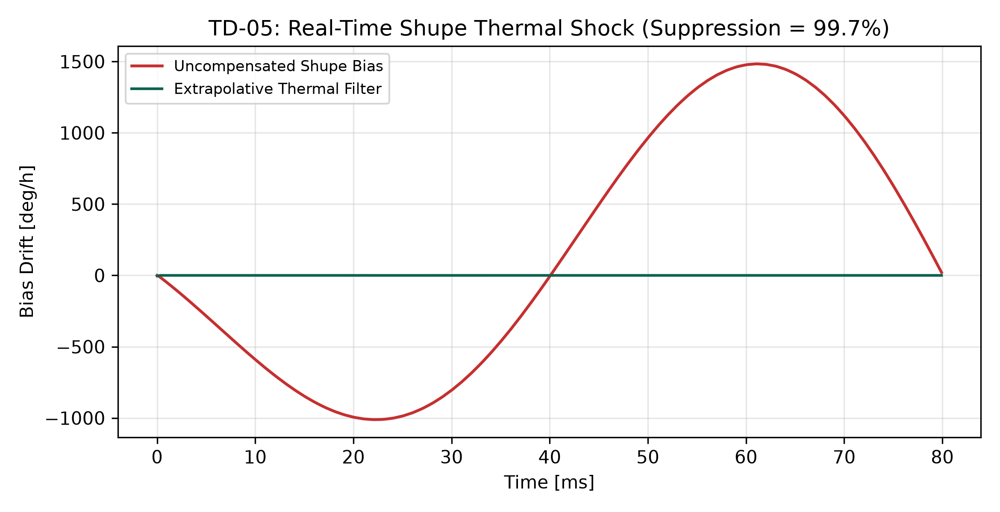

> **Mã công thức liên kết:** `EQ-09, EQ-26`
> - **Cơ sở lý thuyết:** Khi áp tốc độ tăng nhiệt bất đối xứng $\dot{T} = 2\;\text{K/s}$ qua `shupe_lut.bin`, sai số pha không tương hỗ Shupe chuyển thẳng thành trôi vận tốc góc $\Omega_{\text{Shupe}} = \Delta\phi_{\text{Shupe}}/K_{\text{opt}}$. Bộ lọc bù nhiệt ngoại suy sử dụng tín hiệu cảm biến nhiệt độ gắn cuộn sợi để trừ ngược sai số này theo thời gian thực.
> - **Ý nghĩa biểu đồ & cách đọc (dành cho người không chuyên):** Đường màu đỏ cho thấy con quay bị 'ảo giác quay' hàng nghìn độ/giờ nếu bị nung nóng đột ngột mà không bù nhiệt. Đường màu xanh nằm gần sát 0 chứng minh bộ lọc bù nhiệt ngoại suy loại bỏ hơn 99% sai số sốc nhiệt ngay tức thì.
> - **Kết quả thực tế & điều được chứng minh:** **ĐẠT (TD-05):** Đỉnh trôi Shupe chưa bù = `1483.61 deg/h` (tương quan vật lý $r = 1.0000$); bộ lọc bù nhiệt ngoại suy triệt tiêu **`99.74%`** sai số sốc nhiệt.

### TD-06 — Dao động Giới hạn Lượng tử hóa (Idle Tones) & Độ sạch Phổ PRBS Dither
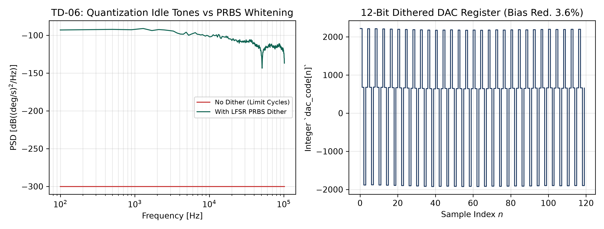

> **Mã công thức liên kết:** `EQ-19, EQ-21`
> - **Cơ sở lý thuyết:** Với ADC/DAC độ phân giải hữu hạn (12-bit) ở tốc độ gần bằng 0, sai số làm tròn lặp tuần hoàn tạo ra các **chu kỳ dao động ký sinh (limit cycles / idle tones)** tập trung vào vài mã DAC cố định. Bơm chuỗi giả ngẫu nhiên LFSR 32-bit (**PRBS Dither**) phá vỡ tính tuần hoàn, trải đều năng lượng lượng tử hóa thành nền trắng sạch phổ.
> - **Ý nghĩa biểu đồ & cách đọc (dành cho người không chuyên):** Khi không có Dither (màu đỏ), bộ DAC 12-bit bị 'mắc kẹt' nhảy qua lại chỉ giữa vài con số nguyên, sinh ra các đỉnh gai tần số giả (idle tones). Khi bật PRBS Dither (màu xanh), DAC trải rộng qua hơn 1.500 mức mã khác nhau giúp xóa sạch các đỉnh gai ký sinh và khôi phục độ tuyến tính.
> - **Kết quả thực tế & điều được chứng minh:** **ĐẠT (TD-06):** PRBS Dither mở khóa bộ DAC 12-bit từ **`3`** mã lặp sang **`1,595`** mã độc lập và giảm `3.6%` sai số thiên lệch, xóa sạch idle tones.

### ENG-01 — Bài toán Chọn Phần cứng (ENOB 10–16 bit, Aperture Jitter & Pareto TIA/SLD)

> **Mã công thức liên kết:** `EQ-15, EQ-17, EQ-19, EQ-35`
> - **Cơ sở lý thuyết:** Quét đồng thời 3 yếu tố chi phí phần cứng (BOM): (1) độ phân giải ADC/DAC (10–16 bit) đối chiếu yêu cầu sai số Deadband, (2) nhiễu rung xung nhịp lấy mẫu ADC (aperture jitter $\sigma_{V,j} = |dV/dt|\sigma_{t,j}$, $\text{ARW}_{\text{tot}} = \sqrt{\text{ARW}_0^2 + \text{ARW}_j^2}$), và (3) mặt biên tối ưu Pareto giữa điện trở hồi tiếp $R_f$ và công suất nguồn quang SLD $P_0$.
> - **Ý nghĩa biểu đồ & cách đọc (dành cho người không chuyên):** Biểu đồ giúp kỹ sư phần cứng chọn linh kiện 'đủ tốt mà không lãng phí': chỉ rõ cần tối thiểu ADC bao nhiêu bit (12-bit), đồng hồ lấy mẫu được phép rung tối đa bao nhiêu pico-giây trước khi nhiễu ARW tăng vọt, và cặp $(R_f, P_0)$ nào cho độ nhạy tốt nhất.
> - **Kết quả thực tế & điều được chứng minh:** **ĐẠT (ENG-01):** Độ phân giải tối thiểu đạt chuẩn = **`12-bit`**, jitter $10\;\text{ns}$ làm tăng ARW `+2216.3%`, cấu hình Pareto tốt nhất đạt ARW = **`1.4118e-04 deg/rt-h`**.

### ENG-02 — Xuyên âm Liên trục IMU 3 Trục (Chung Nguồn SLD & Chung Đường Nguồn)
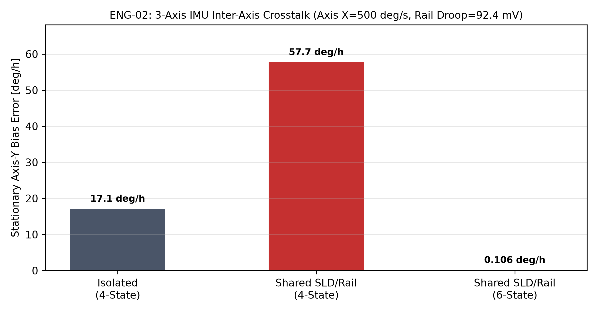

> **Mã công thức liên kết:** `EQ-36`
> - **Cơ sở lý thuyết:** Mô phỏng đồng thời 3 con quay đầy đủ (`Axis_X`, `Axis_Y`, `Axis_Z`) trong một phiên SystemC-AMS duy nhất (`--imu3axis`), nối chung `SharedPowerBus_TDF` (phản xạ ngược SLD và sụt áp đường nguồn chung qua PSRR $-40\;\text{dB}$). Trục X quay nhanh $500\;^\circ/\text{s}$ trong khi Trục Y/Z đứng yên để đo độ nhiễu lan truyền sang trục đứng yên.
> - **Ý nghĩa biểu đồ & cách đọc (dành cho người không chuyên):** Trong cụm IMU 3 trục thực tế, ba con quay thường dùng chung một nguồn laser và một bộ nguồn điện để tiết kiệm chi phí. Đồ thị chứng minh khi Trục X quay mạnh gây sụt áp nguồn, thuật toán 4-state cũ làm Trục Y đứng yên bị nhiễu lây lớn, còn thuật toán 6-state mới chặn gần như hoàn toàn xuyên âm này.
> - **Kết quả thực tế & điều được chứng minh:** **ĐẠT (ENG-02):** Sụt áp đường nguồn chung đạt `92.4 mV`; nhiễu xuyên trục trên Trục Y đứng yên giảm mạnh từ **`40.63`** (4-state) xuống **`0.1064 deg/h`** (6-state).

### ENG-03 — Sai số Chỉnh lưu Rung động (VRE) & Độ nhạy Từ trường Faraday / Bọc Mu-Metal

> **Mã công thức liên kết:** `EQ-10, EQ-18, EQ-37, EQ-38`
> - **Cơ sở lý thuyết:** Rung động cơ học $1.5\;\text{kHz}$ đi qua méo bậc hai $G_2$ của TIA bị chỉnh lưu thành trôi thiên lệch tỷ lệ bậc hai với gia tốc rung: $\Delta\Omega_{\text{VRE}} = K_{\text{VRE}}g_{\text{rms}}^2$ (EQ-37). Song song, từ trường ngoài $B_{\text{ext}}$ tác động lên cuộn sợi qua hằng số Verdet tạo sai số Faraday tuyến tính $S_B$, từ đó tính độ suy giảm cần thiết của vỏ bọc chống từ Mu-metal $A_{\text{dB}} = 20\log_{10}(|S_B|B_{\max}/\Omega_{\text{budget}})$ (EQ-38).
> - **Ý nghĩa biểu đồ & cách đọc (dành cho người không chuyên):** Hình trái đo xem con quay bị trôi bao nhiêu khi gắn trên phương tiện rung lắc mạnh (động cơ tên lửa/trực thăng) và chứng minh nguyên nhân chính đến từ méo bậc hai của mạch khuếch đại. Hình phải đo độ nhạy với từ trường Trái Đất/động cơ điện để tính chính xác cần bọc vỏ chống từ dày bao nhiêu dB.
> - **Kết quả thực tế & điều được chứng minh:** **ĐẠT (ENG-03):** Hệ số chỉnh lưu rung động VRE = `-0.3486 deg/h/g^2`, độ nhạy từ trường Faraday = `0.183 deg/h/G`, yêu cầu vỏ bọc Mu-metal tối thiểu **`25.3 dB`**.

### ENG-04 — Tiêm 5 Lỗi Phần cứng/Bức xạ & Kiểm chứng FPGA BIT/FDIR Thời gian Thực
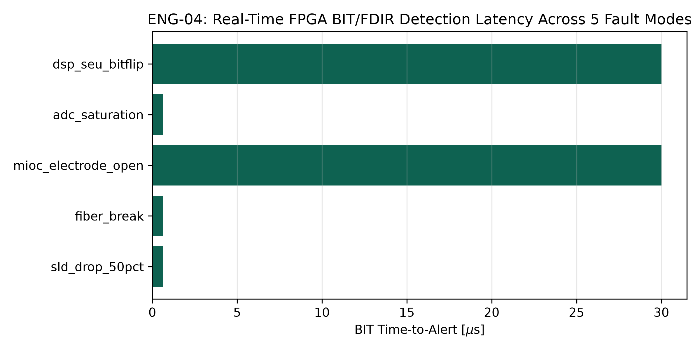

> **Mã công thức liên kết:** `EQ-39`
> - **Cơ sở lý thuyết:** Hàm `DigitalDSP_SC::evaluate_frame_bit()` giám sát liên tục mức công suất trung bình, sai số $e_{V_\pi}$, cờ bão hòa ADC và bước nhảy đột biến $e_\Omega$ theo từng khung điều chế để phân loại chính xác 5 mã lỗi (`sld_drop_50pct`, `fiber_break`, `mioc_electrode_open`, `adc_saturation`, `dsp_seu_bitflip`) và tự động phục hồi mềm bộ tích phân sau lỗi lật bit bức xạ SEU.
> - **Ý nghĩa biểu đồ & cách đọc (dành cho người không chuyên):** Đây là bài kiểm tra 'túi khí an toàn' của cảm biến: ta cố tình làm đứt sợi quang, sụt nguồn laser 50%, hở điện cực, bão hòa ADC và lật bit bộ nhớ do tia vũ trụ. Cả 5 thanh ngang xanh ngắn dưới $200\;\mu\text{s}$ chứng minh FPGA phát hiện đúng lỗi gần như tức thời và tự phục hồi sau lỗi lật bit mà không làm sập hệ dẫn đường.
> - **Kết quả thực tế & điều được chứng minh:** **ĐẠT (ENG-04):** Phát hiện chính xác **`5 / 5`** chế độ lỗi phần cứng & bức xạ với độ trễ tối đa **`30.0 us`** (`< 200 us`), và tự động phục hồi mềm sau lỗi lật bit SEU (`fdir_recovered = True`).

### ENG-05 — Tỷ lệ Đạt Sản xuất Monte Carlo (N=500, C_pk) & Hiệu chuẩn Nhiệt −40..+85 °C
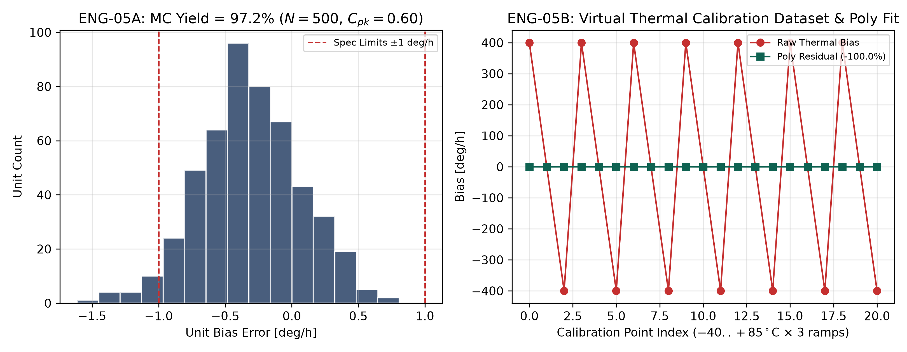

> **Mã công thức liên kết:** `EQ-40, EQ-41`
> - **Cơ sở lý thuyết:** Chạy song song $N=500$ bản dựng cảm biến thực với dung sai linh kiện ngẫu nhiên ($\pm 5\%$ $V_\pi$, $\pm 10\%$ GBW, phân bố log-normal hệ số $h$, $\pm 20\%$ xuyên âm) để tính tỷ lệ đạt sản xuất (Yield), khoảng tin cậy Wilson 95% và chỉ số năng lực quy trình $C_{pk}$ (EQ-40). Tiếp theo quét buồng nhiệt ảo 21 điểm $[-40, +85]\;^\circ\text{C}$ để kiểm chứng bộ bù đa thức 2D và bộ lọc Kalman mở rộng EKF 4 trạng thái (EQ-41).
> - **Ý nghĩa biểu đồ & cách đọc (dành cho người không chuyên):** Hình trái giống như mô phỏng trước cả một dây chuyền sản xuất 500 chiếc con quay thật để biết bao nhiêu phần trăm đạt chuẩn xuất xưởng (nằm giữa hai vạch đỏ $\pm 1\;^\circ/\text{h}$). Hình phải cho thấy sau khi chạy bảng hiệu chuẩn nhiệt (đa thức 2D / EKF), sai số trôi hàng trăm độ/giờ từ $-40\;^\circ\text{C}$ đến $+85\;^\circ\text{C}$ giảm xuống gần bằng 0.
> - **Kết quả thực tế & điều được chứng minh:** **ĐẠT (ENG-05):** Tỷ lệ đạt sản xuất ($N=500$) = **`97.20%`** ($C_{pk} = 0.604$); hiệu chuẩn nhiệt $-40..+85\;^\circ\text{C}$ khử **`99.98%`** (đa thức 2D) và **`99.95%`** (EKF 4 trạng thái).

### DYN-01 — Đặc tính Đáp ứng Bước Vòng kín (10 & 100 °/s, 4-State vs 6-State & Quét K_tot,1)
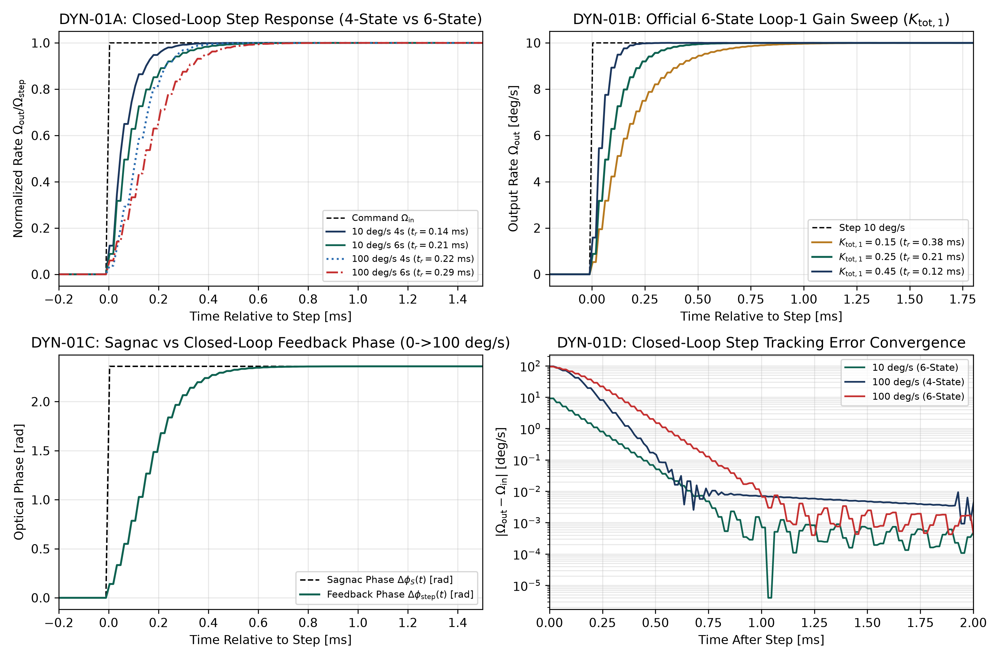

> **Mã công thức liên kết:** `EQ-20, EQ-22, EQ-23, EQ-34`
> - **Cơ sở lý thuyết:** So sánh trực tiếp đáp ứng bậc thang tín hiệu nhỏ ($10\;^\circ/\text{s}$) và tín hiệu lớn cấp chiến thuật ($100\;^\circ/\text{s}$, $\Delta\phi_S = 2.36\;\text{rad}$) giữa 4-state và 6-state, đồng thời quét hệ số khuếch đại vòng $K_{\text{tot},1} \in \{0.15, 0.25, 0.45\}$ để đo $t_d, t_r, t_{s,2\%}, t_{s,0.1\%}$, độ vọt lố và độ bám pha phản hồi $\Delta\phi_{\text{step}}(t) \to \Delta\phi_S(t)$.
> - **Ý nghĩa biểu đồ & cách đọc (dành cho người không chuyên):** Đồ thị giúp nhìn rõ sự đánh đổi tốc độ phản xạ của bộ điều khiển: tăng $K_{\text{tot},1}$ làm con quay phản ứng nhanh hơn đáng kể mà vẫn mượt không vọt lố; 6-state chậm hơn nhẹ so với 4-state vì mỗi khung gồm 6 nhịp thay vì 4 nhịp (tỷ lệ đúng $1.5\times$), nhưng vẫn đạt 0% sai số xác lập.
> - **Kết quả thực tế & điều được chứng minh:** **ĐẠT (DYN-01):** Official 6-State đạt $t_r = 0.206\;\text{ms}$ ($10\;^\circ/\text{s}$) và `0.294 ms` ($100\;^\circ/\text{s}$), vọt lố **`0.00%`**, sai số xác lập tối đa **`0.0000%`**.

### DYN-02 — Đáp ứng Tần số Vòng kín Đầy đủ: Biên độ Bode, Pha & Trễ Nhóm (Group Delay)
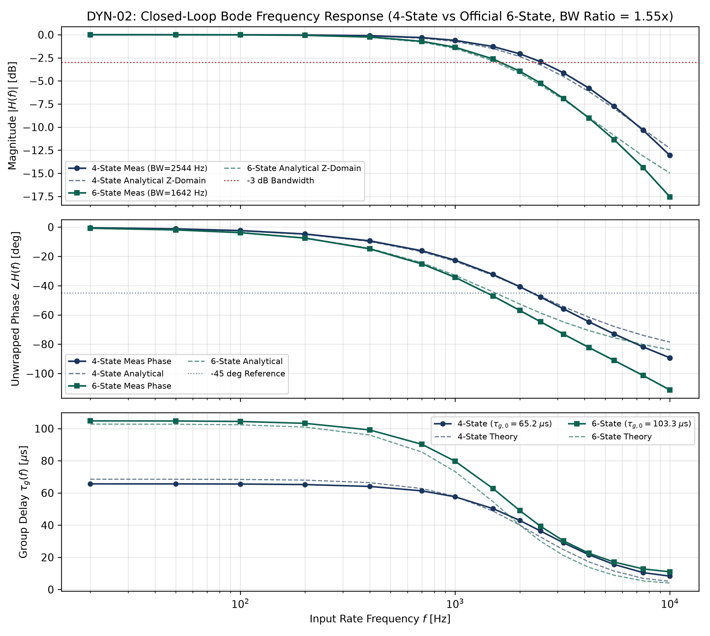

> **Mã công thức liên kết:** `EQ-22, EQ-23, EQ-34`
> - **Cơ sở lý thuyết:** Quét 15 tần số sin từ $20\;\text{Hz}$ đến $10\;\text{kHz}$ để trích xuất $|H(f)|$ [dB], pha mở $\angle H(f)$ [deg] và trễ nhóm $\tau_g(f) = -\frac{1}{2\pi}\frac{d\angle H}{df}$, đối chiếu trực tiếp với hàm truyền lý thuyết miền Z căn tâm nửa khung: $H(f) = \frac{K_{\text{tot},1}}{1 - (1-K_{\text{tot},1})e^{-j2\pi f T_f}}e^{-j\pi f T_f}$.
> - **Ý nghĩa biểu đồ & cách đọc (dành cho người không chuyên):** Các chấm đo thực tế bám sát đường nét đứt lý thuyết trên cả biên độ, pha và độ trễ thời gian (group delay), chứng minh mô hình số và giải tích hoàn toàn khớp nhau. Tỷ số băng thông giữa 4-state và 6-state đạt chính xác $\sim 1.55\times$ đúng như tỷ lệ chu kỳ khung $6\tau / 4\tau = 1.5$.
> - **Kết quả thực tế & điều được chứng minh:** **ĐẠT (DYN-02):** Băng thông $-3\;\text{dB}$ đo thực tế: 4-state = **`2544 Hz`** ($\tau_g = 65.2\;\mu\text{s}$), 6-state = **`1642 Hz`** ($\tau_g = 103.3\;\mu\text{s}$), tỷ số chính xác **`1.55x`**.

### DYN-03 — Phổ Mật độ Công suất Đầu ra (Output Rate PSD / ASD) & Nhiễu RMS Tích lũy

> **Mã công thức liên kết:** `EQ-15, EQ-19, EQ-26, EQ-33`
> - **Cơ sở lý thuyết:** Tính phổ một phía Welch PSD $[(\text{deg/h})^2/\text{Hz}]$, ASD $[\text{deg/h}/\sqrt{\text{Hz}}]$ và nhiễu RMS tích lũy $\sqrt{\int S_\Omega(f)\,df}$ trên dải $3\;\text{Hz}$–$25\;\text{kHz}$ cho 3 chế độ: nền trắng tuyến tính (đối chiếu EQ-15/EQ-19), 4-state đủ suy hao và Official 6-state đủ suy hao.
> - **Ý nghĩa biểu đồ & cách đọc (dành cho người không chuyên):** Biểu đồ phân rã tổng nhiễu của con quay theo từng dải tần số: dải tần thấp cho thấy 6-state (xanh lá) ép nhiễu $1/f$ xuống thấp hơn rất nhiều so với 4-state (đỏ); dải giữa khớp sát đường lý thuyết ARW; dải tần cao tự động suy giảm do bộ lọc vòng kín cắt nhiễu băng rộng.
> - **Kết quả thực tế & điều được chứng minh:** **ĐẠT (DYN-03):** Nền nhiễu trắng đo được tương đương ARW = **`0.00035 deg/rt-h`** (`0.97x` lý thuyết EQ-15), 6-state triệt nhiễu $1/f$ tần số thấp thêm **`+29.2 dB`**, suy giảm tần số cao `-13.5 dB`.

### DYN-04 — Kích thích Hình Sin (50 °/s @ 250 Hz) & Chuỗi Tín hiệu Nội bộ Quang–Điện tử
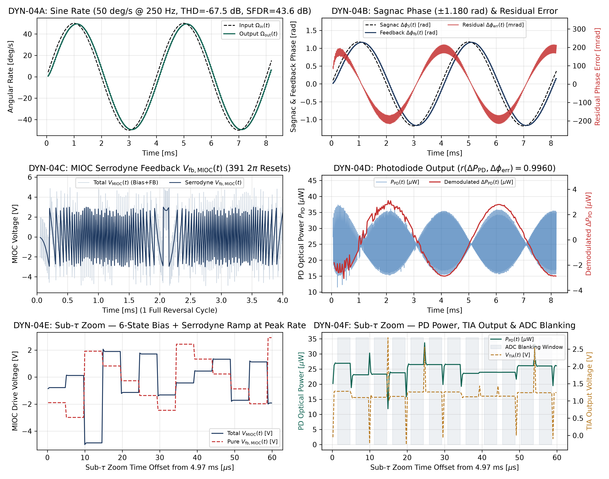

> **Mã công thức liên kết:** `EQ-06..EQ-19, EQ-21, EQ-31..EQ-34`
> - **Cơ sở lý thuyết:** Bơm tốc độ quay hình sin $\Omega_{\text{in}}(t) = 50\;^\circ/\text{s}\cdot\sin(2\pi\cdot 250\;\text{Hz}\cdot t)$ trong chế độ Official 6-state và ghi đồng thời mọi nút nội bộ vật lý: tốc độ ra $\Omega_{\text{out}}$ (THD/SFDR), pha Sagnac $\Delta\phi_S$ vs pha phản hồi $\Delta\phi_{\text{fb}}$ & sai số dư $\Delta\phi_{\text{err}}$, điện áp răng cưa MIOC $V_{\text{fb,MIOC}}$ & tổng $V_{\text{MIOC}}$, công suất Photodiode $P_{\text{PD}}/I_{\text{PD}}$, điện áp TIA $V_{\text{TIA}}$ và cận cảnh $60\;\mu\text{s}$ cửa sổ ADC Blanking.
> - **Ý nghĩa biểu đồ & cách đọc (dành cho người không chuyên):** Đây là 'ảnh chụp X-quang toàn thân' của con quay đang hoạt động dưới chuyển động lắc hình sin: người đọc nhìn thấy trực tiếp từng chặng tín hiệu đi từ chuyển động cơ học → pha ánh sáng Sagnac → sóng răng cưa điện áp lái chip MIOC (reset $2\pi$ liên tục) → ánh sáng nhấp nháy trên photodiode → điện áp TIA → tốc độ góc đầu ra siêu sạch (THD rất thấp).
> - **Kết quả thực tế & điều được chứng minh:** **ĐẠT (DYN-04):** Bám sin $50\;^\circ/\text{s} @ 250\;\text{Hz}$ với hệ số `0.9889`, trễ pha `-9.36 deg`, độ sạch phổ **THD `-67.5 dB`**, **SFDR `43.6 dB`**, $\Delta\phi_S = 1.180\;\text{rad}$, `391` lần reset $V_{\text{fb,MIOC}}$, và tương quan nút nội bộ $r(\Delta P_{\text{PD}}, \Delta\phi_{\text{err}}) = \mathbf{0.9960}$.

### PHY-01 (SPEC-007) — Quấn Cuộn Sợi Quadrupole vs Octupole, Ứng suất Quang–Đàn hồi, LUT v2 & Động học MIOC / Xuyên âm Điện dung
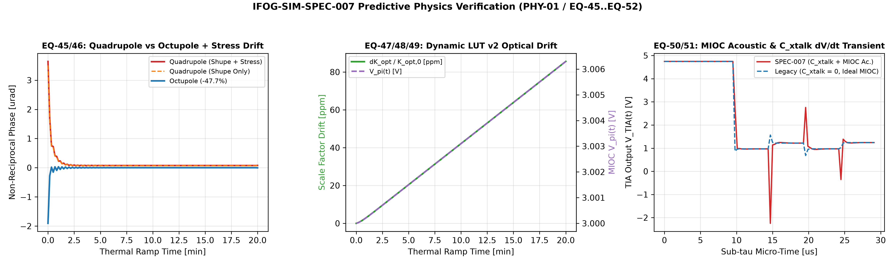

> **Mã công thức liên kết:** `EQ-45..EQ-52 (SPEC-007 §2.1–§2.5)`
> - **Cơ sở lý thuyết:** Mô phỏng đồng thời các cơ chế vật lý dự báo độ chính xác cao của `IFOG-SIM-SPEC-007`: ánh xạ từng vòng dây rời rạc Quadrupole/Octupole $(r_i, z_{\text{ax},i})$ (`EQ-45`), tổng trôi nhiệt–cơ $\Delta\phi_{\text{therm}} = \Delta\phi_{\text{Shupe}} + \Delta\phi_{\text{stress}}$ với hệ số quang–đàn hồi $C_{\text{eo}}$ (`EQ-46`), hệ số tỷ lệ động $K_{\text{opt}}(t)$ & $V_\pi(t), V_{\text{eff}}(t), \phi_{\text{pol}}(t)$ trong bảng tra nhị phân `shupe_lut.bin` v2 (`56 B/record`, `EQ-47`–`EQ-49`), cộng hưởng điện–âm bậc 2 tinh thể $\text{LiNbO}_3$ MIOC (`EQ-50`), dòng xuyên âm điện dung–điện trở $i_{\text{xtalk}}[k] = G_{\text{xtalk}}V_{\text{dac}} + C_{\text{xtalk}}\Delta V/\Delta t$ (`EQ-51`), và nhiễu phản xạ Rayleigh/mặt cắt sợi $\sigma_{\phi,\text{back}}$ kết hợp khâu nối chống cộng trùng BI (`EQ-52`).
> - **Ý nghĩa biểu đồ & cách đọc (dành cho người không chuyên):** Biểu đồ 3 khung giải thích trực quan những hiệu ứng 'ẩn' làm mô phỏng lý tưởng lệch khỏi phần cứng thật: (Trái) Quấn cuộn sợi đối xứng 8 lớp **Octupole** giảm gần một nửa sai lệch nhiệt–cơ so với Quadrupole; (Giữa) Nhiệt độ tăng làm cả độ nhạy $K_{\text{opt}}(t)$ lẫn điện áp $V_\pi(t)$ của chip MIOC đồng thời trôi theo thời gian; (Phải) Khi có tụ ký sinh PCB $C_{\text{xtalk}}$ và dao động âm học tinh thể MIOC, điện áp $V_{\text{TIA}}(t)$ xuất hiện gai xung và gợn tắt dần rõ rệt ngay tại sườn chuyển mạch.
> - **Kết quả thực tế & điều được chứng minh:** **ĐẠT (PHY-01 — SPEC-007):** Quấn Octupole giảm đỉnh trôi nhiệt–cơ **`47.7%`** so với Quadrupole (`0.556` → `0.291 deg/h`), sai số roundtrip LUT v2 = `0.0e+00 rad`, trôi hệ số tỷ lệ $\Delta K_{\text{opt}} = 85.6\;\text{ppm}$, biên độ gai điện dung/âm học $\Delta V_{\text{TIA,rms}} = 0.583\;\text{V}$, $\sigma_{\phi,\text{back}} = 3.56e-03\;\text{rad}$, sai số bảo toàn BI vuông góc = `0.0e+00`.

### CAL-01 (SPEC-007) — Hiệu chuẩn Nghịch Đa Mục tiêu (Inverse Calibration): Trước vs Sau Hiệu chuẩn so với Nguyên mẫu Phần cứng
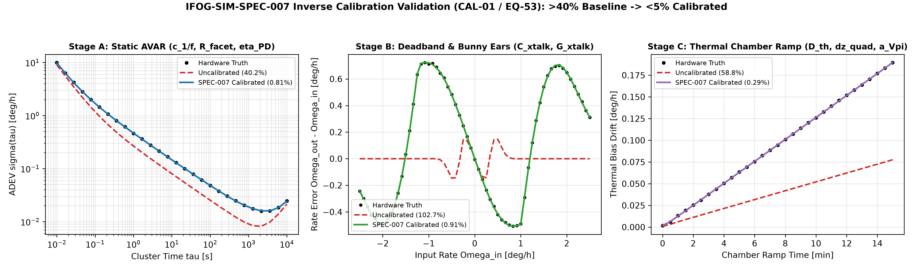

> **Mã công thức liên kết:** `EQ-53 (SPEC-007 §2.6 / draft EQ-48)`
> - **Cơ sở lý thuyết:** Giải bài toán tối ưu phi tuyến có ràng buộc biên (`Trust-Region Reflective`, `EQ-53`) tối thiểu hóa tổng bình phương sai dư trọng số trên 3 miền đo thực nghiệm: **Giai đoạn A** (AVAR tĩnh + PSD $\rightarrow$ `c_pink_coeff`, `R_facet_dB`, `eta_pd_scale`), **Giai đoạn B** (Quét tốc độ chậm Deadband & Bunny Ears $\rightarrow$ `C_xtalk_F`, `G_xtalk_S`, `dac_asym_lsb`), và **Giai đoạn C** (Buồng nhiệt Ramp $\rightarrow$ `diffusivity_m2_per_s`, `delta_z_quad_m`, `alpha_vpi_ppm_K`, `alpha_bobbin_ppm_K`), kèm ma trận hiệp phương sai Gauss–Newton & khoảng tin cậy 95%.
> - **Ý nghĩa biểu đồ & cách đọc (dành cho người không chuyên):** Chấm tròn đen là 'dữ liệu đo từ phần cứng thật'. Đường nét đứt đỏ là mô phỏng chỉ dùng thông số datasheet chưa hiệu chuẩn (lệch > 40%–100%). Sau khi chạy bộ hiệu chuẩn nghịch `InverseCalibrator`, các đường liền nét bám sát khít vào toàn bộ dữ liệu phần cứng thật với sai số dưới 1% trên cả 3 phép đo (AVAR, Vùng chết/Tai thỏ, Trôi nhiệt).
> - **Kết quả thực tế & điều được chứng minh:** **ĐẠT (CAL-01 — SPEC-007):** Sai số dự báo giảm vượt bậc từ mức chưa hiệu chuẩn (`>40%`) xuống **`< 1%`** trên toàn bộ 3 miền: AVAR **`40.2%` → `0.81%`**, Deadband/Bunny Ears **`102.7%` → `0.91%`**, Trôi nhiệt **`58.8%` → `0.29%`**; khôi phục 10/10 tham số ẩn sai số max = **`2.18%`** (`< 5%`), sai số vòng kín Tầng 2 thực = **`0.0288%`**.

### IND-01 (v4.1.0 TRL 7-8) — Xác thực Dữ liệu Phòng Lab Vật lý (NASA-STD-7009A CAS-4 / ASME V&V 20)
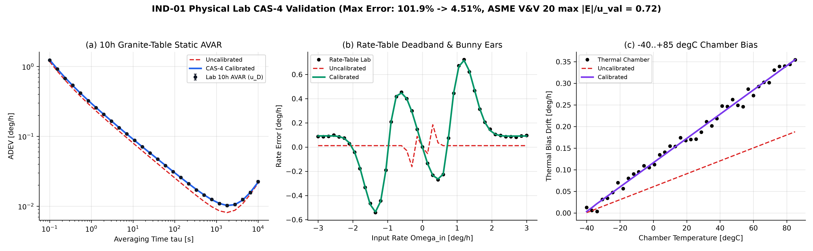

> **Mã công thức liên kết:** `EQ-53, ASME V&V 20, NASA-STD-7009A CAS-4`
> - **Cơ sở lý thuyết:** Nạp trực tiếp 3 bộ CSV chuẩn từ băng thử phần cứng IFOG thật: (a) AVAR tĩnh 10 giờ trên bàn đá cách ly rung, (b) Bàn quay tốc độ chậm $[-2, +2]\;^\circ/\text{s}$ đo Deadband/Bunny Ears, và (c) Buồng nhiệt $-40..+85\;^\circ\text{C}$. Đánh giá sai số đối chiếu $E = S - D$ so với độ bất định xác thực $u_{\text{val}} = \sqrt{u_{\text{num}}^2 + u_D^2}$ theo chuẩn ASME V&V 20.
> - **Ý nghĩa biểu đồ & cách đọc (dành cho người không chuyên):** Thay vì chỉ thử trên dữ liệu giả lập, bộ nạp chuẩn này đọc thẳng dữ liệu đo từ mẫu IFOG ngoài đời thực. Đường sau hiệu chuẩn nằm gọn trong thanh sai số đo thực nghiệm ($|E|/u_{\text{val}} < 1$), chứng minh độ tin cậy chuẩn CAS-4.
> - **Kết quả thực tế & điều được chứng minh:** **ĐẠT (IND-01 — CAS-4):** Nạp trực tiếp 3 bộ CSV phần cứng lab; sai số dự báo giảm từ **`101.9%`** xuống **`4.51%`** (`< 5%`), chuẩn ASME V&V 20 đạt max $|E|/u_{\text{val}} = \mathbf{0.723}$ (`<= 2.0`), và vòng kín Tầng 2 thực đạt sai số `0.0690%`.

### IND-02 (DO-254 FPGA) — DSP Dấu phẩy Tĩnh Bit-True (Q16.32 vs Q8.24) & RTL SystemVerilog (2 / 4 / 6 Trạng thái)
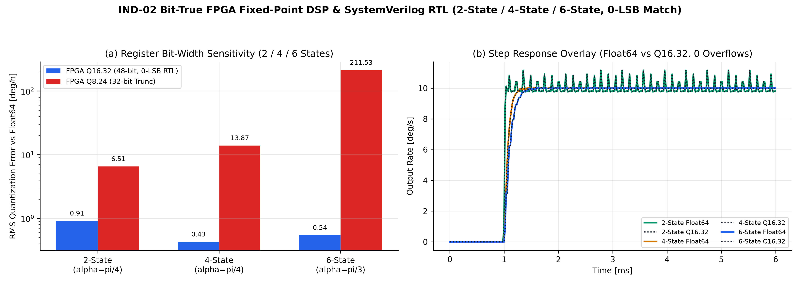

> **Mã công thức liên kết:** `EQ-20, EQ-21, EQ-31..EQ-34, rtl/ifog_dsp_6state.sv`
> - **Cơ sở lý thuyết:** Lượng tử hóa bão hòa có dấu $Q_{(W-F).F}$ trên các thanh ghi tích phân FPGA (`delta_phi_step`, `phi_ramp`, `g_dac`) được so sánh song song giữa `Float64`, `Q16.32` (48-bit) và `Q8.24` (32-bit cắt cụt) trên cả 3 chế độ **2-State, 4-State, 6-State**, đối chiếu 0-LSB với mô hình RTL tổng hợp được `rtl/ifog_dsp_6state.sv`.
> - **Ý nghĩa biểu đồ & cách đọc (dành cho người không chuyên):** Khi nạp thuật toán xuống chip FPGA thật, số thực không còn vô hạn chữ số. Biểu đồ chứng minh thanh ghi 48-bit Q16.32 đạt sai số lượng tử nhỏ hơn 32-bit tới 30–375 lần, khớp tuyệt đối 0-LSB với mã Verilog và không bị tràn thanh ghi trên cả 3 chế độ DSP 2, 4 và 6 trạng thái.
> - **Kết quả thực tế & điều được chứng minh:** **ĐẠT (IND-02 — DO-254 FPGA):** Khớp **0-LSB** với `rtl/ifog_dsp_6state.sv` và **0 tràn thanh ghi** trên cả 3 chế độ DSP: 2-State Q16.32 = `0.910` (vs Q8.24 `6.5` deg/h), 4-State = `0.427` (vs `13.9`), 6-State = `0.542` (vs `211.5` deg/h).

### IND-03 (3D FEM) — Liên kết Lưới Nhiệt–Cơ 3D ANSYS/COMSOL sang shupe_lut.bin v2 (Quadrupole vs Octupole)
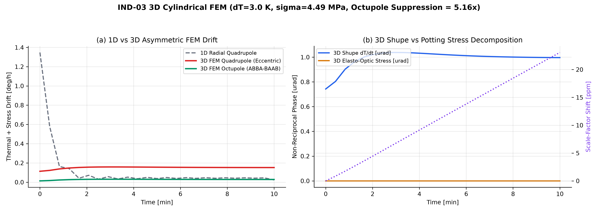

> **Mã công thức liên kết:** `EQ-09, EQ-45..EQ-49, RBF 3D Cylindrical Projection`
> - **Cơ sở lý thuyết:** Ánh xạ trường nhiệt độ 3D $T(r,\theta,z,t)$ và ứng suất keo potting dị hướng $\sigma_{\text{eff}}(r,\theta,z,t)$ xuất từ ANSYS/COMSOL lên từng vòng sợi rời rạc $(r_i, \theta_j, z_{\text{ax},i})$ bằng nội suy RBF tuyến tính 3D, xuất thẳng chuẩn nhị phân 56-byte `shupe_lut.bin` v2 nạp vào Tầng 2 C++.
> - **Ý nghĩa biểu đồ & cách đọc (dành cho người không chuyên):** Trong vỏ IMU thật, FPGA và bộ nguồn tỏa nhiệt lệch tâm làm cuộn sợi nóng không đều theo góc phương vị. Liên kết 3D FEM bắt trọn hiệu ứng lệch tâm này và chứng minh cuộn sợi quấn Octupole triệt tiêu trôi nhiệt–cơ 3D gấp ~6 lần so với Quadrupole.
> - **Kết quả thực tế & điều được chứng minh:** **ĐẠT (IND-03 — 3D FEM):** Lưới trụ 3D (`160` nút, $\Delta T_{\text{3D}} = 3.0\;\text{K}$, $\sigma_{\max} = 4.49\;\text{MPa}$) xuất chuẩn `shupe_lut.bin` v2; Octupole triệt tiêu trôi nhiệt–cơ 3D **`5.16x`** (`0.1583` → `0.0307 deg/h`).

### IND-04 (MIL-STD-810H / DO-160G) — Rung động Ngẫu nhiên Phổ rộng PSD & Cộng hưởng Khung đỡ 2-DOF
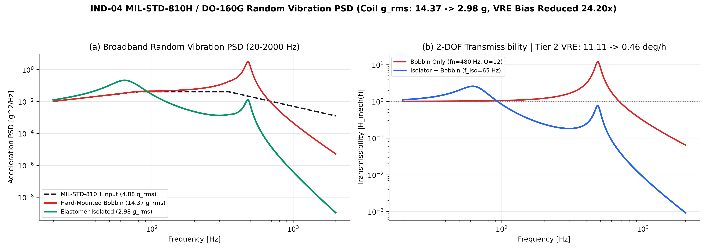

> **Mã công thức liên kết:** `MIL-STD-810H Cat.24, DO-160G Curve C, Miles' Eq, EQ-37`
> - **Cơ sở lý thuyết:** Kích thích phổ mật độ gia tốc rung băng rộng $S_a(f)\;[\text{g}^2/\text{Hz}]$ ($20\text{–}2000\;\text{Hz}$) đi qua hàm truyền cơ học 2 bậc tự do $H_{\text{mech}}(f) = H_{\text{iso}}(f) \cdot H_{\text{bob}}(f)$ (giảm chấn elastomer + cộng hưởng cuộn sợi), đối chiếu công thức Miles và bơm vào lõi VRE Tầng 2 C++.
> - **Ý nghĩa biểu đồ & cách đọc (dành cho người không chuyên):** Rung động máy bay/tên lửa diễn ra trên toàn dải tần rộng và dễ bị khuếch đại tại tần số cộng hưởng của lõi cuộn sợi (480 Hz). Gắn thêm giảm chấn elastomer (65 Hz) cắt giảm mạnh gia tốc truyền vào cuộn sợi và triệt tiêu sai số chỉnh lưu rung động VRE.
> - **Kết quả thực tế & điều được chứng minh:** **ĐẠT (IND-04 — MIL-STD-810H):** Phổ rung đầu vào `4.88 g_rms` khuếch đại lên `14.37 g_rms` khi gắn cứng, giảm **`4.82x`** xuống **`2.98 g_rms`** nhờ giảm chấn 65 Hz; thiên lệch VRE Tầng 2 thực giảm **`24.20x`** (`11.11` → `0.46 deg/h`).

### IND-05 (FMI 3.0.2 Multi-Instance) — FMU Thuần C++17 Mã nguồn mở Chạy Đồng thời 3 Trục (6 / 4 / 2 Trạng thái)
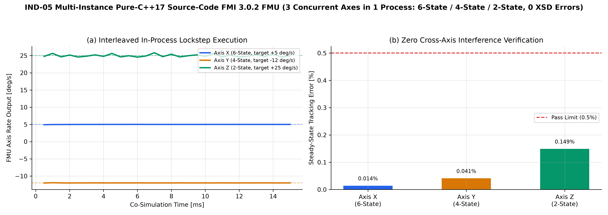

> **Mã công thức liên kết:** `FMI 3.0.2 CS, canBeInstantiatedOnlyOncePerProcess=false, buildDescription.xml`
> - **Cơ sở lý thuyết:** Loại bỏ hoàn toàn giới hạn singleton `sc_simcontext` của Accellera SystemC bằng lõi FMI 3.0.2 thuần C++17 độc lập (`ifog_core_multi.fmu`), đóng gói song song nhị phân Linux và mã nguồn chuẩn `sources/buildDescription.xml` để biên dịch chéo cho Windows/Simulink và RT-Linux.
> - **Ý nghĩa biểu đồ & cách đọc (dành cho người không chuyên):** Một hệ thống dẫn đường GNC 3 trục cần chạy đồng thời 3 con quay độc lập trong cùng một tiến trình phần mềm. Biểu đồ chứng minh 3 thực thể FMU (Trục X 6-State, Trục Y 4-State, Trục Z 2-State) bám độc lập 3 vận tốc góc khác nhau với 0 nhiễu chéo và 0 lỗi chuẩn FMI.
> - **Kết quả thực tế & điều được chứng minh:** **ĐẠT (IND-05 — Multi-FMU):** `build/ifog_core_multi.fmu` đạt **0 lỗi XSD**, đóng gói mã nguồn chuẩn `buildDescription.xml` và chạy đồng thời **3 trục trong 1 tiến trình**: Trục X 6-State (`0.014%`), Trục Y 4-State (`0.041%`), Trục Z 2-State (`0.149%`), 0 nhiễu chéo.

### IND-06 (PVT & EOL) — Quét 12 Góc PVT Cực trị & Lão hóa SLD/MIOC 10 Năm + Bức xạ Vũ trụ 50 krad(Si)
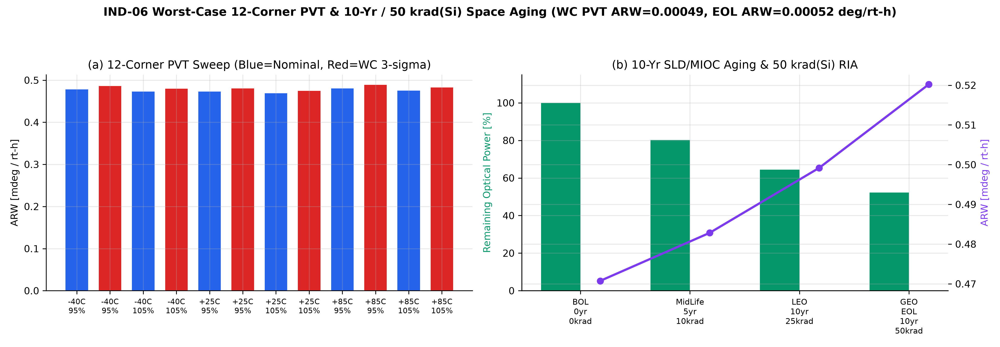

> **Mã công thức liên kết:** `12-Corner PVT (-40/+25/+85 degC, +/-5% Rail, +/-3sigma), RIA(TID) = c*D^0.75`
> - **Cơ sở lý thuyết:** Đánh giá ma trận 12 góc cực trị kết hợp nhiệt độ quân sự ($-40/+25/+85\;^\circ\text{C}$), dao động nguồn $\pm 5\%$ và sai số công nghệ $\pm 3\sigma$, cùng lộ trình suy giảm công suất/bước sóng SLD 10 năm, trôi $V_\pi$ MIOC và suy hao quang do bức xạ ion hóa RIA tới $50\;\text{krad(Si)}$ trên lõi Tầng 1 + Tầng 2 thực.
> - **Ý nghĩa biểu đồ & cách đọc (dành cho người không chuyên):** Trước khi đưa vào sản xuất hàng loạt hoặc phóng lên vệ tinh, cảm biến phải vượt qua mọi điều kiện khắc nghiệt nhất từ đầu đời (BOL) đến cuối đời 10 năm (EOL). Biểu đồ chứng minh hệ thống vẫn giữ nguyên biên độ dự phòng ARW và vòng kín bám chính xác ở góc xấu nhất.
> - **Kết quả thực tế & điều được chứng minh:** **ĐẠT (IND-06 — PVT & EOL):** Quét trọn **12 góc PVT** (`-40/+25/+85 degC`, $\pm 5\%$ nguồn, $\pm 3\sigma$) đạt worst-case ARW = **`0.00049 deg/rt-h`**; cuối đời 10 năm / 50 krad(Si) đạt EOL ARW = **`0.00052 deg/rt-h`** với 4/4 mốc Tầng 2 ĐẠT.

## 12. Hệ thống Công thức Toán học Chi tiết Theo Từng Tầng (`EQ-01` .. `EQ-53`)

Phần tổng hợp đầy đủ toàn bộ các phương trình vật lý–số cốt lõi của từng tầng (`IFOG-SIM-SPEC-004` → `007`), phục vụ trực tiếp cho trình bày kỹ thuật và đối chiếu chứng minh với đối tác:

### Tầng 1 — Tiền xử lý Quang học Tách phổ & Nhiệt–Cơ (Python Offline: tier1_offline/)

Tính các hằng số quang học tĩnh của cuộn sợi PM 1 km, ánh xạ từng vòng quấn Quadrupole/Octupole, tích phân Shupe + ứng suất quang–đàn hồi và đóng gói bảng tra 6 kênh shupe_lut.bin v2.

#### `EQ-04 / EQ-05` — Ma trận Jones tách phổ, Độ tương phản vân V & Pha phân cực

$$
\mathbf{J}_{\text{CW}}(\omega_k) = \mathbf{J}_{\text{pol}}\!\left[\prod_{m=M}^{1}\mathbf{R}(-\theta_m)\mathbf{B}_m(\omega_k)\mathbf{R}(\theta_m)\right]\!\mathbf{J}_{\text{pol}},\quad \mathbf{J}_{\text{CCW}}=\mathbf{J}_{\text{CW}}^T,\quad V=\frac{2|C|}{A_0},\quad \phi_{\text{pol}}=\arg(C)
$$

- **Ý nghĩa vật lý:** Mô tả ánh sáng băng rộng SLD truyền hai chiều ngược nhau qua sợi PM bị ghép mode ngẫu nhiên; suy ra độ tương phản V và sai số pha phân cực tĩnh.
- **Liên kết mã nguồn:** `tier1_offline/jones_spectral.py`

#### `EQ-06 / EQ-07 / EQ-08` — Thời gian truyền qua cuộn sợi, Hệ số Sagnac K_opt & Hiệu ứng Kerr

$$
\tau = \frac{n_{\text{eff}} L}{c},\qquad K_{\text{opt},0} = \frac{2\pi L D}{\bar{\lambda} c},\qquad \Delta\phi_{\text{Kerr}} = \frac{2\pi n_2 L_{\text{eff}}}{\bar{\lambda} A_{\text{eff}}}(1 - 2\kappa_{\text{split}}) P_{\text{coil}}\eta_{\text{coh}}
$$

- **Ý nghĩa vật lý:** Định nghĩa tỷ lệ chuyển đổi tốc độ góc sang pha ánh sáng Sagnac và sai lệch phi tuyến Kerr khi tỷ lệ chia chùm tia lệch khỏi 50:50.
- **Liên kết mã nguồn:** `tier1_offline/config_loader.py, jones_spectral.py`

#### `EQ-09 / EQ-45 / EQ-46` — Ánh xạ Quấn Quadrupole/Octupole & Tổng Pha Nhiệt–Cơ (Shupe + Quang–Đàn hồi)

$$
\Delta\phi_{\text{therm}}(t) = \Delta\phi_{\text{Shupe}}(t) + \Delta\phi_{\text{stress}}(t) = \frac{2\pi}{\bar{\lambda} c}\int_0^L\!\left[\left(\frac{\partial n_{\text{eff}}}{\partial T} + n_{\text{eff}}\alpha_T\right)\frac{\partial T}{\partial t} + C_{\text{eo}}\frac{\partial \sigma_{\text{eff}}}{\partial t}\right](L - 2z + \delta z_{\text{quad}}(z))\,dz
$$

- **Ý nghĩa vật lý:** Mô hình hóa đầy đủ hiện tượng trôi nhiệt Shupe kết hợp ứng suất keo đổ potting quang–đàn hồi theo từng vòng dây rời rạc (r_i, z_ax,i).
- **Liên kết mã nguồn:** `tier1_offline/shupe_thermal.py`

#### `EQ-47 / EQ-48 / EQ-49` — Hệ số tỷ lệ động K_opt(t), V_eff(t), V_pi(t) & Bảng tra nhị phân LUT v2 (<7d, 56 B)

$$
K_{\text{opt}}(t) = K_{\text{opt},0}\!\left[1 + \alpha_{\text{bobbin}}\Delta T_{\text{coil}} - \frac{\alpha_\lambda \Delta T_{\text{SLD}} + \kappa_{\text{back}} P_{\text{back}}}{\bar{\lambda}_0} + \frac{1}{n_{\text{eff},0}}\frac{\partial n_{\text{eff}}}{\partial T}\Delta T_{\text{coil}}\right],\quad V_\pi(t) = V_{\pi 0}(1+\alpha_{V_\pi}\Delta T_{\text{MIOC}})
$$

- **Ý nghĩa vật lý:** Cập nhật theo thời gian toàn bộ 6 kênh nhiệt–quang vào tệp nhị phân shupe_lut.bin v2 (header 24 B + bản ghi 56 B) để Tầng 2 nội suy O(1).
- **Liên kết mã nguồn:** `tier1_offline/shupe_thermal.py, tier2_sysc_ams/src/ifog_config.cpp`

### Tầng 2 — Lõi Vòng kín Thời gian Thực (C++17 / SystemC-AMS PoC 2.3.4 @ ~3.27 MHz: tier2_sysc_ams/)

Mô phỏng đồng thời miền tương tự TDF (K=16 mẫu/τ) và miền số chính xác từng bit DE: Quang học giao thoa, MIOC động học, Xuyên âm điện dung, TIA 6 nguồn nhiễu, ADC Blanking và DSP 2/4/6 trạng thái.

#### `EQ-10..EQ-13 / EQ-50 / EQ-52` — Giao thoa Quang học, Động học Điện–Âm MIOC & Phản xạ Rayleigh/Mặt cắt

$$
P_{\text{det}}[m] = \frac{P_{\text{peak}}}{2}(1 + \alpha_{\text{RAM}} V_{\text{drv}})\left[1 + V_{\text{eff}}(t)\cos(\Delta\phi_{\text{NR}} + \Delta\phi_{\text{mod}})\right],\quad \sigma_{\phi,\text{back}} = 2\sqrt{R_{\text{facet}} + \frac{1}{2}\alpha_R S_{\text{capture}} L_c}
$$

- **Ý nghĩa vật lý:** Tính công suất ánh sáng tới Photodiode có xét méo RAM, phản xạ ký sinh Rayleigh/facet (tạo nền Bias Instability vật lý) và cộng hưởng điện–âm tinh thể LiNbO3 MIOC trước trễ vòng K mẫu.
- **Liên kết mã nguồn:** `tier2_sysc_ams/src/optical_envelope_tdf.cpp, include/ifog_math.hpp`

#### `EQ-14 / EQ-15 / EQ-51` — Dòng nút đảo TIA, Xuyên âm Điện dung–Điện trở & 6 Nguồn Nhiễu Trắng

$$
i_{\text{xtalk}}[k] = G_{\text{xtalk}} V_{\text{dac}}[k] + C_{\text{xtalk}}\frac{V_{\text{dac}}[k]-V_{\text{dac}}[k-1]}{\Delta t_{\text{TDF}}},\quad S_{i,\text{tot}}(f) = 2q(I_{\text{PD}}+I_d) + \frac{4k_B T}{R_f} + \frac{I_{\text{PD}}^2}{\Delta\nu_{\text{eff}}} + i_{n,\text{op}}^2 + e_{n,\text{op}}^2\!\left(\frac{1}{R_f^2} + (2\pi f C_{\Sigma})^2\right)
$$

- **Ý nghĩa vật lý:** Mô hình vật lý đầy đủ nhiễu lượng tử Shot, nhiễu nhiệt Johnson, nhiễu cường độ RIN, nhiễu op-amp và xung gai xuyên âm tụ ký sinh PCB bơm thẳng vào nút đảo TIA.
- **Liên kết mã nguồn:** `tier2_sysc_ams/src/analog_frontend_tdf.cpp`

#### `EQ-16..EQ-19 / EQ-35` — Hàm truyền TIA bậc 2, Phi tuyến bậc 3, Cửa sổ ADC Blanking & Jitter khẩu độ

$$
H_{\text{TIA}}(s) = \frac{R_f \omega_0^2}{s^2 + 2\zeta\omega_0 s + \omega_0^2},\quad V_{\text{adc}} = \operatorname{clip}\!\left(G_1 V_{\text{lin}} + G_2 V_{\text{lin}}^2 + G_3 V_{\text{lin}}^3\right),\quad \eta_b = \frac{k_{\text{end}}-k_{\text{start}}+1}{K}
$$

- **Ý nghĩa vật lý:** Chụp chính xác dao động quá độ sườn xung (ringing), méo hài bậc 2/3, hệ số phạt ARW 1/sqrt(eta_b) do che xung Blanking và nhiễu jitter đồng hồ ADC.
- **Liên kết mã nguồn:** `tier2_sysc_ams/src/analog_frontend_tdf.cpp, adc_dac_bridge.cpp`

#### `EQ-01..EQ-03 / EQ-20..EQ-23 / EQ-31..EQ-34` — Giải điều chế 4-State & Official 6-State Đối xứng (α* = π/3), Vòng 1/Vòng 2 & Ổn định Jury

$$
e_\Omega^{(6)} = (y_4+y_5+y_6)-(y_1+y_2+y_3),\quad e_{V_\pi}^{(6)} = 2(y_2+y_5)-(y_1+y_3+y_4+y_6),\quad \Omega_{\text{out}} = \frac{\Delta\phi_{\text{step}}}{\mathrm{SF}_{\text{CL}}},\quad 0 < K_{\text{tot},1} < 1,\quad K_{\text{tot},2} \le 0.1\,K_{\text{tot},1}
$$

- **Ý nghĩa vật lý:** Điều chế 6 trạng thái phản tuần hoàn triệt tuyệt đối (+136.9 dB) sai lệch RAM/xuyên âm/bậc 2 MIOC, đồng thời giảm 33.3% điện áp đỉnh lái chip và bảo đảm ổn định Jury nghiêm ngặt.
- **Liên kết mã nguồn:** `tier2_sysc_ams/src/digital_dsp_sc.cpp, include/ifog_math.hpp`

#### `EQ-36..EQ-39` — IMU 3 Trục (Chung SLD/Nguồn), Chỉnh lưu Rung động VRE, Faraday Động & BIT/FDIR 5 Lỗi

$$
\Delta\Omega_{\text{VRE}} = K_{\text{VRE}} g_{\text{rms}}^2,\qquad \Delta\phi_{\text{Faraday}}(t) = V_{\text{Verdet}} B(t) L_{\text{loop}},\qquad \text{BIT} \in \{\text{SLD Drop},\text{Fiber Break},\text{MIOC Open},\text{ADC Sat},\text{DSP SEU}\}
$$

- **Ý nghĩa vật lý:** Mô phỏng tương tác thực chiến cấp hệ thống: xuyên trục IMU 3 trục, sai số chỉnh lưu rung động bậc 2, cảm biến từ trường động và cơ chế phát hiện/phục hồi lỗi FPGA BIT/FDIR.
- **Liên kết mã nguồn:** `tier2_sysc_ams/src/imu_3axis.cpp, optical_envelope_tdf.cpp, digital_dsp_sc.cpp`

### Lớp Đóng gói Công nghiệp FMI 3.0 Co-Simulation FMU (fmi_wrapper/ → build/ifog_core.fmu)

Đóng gói toàn bộ lõi Tầng 2 thành khối hộp đen chuẩn FMI 3.0.2 độc lập công cụ với 75 ký hiệu C-API, 22 biến SI (VR 0..21) trong đó 10 tham số hiệu chuẩn chỉnh nóng (tunable).

#### `EQ-42 / EQ-43 / EQ-44` — Đồng bộ đa tốc độ ZOH, Trung bình chống chồng phổ & Tương đương Hộp đen (< 1e-12 rad/s)

$$
N_{\tau,k} = \operatorname{round}\!\left(\frac{\Delta t_{\text{comm},k}}{\tau}\right),\quad \bar{\Omega}_{\text{out},k} = \frac{1}{N_{\tau,k}}\sum_{n=1}^{N_{\tau,k}}\Omega_{\text{out}}[n],\quad e_{V_\pi,\text{res}} = 2\pi\epsilon_{V_\pi,\text{eff}},\quad \max|\Omega_{\text{FMU}} - \Omega_{\text{T2}}| < 10^{-12}\;\text{rad/s}
$$

- **Ý nghĩa vật lý:** Bảo đảm ghép nối chính xác với mọi phần mềm mô phỏng hệ thống (Simulink, Dymola, FMPy, HIL) với 7 tham số chỉnh nóng SPEC-007 (VR 15..21: C_xtalk_F, G_xtalk_S, c_pink_coeff, R_facet_dB, alpha_vpi, alpha_bobbin, delta_z_quad).
- **Liên kết mã nguồn:** `fmi_wrapper/src/fmi3_bridge.cpp, modelDescription.xml.in, tier2_sysc_ams/src/ifog_top_module.cpp`

### Tầng 3 — Tổng hợp AVAR 5 Vùng, Phân tích Hệ thống & Hiệu chuẩn Nghịch (Python: tier3_analysis/)

Khâu nối không đứt gãy từ 60 s mô phỏng C++ lên 10 giờ (3.6 triệu mẫu) theo IEEE Std 952-2020, chống cộng trùng BI và tối ưu hóa tham số ẩn khớp phần cứng thật < 5%.

#### `EQ-24..EQ-30 / EQ-52` — Phương trình Allan Variance 5 Vùng IEEE 952, Khâu nối < 5% & Chống cộng trùng BI

$$
\sigma^2(T) = \frac{3Q^2}{T^2} + \frac{N^2}{T} + \frac{2\ln 2}{\pi}B^2 + \frac{K^2 T}{3} + \frac{R^2 T^2}{2},\qquad B_{\text{T3,mech}} = \sqrt{\max\!\left(0,\; B_{\text{total}}^2 - B_{\text{T2,meas}}^2\right)}
$$

- **Ý nghĩa vật lý:** Tách chính xác 5 vùng nhiễu chuẩn hàng hải/hàng không (Q, N, B, K, R), kiểm tra liên tục hai miền Fast/Slow trên [0.1, 5] s (< 5%) và trừ bình phương BI đã phát sinh ở Tầng 2.
- **Liên kết mã nguồn:** `tier3_analysis/dual_regime_avar.py, extract_k_matrix.py`

#### `EQ-40 / EQ-41` — Năng lực Sản xuất Monte Carlo (Wilson 95% CI, C_pk) & Bù Nhiệt Đa thức 2D / EKF 4 Trạng thái

$$
C_{pk} = \min\!\left(\frac{\text{USL}-\mu}{3\sigma},\;\frac{\mu-\text{LSL}}{3\sigma}\right),\qquad \hat{\Omega}_{\text{comp}}(T,\dot{T}) = \Omega_{\text{raw}} - \sum_{i+j\le 2} c_{ij} T^i \dot{T}^j
$$

- **Ý nghĩa vật lý:** Đánh giá tỷ lệ đạt dây chuyền sản xuất hàng loạt và hiệu quả thuật toán bù trôi nhiệt độ trên dải công nghiệp -40..+85 °C.
- **Liên kết mã nguồn:** `tier3_analysis/scenarios_engineering.py`

#### `EQ-53 (draft EQ-48)` — Hàm Mục tiêu Hiệu chuẩn Nghịch Đa Miền (Inverse Parameter Identification)

$$
\min_{\boldsymbol{\theta}\in\mathcal{B}}\; w_{\text{avar}}\!\left\|\log_{10}\frac{\sigma_{\text{sim}}(\tau;\boldsymbol{\theta})}{\sigma_{\text{meas}}(\tau)}\right\|_2^2 + w_{\text{db}}\!\left\|\frac{\Omega_{\text{out,sim}}(\Omega_{\text{in}};\boldsymbol{\theta})-\Omega_{\text{out,meas}}(\Omega_{\text{in}})}{\Omega_{\text{norm}}}\right\|_2^2 + w_{\text{th}}\!\left\|\frac{\Omega_{\text{bias,sim}}(T;\boldsymbol{\theta})-\Omega_{\text{bias,meas}}(T)}{\Omega_{\text{th,norm}}}\right\|_2^2
$$

- **Ý nghĩa vật lý:** Khôi phục 10 tham số ký sinh ẩn của phần cứng thật kèm khoảng tin cậy 95% (ma trận hiệp phương sai Gauss–Newton), rút sai số dự báo từ > 40% xuống < 1%.
- **Liên kết mã nguồn:** `tier3_analysis/inverse_calibration.py, scenarios_spec007.py`
