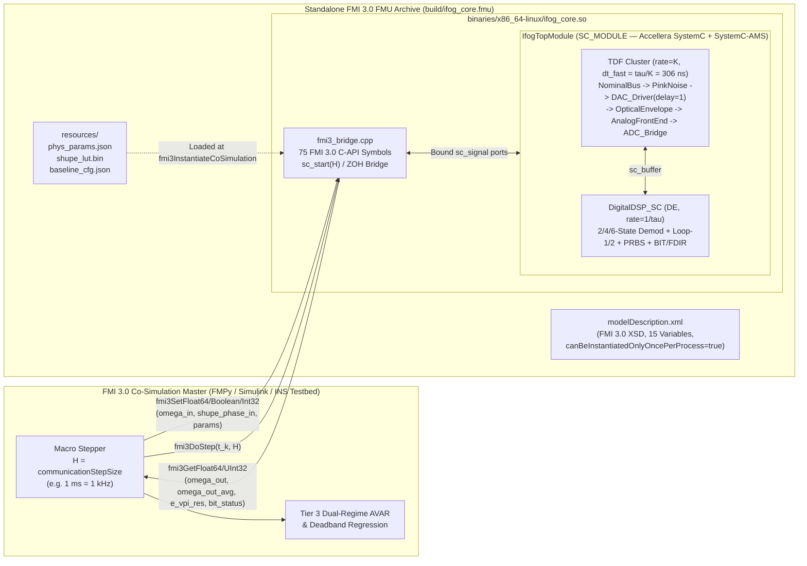

# IFOG-SIM-SPEC-006 — Closed-Loop IFOG Multi-Scale Virtual Prototype with FMI 3.0 Black-Box Co-Simulation FMU Packaging

| Field | Value |
| :--- | :--- |
| **Document ID** | `IFOG-SIM-SPEC-006` |
| **Version** | `6.0` (Owner-Authorized Upgrade extending `IFOG-SIM-SPEC-005` v5.0 & `IFOG-SIM-SPEC-004` v4.0) |
| **System** | Closed-Loop IFOG Multi-Scale Virtual Prototype (2/4/6-State DSP + 3-Axis IMU + FMI 3.0 Co-Simulation FMU) |
| **Reference Standards** | FMI Standard 3.0.2 (Modelica Association Project FMI); IEEE Std 952-2020; IEEE Std 1666.1-2016 (SystemC-AMS) |
| **Deliverable Binary** | Standalone Tool-Agnostic FMI 3.0 Co-Simulation FMU (`build/ifog_core.fmu`) |
| **Backward Compatibility** | 100% preservation of `EQ-01`–`EQ-41`, Gates 1–5, `TD-01`–`TD-06`, `ENG-01`–`ENG-05`, `DYN-01`–`DYN-04`, and immutable `SPEC-004`/`SPEC-005` SHA-256 locks |

---

## 1. Executive Summary & Upgrade Rationale (`SPEC-005` -> `SPEC-006`)

`IFOG-SIM-SPEC-006` upgrades the `ifog-vproto` multi-scale closed-loop Interferometric Fiber-Optic Gyroscope (IFOG) virtual prototype into a **tool-agnostic FMI 3.0 Co-Simulation Functional Mock-up Unit (`build/ifog_core.fmu`)** without altering a single physical equation, non-linear analog front-end solver (`sca_ltf_nd` / exact ZOH matrix-exponential LTF), or bit-true digital DSP algorithm (2-state, 4-state Lefèvre, and 6-state symmetric demodulation) verified in `IFOG-SIM-SPEC-004` and `IFOG-SIM-SPEC-005`.

Wrapping Tier 2 (`tier2_sysc_ams`) as an FMI 3.0 Co-Simulation FMU enables direct plug-and-play integration of the physics-accurate Accellera SystemC/SystemC-AMS IFOG core into any FMI 3.0 compliant system-level orchestrator (Python **FMPy**, MATLAB/Simulink, Dymola, Ansys Twin Builder, OpenModelica, or 6-DOF INS/GNC strapdown navigation testbeds) while keeping all internal micro-scale switching transients ($\Delta t_{\text{fast}} = \tau / K \approx 306\text{ ns}$) encapsulated inside a black-box binary artifact.

| Upgrade Axis | `IFOG-SIM-SPEC-005` (v5.0) | `IFOG-SIM-SPEC-006` (v6.0) | Normative Equation / Gate |
| :--- | :--- | :--- | :--- |
| **Execution Boundary** | Standalone CLI executable (`build/ifog_sim`) driven by static JSON config + binary LUTs | Standalone FMI 3.0 Co-Simulation FMU (`build/ifog_core.fmu`) + standalone `build/ifog_sim` (bit-exact equivalent) | `EQ-42`, `EQ-44` |
| **External Coupling** | Offline stimulus tables (`constant`, `step`, `ramp`, `sine`, `shupe_lut.bin`) | Live macro-step Zero-Order Hold (ZOH) external inputs (`omega_in`, `shupe_phase_in`) and tunable parameters (`eps_vpi`, `k_xtalk`, `enable_dither`) | `EQ-42`, `EQ-43` |
| **Anti-Aliased Rate Readout** | High-rate `sim_out.bin` ($f_s = 1/(4\tau) \approx 51\text{ kHz}$) decimated offline | Both instantaneous `omega_out` (for `< 1e-12` equivalence) and macro-step interval-averaged `omega_out_avg` (zero-aliasing INS / Dual-Regime AVAR readout) | `EQ-42` |
| **Real-Time Diagnostics** | Post-run `sim_summary.json` and `dsp_trace.bin` | Live FMI 3.0 outputs `e_vpi_res` (`rad`) and `bit_status` (`UInt32` BIT/FDIR + saturation bitmask) at every communication point | `EQ-43` |
| **Verification Gate** | Gates 1–5 + 6 TD + 5 ENG + 4 DYN (`EQ-01`..`EQ-41`) | Adds **Gate 6 (FMI 3.0 Compliance & Black-Box Equivalence Gate)** via `tier3_analysis/fmi_master_runner.py` (`EQ-42`..`EQ-44`, 44 total verified formulas) | Gate 6, `EQ-42`–`EQ-44` |

---

## 2. Preserved Mathematical Core (`EQ-01` .. `EQ-41`)

All 41 normative equations from `IFOG-SIM-SPEC-004` (`EQ-01`–`EQ-30`) and `IFOG-SIM-SPEC-005` (`EQ-31`–`EQ-41`) remain strictly unchanged in definition, sign convention, and implementation:

1. **4-State & 6-State Orthogonal Demodulation (`EQ-01`–`EQ-03`, `EQ-31`–`EQ-34`):**
   - 4-state Lefèvre demodulation: $e_\Omega^{(4)} = (y_2 - y_1) + (y_4 - y_3) \approx 4 S_\alpha \Delta\phi_{\text{NR}}$, $e_{V_\pi}^{(4)} = (y_3 + y_4) - (y_1 + y_2) \approx 4\pi S_\alpha \epsilon_{V_\pi}$.
   - 6-state symmetric balanced demodulation ($\alpha^* = \pi/3$, $-33.3\%$ peak voltage, simultaneous RAM/xtalk/quadratic cancellation): $e_\Omega^{(6)} = (y_4+y_5+y_6)-(y_1+y_2+y_3)$, $e_{V_\pi}^{(6)} = 2(y_2+y_5)-(y_1+y_3+y_4+y_6)$, $e_{\text{asym}}^{(6)} = (y_1-y_3)+(y_6-y_4)$.
2. **Optical Domain (`EQ-04`–`EQ-13`):** Spectral-sliced Jones matrices ($\mathbf{J}_{\text{CW}}, \mathbf{J}_{\text{CCW}} = \mathbf{J}_{\text{CW}}^T$), visibility $V$ and polarization phase $\phi_{\text{pol}}$, transit time $\tau = n_{\text{eff}}L/c$, Sagnac factor $K_{\text{opt}} = 2\pi LD/(\bar{\lambda}c)$, optical Kerr phase ($\eta_{\text{coh}}$), thermal Shupe integral ($\delta z_{\text{quad}}$), Faraday effect, MIOC modulation ($\epsilon_{V_\pi}, \gamma_{\text{nl}}$), modulo-$2\pi$ wrapping $\operatorname{wrap}_{2\pi}$, and photodiode power $P_{\text{det}}[m]$ with parasitic RAM ($\alpha_{\text{RAM}}$).
3. **Analog Front-End & ADC/DAC Bridge (`EQ-14`–`EQ-19`, `EQ-35`):** 6-component noise PSD $S_{i,\text{tot}}(f,m)$, capacitive/resistive DAC-to-TIA crosstalk, 2nd-order TIA transfer function $H_{\text{TIA}}(s)$ (hybrid `sca_ltf_nd` / exact ZOH matrix exponential), cubic polynomial nonlinearity ($G_1, G_2, G_3$) with clipping, ADC blanking window $[k_{\text{start}}, k_{\text{end}}]$ ($1/\sqrt{\eta_b}$ ARW penalty), and sampling aperture jitter $\delta V_j = (dV_{\text{adc}}/dt)\,\delta t_j$.
4. **Closed-Loop Digital DSP & System Engineering (`EQ-20`–`EQ-30`, `EQ-36`–`EQ-41`):** Loop-1/Loop-2 integrators with Jury bound $0 < K_{\text{tot},1} < 1$ and $K_{\text{tot},2} \le 0.1 K_{\text{tot},1}$, anti-windup clamping, 32-bit LFSR PRBS dither, 3-axis shared-SLD/shared-rail IMU coupling, VRE quadratic rectification, dynamic Faraday sensitivity, real-time FPGA BIT/FDIR 5-fault monitor, Monte Carlo yield ($C_{pk}$), virtual thermal calibration ($-40..+85^\circ\text{C}$), and Dual-Regime IEEE Std 952-2020 5-region Overlapping AVAR ($Q, N, B, K, R$).

---

## 3. FMI 3.0 Black-Box Co-Simulation Architecture

### 3.1 Multi-Rate Co-Simulation Hierarchy



### 3.2 Archive Layout & Build Reproducibility

The CMake target `package_fmu` packages a self-contained, offline-reproducible ZIP archive (`build/ifog_core.fmu`) using vendorized BSD-2-Clause official FMI 3.0 C headers (`fmi_wrapper/include/fmi3/{fmi3Functions.h, fmi3FunctionTypes.h, fmi3PlatformTypes.h}`):

```text
build/ifog_core.fmu
├── modelDescription.xml                 # Configured from fmi_wrapper/modelDescription.xml.in
├── binaries/
│   └── x86_64-linux/
│       └── ifog_core.so                 # -fPIC shared lib linking ifog_core + SystemC + SystemC-AMS
└── resources/
    ├── phys_params.json                 # Tier 1 spectral-sliced Jones output (V, phi_pol, K_opt, tau, Kerr)
    ├── shupe_lut.bin                    # Tier 1 1D thermal Shupe LUT (SHUP v1 binary)
    └── baseline_cfg.json                # Reference IFOG hardware & DSP baseline configuration
```

### 3.3 FMI 3.0 Co-Simulation Lifecycle & SystemC Kernel Synchronization

1. **`fmi3InstantiateCoSimulation`**:
   - Validates `instantiationToken == "{6e9c4b1a-7f20-4f06-9a5c-000000000006}"`.
   - Enforces the process-global SystemC singleton guard (`canBeInstantiatedOnlyOncePerProcess="true"`): any second instantiation within the same OS process fails cleanly returning `nullptr`.
   - Normalizes `resourcePath` across native Linux/Windows paths and `file://`, `file:///`, `file://localhost/`, `file:/` URIs (including `%XX` percent-decoding and Windows drive-letter normalization) and loads `resources/phys_params.json`, `resources/baseline_cfg.json`, and optional `resources/shupe_lut.bin`.
2. **`fmi3EnterInitializationMode` & Parameter Configuration**:
   - Accepts `fmi3SetFloat64`, `fmi3SetBoolean`, and `fmi3SetInt32` for both `fixed` parameters (`dsp_mode`, `en_white_noise`, `en_pink_noise`, `en_vpi_loop`, `seed`) and `tunable` parameters (`eps_vpi`, `k_xtalk`, `enable_dither`), plus initial inputs (`omega_in`, `shupe_phase_in`).
   - Validates `dsp_mode` strictly in `{2, 4, 6}` (automatically selecting optimal $\alpha^* = \pi/3$ for `dsp_mode=6` and $\alpha = \pi/4$ for `dsp_mode in {2, 4}`).
3. **`fmi3ExitInitializationMode`**:
   - Instantiates `IfogTopModule`, binds all `sc_signal` input/parameter/output channels, writes initial ZOH values, and executes `sc_core::sc_start(sc_core::SC_ZERO_TIME)` to complete IEEE 1666 elaboration and static IEEE 1666.1 TDF cluster scheduling.
4. **`fmi3DoStep`**:
   - Applies Zero-Order Hold (ZOH) inputs and tunable parameters (`omega_in`, `shupe_phase_in`, `eps_vpi`, `k_xtalk`, `enable_dither`) to `IfogTopModule`, resets the macro-step anti-aliased accumulator, advances the SystemC-AMS simulation clock by `sc_core::sc_time(communicationStepSize, sc_core::SC_SEC)`, samples outputs (`omega_out`, `omega_out_avg`, `e_vpi_res`, `bit_status`), and sets `eventHandlingNeeded = false`, `terminateSimulation = false`, `earlyReturn = false`, `lastSuccessfulTime = currentCommunicationPoint + communicationStepSize`.
5. **`fmi3Terminate` & `fmi3FreeInstance`**:
   - Cleanly calls `sc_core::sc_stop()` if not already stopped and destroys `IfogTopModule` and bound SystemC signals without memory leaks.

---

## 4. Normative FMI 3.0 Equations (`EQ-42` .. `EQ-44`)

### 4.1 Multi-Rate Macro/Micro Synchronization & Anti-Aliased Rate Output (`EQ-42`)

Given macro communication step size $H = \Delta t_{\text{comm}} > 0$ and optical coil transit time $\tau = n_{\text{eff}} L / c$ with $K \in \{16, 32\}$ sub-$\tau$ TDF micro-samples ($\Delta t_{\text{fast}} = \tau / K$), each `fmi3DoStep(t_k, H)` executes $N_{\tau,k}$ full SystemC-AMS TDF/DE clusters while holding external inputs constant via Zero-Order Hold:

$$
N_{\tau,k} = \left\lfloor \frac{t_k + H}{\tau} \right\rfloor - \left\lfloor \frac{t_k}{\tau} \right\rfloor, \qquad
\Omega_{\text{in}}(t) = \Omega_{\text{in},k}, \quad \Delta\phi_{\text{Shupe,ext}}(t) = \Delta\phi_{\text{Shupe},k} \quad \forall t \in [t_k,\, t_k + H)
$$

At the end of macro step $k$, the FMU exports both the exact instantaneous closed-loop rate $\Omega_{\text{out}}(t_{k+1})$ (matching standalone `ifog_sim` bit-for-bit) and the boxcar anti-aliased macro-step average rate $\bar{\Omega}_{\text{out},k}$ (equivalent to strapdown INS delta-angle readout $\Delta\theta_k / H$):

$$
\bar{\Omega}_{\text{out},k} = \frac{1}{N_{\tau,k}} \sum_{n=n_k}^{n_k + N_{\tau,k} - 1} \Omega_{\text{out}}[n] \quad [\text{rad/s}]
$$

Boxcar averaging over $H$ acts as an exact $\operatorname{sinc}(f H)$ anti-aliasing pre-filter, preserving the true white Angle Random Walk (ARW) PSD $N^2 = S_\Omega(0)$ when sampled at $f_{\text{comm}} = 1/H$ (e.g., $1\text{ kHz}$ for $H = 1\text{ ms}$) even when $f_{\text{comm}} < 2 f_{-3\text{dB,CL}}$.

### 4.2 Loop-2 Residual $V_\pi$ Phase Error & BIT/FDIR Status Bitmask (`EQ-43`)

At every communication point, the FMU exposes the closed-loop Loop-2 residual $2\pi$-flyback phase error $e_{V_\pi,\text{res}}$ in radians:

$$
e_{V_\pi,\text{res}} = 2\pi\,\epsilon_{V_\pi,\text{eff}} = 2\pi \left[ \left(1 + \epsilon_{V_\pi}\right)\,\frac{G_{\text{DAC}} V_{\text{ref,DAC}}}{2 V_{\pi,0}} - 1 \right] \quad [\text{rad}]
$$

(evaluating identically to $0\text{ rad}$ when `en_mioc_vpi_err` is disabled), together with the 32-bit unsigned real-time BIT/FDIR & saturation bitmask `bit_status`:

$$
\texttt{bit\_status} = \mathbb{I}(\text{SLD})\cdot 2^0 \;\lor\; \mathbb{I}(\text{Break})\cdot 2^1 \;\lor\; \mathbb{I}(\text{MIOC})\cdot 2^2 \;\lor\; \mathbb{I}(\text{ADC\_Sat})\cdot 2^3 \;\lor\; \mathbb{I}(\text{SEU})\cdot 2^4 \;\lor\; \mathbb{I}(\text{AntiWindup})\cdot 2^5
$$

where `bit_status == 0` signifies nominal healthy closed-loop operation with zero faults, zero ADC clipping, and zero integrator windup.

### 4.3 Black-Box FMU vs Standalone Equivalence Bound (`EQ-44`)

For identical physical parameters (`phys_params.json`), configuration (`baseline_cfg.json`), deterministic PRNG/LFSR seed, DSP mode ($M \in \{2, 4, 6\}$), and constant ZOH stimulus over duration $T$, the black-box FMU output and standalone Tier 2 `build/ifog_sim` output MUST agree to within double-precision numerical tolerance:

$$
\left|\Omega_{\text{out}}^{\text{FMU}}(T) - \Omega_{\text{out}}^{\text{standalone}}(T)\right| < 10^{-12}\;\text{rad/s}, \qquad
\left|e_{V_\pi,\text{res}}^{\text{FMU}}(T) - 2\pi\,\epsilon_{V_\pi,\text{eff}}^{\text{standalone}}(T)\right| < 10^{-12}\;\text{rad}
$$

Because Accellera SystemC 2.3.4 maintains a process-global `sc_simcontext` singleton, `<CoSimulation>` MUST declare `canBeInstantiatedOnlyOncePerProcess="true"`, and multi-run master orchestrators MUST isolate each FMU instance in a separate OS process.

---

## 5. `modelDescription.xml` FMI 3.0 Interface Contract Table

| `valueReference` | Name | FMI 3.0 Type | `causality` | `variability` | Unit | Default `start` | Description |
| :---: | :--- | :--- | :--- | :--- | :---: | :---: | :--- |
| `0` | `time` | `Float64` | `independent` | `continuous` | `s` | — | Independent simulation time |
| `1` | `omega_in` | `Float64` | `input` | `continuous` | `rad/s` | `0.0` | External angular rate input $\Omega_{\text{in}}(t)$ (ZOH over $H$) |
| `2` | `shupe_phase_in` | `Float64` | `input` | `continuous` | `rad` | `0.0` | External thermal Shupe phase perturbation $\Delta\phi_{\text{Shupe}}(t)$ |
| `3` | `omega_out` | `Float64` | `output` | `continuous` | `rad/s` | *(calculated)* | Instantaneous closed-loop angular rate output $\Omega_{\text{out}}(t)$ |
| `4` | `e_vpi_res` | `Float64` | `output` | `continuous` | `rad` | *(calculated)* | Loop-2 residual $2\pi$ flyback $V_\pi$ phase error (`EQ-43`) |
| `5` | `bit_status` | `UInt32` | `output` | `discrete` | — | *(calculated)* | Real-time FPGA BIT/FDIR & saturation bitmask (`0` = healthy, `EQ-43`) |
| `6` | `eps_vpi` | `Float64` | `parameter` | `tunable` | `1` | `0.02` | MIOC half-wave voltage fractional error $\epsilon_{V_\pi}$ |
| `7` | `k_xtalk` | `Float64` | `parameter` | `tunable` | `A/V` | `1.0e-8` | DAC-to-TIA resistive crosstalk conductance $k_{\text{xtalk}}$ |
| `8` | `enable_dither` | `Boolean` | `parameter` | `tunable` | — | `true` | Enable 32-bit LFSR PRBS dither for deadband suppression |
| `9` | `dsp_mode` | `Int32` | `parameter` | `fixed` | — | `4` | Digital demodulation mode: `2`, `4`, or `6` states |
| `10` | `en_white_noise` | `Boolean` | `parameter` | `fixed` | — | `true` | Enable 6-component TIA white noise (`EQ-15`) |
| `11` | `en_pink_noise` | `Boolean` | `parameter` | `fixed` | — | `false` | Enable 5-pole IIR $1/f$ flicker noise |
| `12` | `en_vpi_loop` | `Boolean` | `parameter` | `fixed` | — | `true` | Enable Loop-2 $V_\pi$ closed-loop gain tracking |
| `13` | `seed` | `Int32` | `parameter` | `fixed` | — | `42004` | Deterministic PRNG & LFSR seed |
| `14` | `omega_out_avg` | `Float64` | `output` | `continuous` | `rad/s` | *(calculated)* | Anti-aliased macro-step interval-averaged rate output (`EQ-42`) |

---

## 6. Verification Gate 6 — FMI 3.0 Compliance & Black-Box Equivalence Gate

Gate 6 (`--mode fmi_gate` in `scripts/run_sim.sh` / `tier3_analysis/fmi_master_runner.py`, included in `all_scenarios` and `pytest tests/system`) validates the packaged `build/ifog_core.fmu` end-to-end against four mandatory acceptance criteria:

| Sub-Gate | Verification Method | Acceptance Criterion |
| :--- | :--- | :--- |
| **6A. FMI 3.0 XSD & Packaging Compliance** | `fmpy.validation.validate_fmu("build/ifog_core.fmu")` + ZIP audit | **0 validation errors**, `fmiVersion == "3.0"`, `canBeInstantiatedOnlyOncePerProcess == True`, all 15 variables + `binaries/<arch>/ifog_core.so` + `resources/*` present |
| **6B. Standalone vs FMU Bit-Exact Equivalence** | `ifog_sim` vs `ifog_core.fmu` (`dsp_mode=4` and `dsp_mode=6`, noisy `seed=42004`, `step_size=1e-3`) | Final `omega_out` & `e_vpi_res` discrepancy **$< 10^{-12}\text{ rad/s}$** (and `< 1e-12 rad`), `bit_status == 0` |
| **6C. FMU Slow Rate Ramp Deadband Sweep** | `fmpy.simulate_fmu(..., step_size=1e-3)` across `0 deg/h` with `enable_dither=False` vs `enable_dither=True` | Deadband error reduction **$\ge 90\%$** when PRBS dither & Loop-2 tracking are enabled |
| **6D. FMU -> Tier 3 Dual-Regime 5-Region AVAR** | FMU `omega_out_avg` stream ($H = 1\text{ ms}$) packed into `sim_out.bin` -> `run_dual_regime_avar()` | Fast/Slow overlap continuity **$< 5\%$** on $T_m \in [0.1, 5]\text{ s}$ and 5-region WLS $(Q, N, B, K, R)$ error **$\le 10\%$** |

---

## 7. Normative Formula Registry Expansion (`EQ-01` .. `EQ-44`)

`IFOG-SIM-SPEC-006` preserves `EQ-01`..`EQ-41` verbatim and adds 3 FMI 3.0 co-simulation equations (`EQ-42`..`EQ-44`), all individually verified in `tests/formula_verification/` and enforced by `scripts/verify_formulas_ci.py`:

| Formula ID | Spec Section | Equation / Contract Summary | Implementation & Verification |
| :---: | :---: | :--- | :--- |
| `EQ-01`..`EQ-30` | `SPEC-004` §1–§4 | Core 4-state optics, TIA, DSP, Jury stability, 5-region AVAR, K-matrix | `tier1_offline/`, `tier2_sysc_ams/`, `tier3_analysis/` |
| `EQ-31`..`EQ-41` | `SPEC-005` §2–§5 | Official 6-state DSP, aperture jitter, 3-axis IMU, VRE/Faraday, BIT/FDIR, MC Yield/Thermal Cal | `tier2_sysc_ams/`, `tier3_analysis/scenarios_*.py` |
| `EQ-42` | `SPEC-006` §4.1 | Multi-rate FMI 3.0 macro/micro ZOH alignment ($N_{\tau,k}$) & anti-aliased interval-averaged rate $\bar{\Omega}_{\text{out},k}$ | `tier2_sysc_ams/src/ifog_top_module.cpp`, `fmi_wrapper/src/fmi3_bridge.cpp`, `test_formulas_spec006.py` |
| `EQ-43` | `SPEC-006` §4.2 | FMI 3.0 Loop-2 residual $V_\pi$ phase error $e_{V_\pi,\text{res}} = 2\pi\epsilon_{V_\pi,\text{eff}}$ & 6-bit `bit_status` bitmask | `tier2_sysc_ams/src/ifog_top_module.cpp`, `test_formulas_spec006.py` |
| `EQ-44` | `SPEC-006` §4.3 | Black-box FMU vs standalone Tier 2 `< 1e-12` equivalence bound & `canBeInstantiatedOnlyOncePerProcess` singleton contract | `fmi_wrapper/src/fmi3_bridge.cpp`, `tier3_analysis/fmi_master_runner.py`, `test_formulas_spec006.py` |
